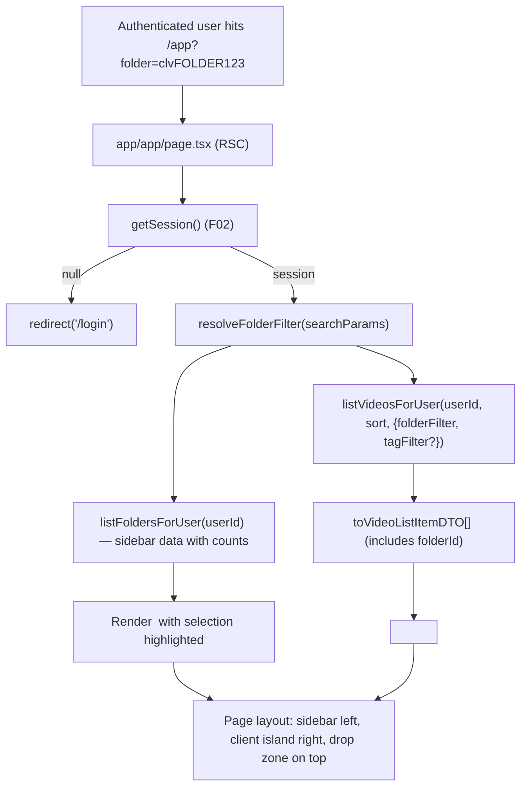
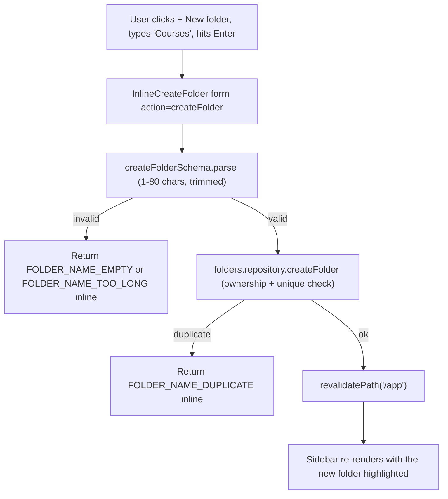
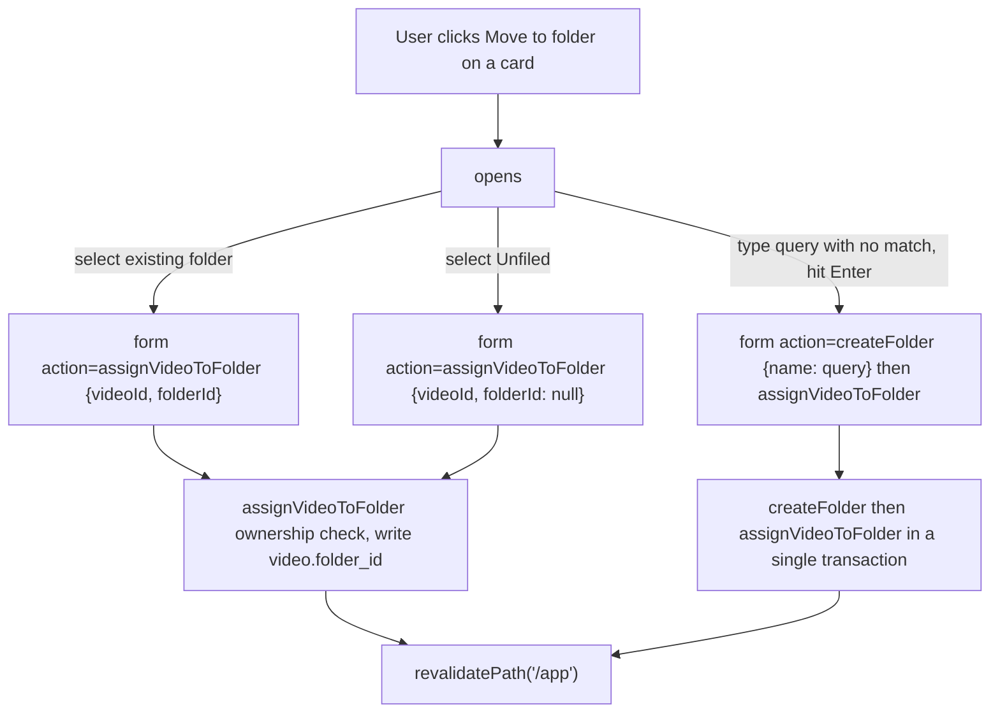
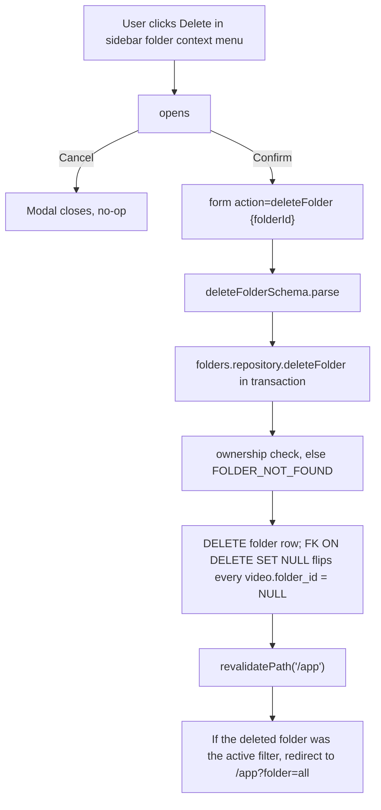

# F05. Folder Organization — Technical Specification

**Scope tag:** full scope — no Core/Full split (PRD has neither a `Core Scope` block nor a `Full Scope additions` block for F05, so the entire feature definition is in scope)

**Complexity:** medium

---

## 1. Technical Overview

**What:** Introduce user-owned video folders to the library experience at `/app`. F05 adds a new `folder` table (one row per user-named folder, unique per owner, 1–80 chars, flat hierarchy), an optional `folder_id` foreign key on the existing F03 `video` table so each video belongs to at most one folder, and the full UX surface that makes folders usable: a collapsible sidebar anchored on the left of the library page that lists "All videos", "Unfiled", and the user's folders alphabetically; a folder-selection state that filters the library to one folder at a time and composes with F06's tag filter via AND; context-menu integration on every video card that opens a "Move to folder" combobox with an inline "Create new folder" option; and sidebar context-menu entries for renaming and deleting a folder (delete moves contained videos back to "Unfiled" inside a single transaction and never removes the video rows themselves).

**Why:** F05 is a pure organization layer on top of F03's video records and F04's library shell. It does not touch the upload or processing pipeline, does not add a new API surface for binary transfer, and does not require any change to the player. The design reuses everything F02 (session, Prisma singleton, cookie helpers), F03 (`Video` table, ownership accessor pattern, `/app/videos/{id}` detail route), and F04 (the Server-Action convention, `LibraryClient` island, `ContextMenu`, the library page RSC, `VideoListItemDTO`) already expose — folders plug into the same Server-Action module, the same `app/_lib/videos/` folder convention, and the same `app/_components/library/` render tree. Folder persistence lives in a dedicated `folder` model with a compound UNIQUE on `(user_id, lower(name))` so name collisions are rejected at the database level, and the `video.folder_id` column is added as nullable with `ON DELETE SET NULL` so deleting a folder is a single `DELETE` that automatically reassigns its videos to Unfiled without an application-layer loop. The folder filter is routed through a `?folder=<id|all|unfiled>` URL search param so the server-rendered library reads it once, feeds the right `where` clause into `listByUser`, and ships the filtered list to the existing `<LibraryClient />` island — no client-side re-fetch, no new state duplication, and deep-linking (bookmarking a folder view) works for free.

**Scope:**

Included:
- New `folder` table scoped by user with `(user_id, lower(name))` uniqueness and a 1–80 character CHECK constraint
- New nullable `folder_id` column on the existing `video` table with `ON DELETE SET NULL` and an index for folder-filtered listing
- Server-side query extension in `app/_lib/videos/library.ts` / `app/_lib/videos/libraryRepository.ts` so `listByUser` accepts a folder filter (`all`, `unfiled`, or a specific folder id) and combines with F06's tag filter — for F05 alone, the F06 filter is wired as an optional parameter whose default is "no tag filter" so merging is a straightforward AND
- New `app/_lib/folders/` domain module (`repository.ts`, `actions.ts`, `validation.ts`, `errors.ts`, `dto.ts`) mirroring the F04 library module layout
- Server Actions: `createFolder`, `renameFolder`, `deleteFolder`, `assignVideoToFolder` (covers "move to folder", "unfile", and the empty-unfiled case)
- Extension of `app/_lib/videos/library.ts` so `listVideosForUser` accepts a `{ folderFilter, tagFilter? }` object and returns only matching rows; `listFoldersForUser` helper returns the sidebar data with per-folder video counts
- Collapsible sidebar on `/app`: `<FolderSidebar />` rendered server-side with the current selection highlighted; it shows "All videos", "Unfiled", then user folders alphabetically, each with its video count as a small counter
- Sidebar "New folder" affordance: an inline input appears at the bottom of the sidebar when the "+ New folder" button is clicked; Enter confirms, Escape cancels, duplicate names show inline error
- Sidebar per-folder context menu: Rename (inline editable), Delete (confirmation modal with the PRD copy "Delete folder '{name}'? Its videos will move to Unfiled.")
- Card context-menu integration: adds a new "Move to folder" item to the existing F04 `<ContextMenu />`, opens a `<FolderCombobox />` popover listing existing folders plus an "Unfiled" option and a "Create new folder" inline row
- `<FolderCombobox />` supports keyboard navigation (Up/Down/Enter/Escape), type-ahead filtering, Enter-to-create-when-no-match, and optimistic UI for both create-and-move and move-existing flows
- URL-driven filter state: `/app?folder=all|unfiled|<cuid>`; the library page reads this once server-side and renders the filtered list on first paint
- Folder filter composes with F06's tag filter using AND semantics at the database level (spec explicitly shows the `AND tag` extension point; the tag side is owned by F06 and wired in its feature)
- Typed error codes: `FOLDER_FORBIDDEN`, `FOLDER_NOT_FOUND`, `FOLDER_NAME_EMPTY`, `FOLDER_NAME_TOO_LONG`, `FOLDER_NAME_DUPLICATE`, `FOLDER_INVALID_INPUT`, `FOLDER_VIDEO_NOT_FOUND`
- Optimistic UI for create/rename/assign so the sidebar reflects changes immediately; delete uses a hard revalidation after confirmation (no phantom-removed folders)
- Unit tests for the repository, validation schemas, DTO mappers, and every component (sidebar, combobox, rename field, delete modal, inline-create field); integration tests for every Server Action against the existing `testcontainers` Postgres; Playwright spec for the DOM-driven acceptance criteria

Excluded (owned by other features or out of scope per PRD Section 7):
- Nested folders / folder hierarchy (PRD: "Folders are flat (no nesting) in this release")
- Multi-folder membership per video (PRD: "A video belongs to at most one folder")
- Drag-and-drop to move videos between folders (PRD does not require it; context menu + detail-header control are the documented affordances)
- Bulk move (selecting multiple cards and filing them at once — not in PRD)
- Folder colors, icons, emojis (not in PRD)
- Sharing folders across users (PRD Section 7 excludes multi-user features)
- Folder-level search (PRD Section 7 excludes global search)
- Tag filter semantics — F06 owns the tag side of the AND combination; F05 only guarantees its own side does not break the shared query contract
- The detail-page "Move to folder" control lives on the detail page's header, but F08 owns the detail page; F05 ships the action and the combobox component so F08 can drop it in without a second wiring pass, but F05 does not modify the detail route itself beyond exporting the reusable piece

---

## 2. Architecture Impact

**Affected components:**

| Path | Role |
|------|------|
| `prisma/schema.prisma` | Modified — add the `Folder` model, add a nullable `folderId` field + relation on the existing `Video` model |
| `prisma/migrations/<timestamp>_add_folders/migration.sql` | New — `CREATE TABLE folder`, indexes, unique on `(user_id, lower(name))`, CHECK on `char_length(name)`, `ALTER TABLE video ADD COLUMN folder_id`, FK with `ON DELETE SET NULL`, supporting index |
| `app/app/page.tsx` | Modified — read `?folder=…` search param, fetch folders + filtered video list server-side, render the new `<FolderSidebar />` alongside the existing `<LibraryClient />` |
| `app/_components/library/LibraryClient.tsx` | Modified — accept `folderFilter` prop, extend card context menu with the "Move to folder" entry that opens `<FolderCombobox />`; receive `folders` and pass through to the combobox |
| `app/_components/library/FolderSidebar.tsx` | New — server-rendered sidebar shell; embeds `<FolderSidebarClient />` for the interactive slices (inline create, rename, delete confirmation, folder context menu) |
| `app/_components/library/FolderSidebarClient.tsx` | New — `"use client"` island: owns the "new folder" input open/close state, per-folder rename state, and the delete-confirmation modal; links are `<Link href="/app?folder=...">` so navigation uses the RSC |
| `app/_components/library/FolderCombobox.tsx` | New — popover rendered from the card context menu; type-ahead filter, "Create new folder '{query}'" inline when no match, keyboard nav, Enter-confirms; wired to `assignVideoToFolder` and `createFolder` |
| `app/_components/library/FolderRenameField.tsx` | New — inline editable folder-name field used by the sidebar rename item; mirrors `RenameField` from F04 |
| `app/_components/library/FolderDeleteConfirmModal.tsx` | New — confirmation modal with the PRD copy "Delete folder '{name}'? Its videos will move to Unfiled."; reuses F04's modal structure |
| `app/_components/library/InlineCreateFolder.tsx` | New — the "+ New folder" affordance at the sidebar bottom; Enter confirms, Escape cancels |
| `app/_components/library/ContextMenu.tsx` | Re-used (no change) — the existing menu is already item-driven; F05 supplies an additional `ContextMenuItem` from `LibraryClient` |
| `app/_lib/folders/repository.ts` | New — ownership-scoped Prisma accessors: `listFoldersForUser`, `createFolder`, `renameFolder`, `deleteFolder`, `assignVideoToFolder` |
| `app/_lib/folders/actions.ts` | New — Server Actions mirroring F04's pattern: `createFolder`, `renameFolder`, `deleteFolder`, `assignVideoToFolder`; each reads the session, validates with zod, calls the repository, calls `revalidatePath('/app')`, returns a typed state |
| `app/_lib/folders/validation.ts` | New — zod schemas (`createFolderSchema`, `renameFolderSchema`, `deleteFolderSchema`, `assignVideoSchema`); shared with unit tests |
| `app/_lib/folders/errors.ts` | New — typed error codes and messages |
| `app/_lib/folders/dto.ts` | New — `FolderDTO`, `FolderSidebarDTO` (adds video count), `parseFolderFilter()` helper that coerces the URL param into `all | unfiled | { folderId }` |
| `app/_lib/videos/library.ts` | Modified — extend `listVideosForUser` to accept `{ folderFilter, tagFilter? }`; update the DTO mapper to include `folderId` on each `VideoListItemDTO`; expose `resolveFolderFilter()` helper that the RSC uses to coerce the URL param with fallback to `all` |
| `app/_lib/videos/libraryRepository.ts` | Modified — `listByUser` accepts an optional `{ folderFilter, tagFilter? }` and threads the resulting `where` clause into the Prisma query; a dedicated `countForAllFilters(userId)` returns the three aggregate counts the sidebar needs in one round trip (all, unfiled, per folder) |
| `app/_lib/videos/libraryValidation.ts` | Re-used — no change; F05's validation lives in its own module |
| `app/_components/library/__tests__/*` | New — component tests per Testing Strategy |
| `app/_lib/folders/__tests__/*` | New — unit + integration tests |
| `e2e/folders.spec.ts` | New — Playwright coverage for user-visible acceptance criteria |

**Data flow — first paint of `/app?folder=<id>` with folder filter active:**



**Data flow — create folder (inline from sidebar):**



**Data flow — move a video to folder from card context menu:**



**Data flow — delete folder (videos move to Unfiled):**



---

## 3. Technical Decisions

| Decision | Chosen Approach | Alternative Considered | Trade-off |
|----------|-----------------|------------------------|-----------|
| Folder storage | New `folder` table with `(user_id, lower(name))` UNIQUE and a 1–80 character CHECK constraint | Store folder names as a denormalized column on `video` | A dedicated table is the only way to represent an empty folder and to enforce unique names per user at the DB level. The denormalized approach cannot express "folder exists but has no videos" |
| Video-to-folder link | Nullable `folder_id` FK on the existing `video` table with `ON DELETE SET NULL` | Junction table `video_folder` | PRD: "A video belongs to at most one folder at a time". A single nullable FK is simpler, enforces the one-folder constraint at the column level, and makes folder deletion a single DELETE (FK cascades the NULL-out) |
| Filter state transport | URL search param `?folder=all|unfiled|<cuid>` | Client-side state only (no URL reflection) | PRD Experience: "Selecting a folder filters the library"; URL-driven state gives deep-linking, back/forward works, and the SSR branch reads the filter once. F04's `LibraryClient` already receives its initial data from the RSC — the same pattern applies |
| Sidebar rendering | Server-rendered shell that reads the folder list and counts; a small client island handles the inline "new folder" input, per-folder rename, and delete modal | Fully client-side sidebar fetched on mount | Matches F04's split: RSC provides first paint + counts, `"use client"` island handles transient UI state. Keeps total JS small |
| Counts query | A single `libraryRepository.countForAllFilters(userId)` method that runs three aggregates (total, unfiled, per-folder) in one query via Prisma `groupBy` | One query per folder | One round trip regardless of folder count |
| Mutation style | App Router **Server Actions** for every folder mutation (create, rename, delete, assign) | Route Handlers under `/api/folders/*` | Matches F04's convention; CSRF is free, `revalidatePath('/app')` is a one-liner; no public HTTP API surface needed |
| Folder name validation | `z.string().trim().min(1, 'FOLDER_NAME_EMPTY').max(80, 'FOLDER_NAME_TOO_LONG')` | Allow empty; store null | PRD: "create folders with a name of 1–80 characters" |
| Duplicate-name detection | Trust the DB UNIQUE constraint and surface a typed `FOLDER_NAME_DUPLICATE` error on `P2002` violations; do not pre-check with a `SELECT` | Pre-check existence before insert | Avoids a TOCTOU race when two tabs create the same name simultaneously; Prisma's `P2002` mapping is stable and documented |
| Case-insensitive uniqueness | UNIQUE INDEX on `(user_id, lower(name))` | Case-sensitive unique | PRD does not explicitly specify but "Duplicate folder names per user are rejected" implies user intent; most users consider `Courses` and `courses` the same folder. Documented in Assumptions |
| Sidebar ordering | Alphabetical by `LOWER(name)` ASC; "All videos" and "Unfiled" are fixed entries above the user folders | Creation order | PRD Capabilities: "listed in a collapsible sidebar on the library page, sorted alphabetically, above an 'All videos' and an 'Unfiled' entry" (note: PRD wording is ambiguous about which is "above", but the Experience block says "shows 'All videos', 'Unfiled', then user folders" — we follow the Experience block) |
| Deletion cascade | FK `video.folder_id REFERENCES folder(id) ON DELETE SET NULL` | App-layer UPDATE loop before DELETE | PRD: "videos inside the folder revert to 'Unfiled' and are not deleted". FK cascade does it atomically in one statement with zero application code |
| Active-folder delete redirect | If the deleted folder is currently in the `?folder=` param, the delete Server Action returns a `redirectTo: '/app?folder=all'` in its response and the client navigates | Stay on the same URL | Staying on `/app?folder=<deletedId>` would render an empty list and a confusing "folder not found" state. Redirecting to "All videos" preserves context |
| Combobox component | In-house `<FolderCombobox />` built on a popover with type-ahead filtering; no new dependency | Radix UI / Headless UI `Combobox` | Matches F04's in-house `<ContextMenu />` decision; ~80 LOC is justifiable for one combobox and avoids a new dependency |
| Card context menu wiring | Extend F04's `LibraryClient` so it injects "Move to folder" as an additional `ContextMenuItem`; re-use the existing `ContextMenu.tsx` unchanged | Fork the context menu into a folder-aware variant | F04 already designed the menu to be item-driven; adding one item is a three-line change in the menu builder |
| Filter combination with F06 | `listByUser` accepts `{ folderFilter, tagFilter? }`; the folder side is F05's responsibility, the tag side is wired by F06 later. When both are present the repository builds the AND `where` clause | Two separate list functions | PRD Acceptance: "Folder filter combines with active tag filter using AND semantics". Keeping one list function with optional filters is the only way to guarantee AND composition |
| Moving to the same folder | Silent no-op (same-folder assignment is a DB-level no-op because the current `folderId` already matches) | Return a "nothing changed" error | Matches F04's rename-idempotency decision |
| Moving to a folder the user does not own | Treat as `FOLDER_NOT_FOUND`, not `FOLDER_FORBIDDEN` | Distinct "forbidden" code | Mirrors F04's ownership-scoping decision — do not disclose the existence of another user's folder |
| Assigning when the video belongs to another user | Return `FOLDER_VIDEO_NOT_FOUND`; do not reveal the video exists | Let the DB `WHERE userId` fail silently | Matches F04's ownership-scoping pattern |
| Folder-filtered empty state | Reuse F04's `<EmptyState />` but swap the copy to "No videos in this folder yet" when a folder or "Unfiled" is selected and has zero rows | A separate component | Consistency and minimal code |
| URL param parsing | `parseFolderFilter(raw: string | string[] | undefined): { kind: 'all' | 'unfiled' | 'folder', folderId?: string }`; unknown values fall back to `all` | Throw on invalid input | A bad URL should degrade gracefully to "All videos" rather than error-page the library |
| Sidebar collapse state | Client-only (persisted to `localStorage` under `videomax:foldersSidebarOpen`); the default is expanded on first visit | Server-persisted preference column | PRD Capabilities: "Folders are listed in a collapsible sidebar" — no requirement for cross-device persistence; localStorage is sufficient |
| Sidebar keyboard a11y | Sidebar entries are `<Link>` + `aria-current="page"` for the selected one; rename and delete are reachable via a kebab trigger with the same keyboard contract as F04's `<ContextMenu />` | Custom focus-trap nav | Consistency with F04 |
| Database collation for name uniqueness | UNIQUE INDEX on `LOWER(name)` with a raw SQL expression index, since Prisma does not natively model `lower()` unique indexes (handled in the migration SQL) | `citext` column type | `citext` is not installed in the current Postgres image; raw SQL expression index is supported out of the box |
| Tests split | Same pattern as F04 — `*.test.ts` for pure unit, `*.integration.test.ts` for Postgres-backed, a single `e2e/folders.spec.ts` for DOM-driven user flows | One test file per module | Consistency with F02/F03/F04 |

---

## 4. Component Overview

**Frontend (App Router):**

| File Path | New/Modified | Purpose | Key Responsibilities |
|-----------|--------------|---------|----------------------|
| `app/app/page.tsx` | Modified | Library RSC shell | Reads `?folder=` search param via `resolveFolderFilter`; loads the user's folders via `listFoldersForUser` and the filtered videos via `listVideosForUser(userId, sort, { folderFilter, tagFilter? })`; renders `<FolderSidebar />` on the left and `<LibraryClient />` on the right; passes `folders` and `folderFilter` to the client island for combobox wiring |
| `app/_components/library/FolderSidebar.tsx` | New | Sidebar shell | Renders "All videos", "Unfiled", and every user folder alphabetically with its video count; highlights the active entry via `aria-current="page"`; each entry is a `<Link href="/app?folder=...">`; embeds `<FolderSidebarClient />` for interactive affordances |
| `app/_components/library/FolderSidebarClient.tsx` | New | Sidebar client island | `"use client"`; owns the "New folder" input open/close state, per-folder rename state, and the delete-confirmation modal; hosts the sidebar's per-folder kebab `<ContextMenu />` with Rename and Delete items; persists collapse state in `localStorage` |
| `app/_components/library/InlineCreateFolder.tsx` | New | "+ New folder" affordance | Renders a button that toggles into an `<input>` when clicked; Enter submits the `createFolder` Server Action; Escape cancels; duplicate-name error appears inline |
| `app/_components/library/FolderRenameField.tsx` | New | Inline folder rename | Switches between a read-only label and an `<input>`; Save posts `renameFolder`; Escape cancels; 1–80 char bounds enforced client-side; inline error for duplicates |
| `app/_components/library/FolderDeleteConfirmModal.tsx` | New | Folder delete confirmation | `<dialog>`-style modal with the PRD copy "Delete folder '{name}'? Its videos will move to Unfiled."; Confirm posts `deleteFolder`; on success the modal closes and (if the deleted folder is the active filter) navigates to `/app?folder=all` |
| `app/_components/library/FolderCombobox.tsx` | New | Move-to-folder combobox | Popover listing existing folders plus an "Unfiled" option; type-ahead filter; when the typed query matches nothing, an inline "Create new folder '{query}'" row creates and assigns in one transaction; keyboard nav (Up/Down/Enter/Escape); wired to `assignVideoToFolder` + `createFolder` |
| `app/_components/library/LibraryClient.tsx` | Modified | Main client island | Extend F04's island to receive `folders` and `folderFilter`; extend the `buildMenu` function so every card's context menu now includes a "Move to folder" item that opens `<FolderCombobox />`; optimistic UI for assignment (flip the card's `folderId` immediately; roll back on error) |
| `app/_components/library/EmptyState.tsx` | Modified | Empty state copy | Accept an optional `context` prop: "library" (current F04 copy), "folder" ("No videos in this folder yet"), "unfiled" ("Everything is filed — drop a video here or pick a folder") |
| `app/_components/library/VideoCard.tsx` | Re-used (no change) | Grid card | The context menu items are already injected from `LibraryClient`; no internal change needed |
| `app/_components/library/VideoRow.tsx` | Re-used (no change) | List row | Same as the card |
| `app/_components/library/ContextMenu.tsx` | Re-used (no change) | Popover menu | Item-driven; F05 adds one more `ContextMenuItem` from the menu builder |

**Backend (server-side modules + Server Actions):**

| File Path | New/Modified | Purpose | Key Responsibilities |
|-----------|--------------|---------|----------------------|
| `app/_lib/folders/repository.ts` | New | Ownership-scoped Prisma accessors | `listFoldersForUser(userId)` returning folders with per-folder video counts; `createFolder(userId, name)` mapping `P2002` to `FOLDER_NAME_DUPLICATE`; `renameFolder(userId, folderId, name)`; `deleteFolder(userId, folderId)` using a transaction that relies on the FK `ON DELETE SET NULL`; `assignVideoToFolder(userId, videoId, folderId | null)` with both ownership checks |
| `app/_lib/folders/actions.ts` | New | Server Actions | `"use server"`; four actions (`createFolder`, `renameFolder`, `deleteFolder`, `assignVideoToFolder`); each reads the session, validates input, calls the repository, calls `revalidatePath('/app')`, returns a typed `{ ok, code?, folder?, videoFolderId? }` state |
| `app/_lib/folders/validation.ts` | New | zod schemas | `createFolderSchema`, `renameFolderSchema`, `deleteFolderSchema`, `assignVideoSchema` — identical patterns to F04's validation module |
| `app/_lib/folders/errors.ts` | New | Typed error codes | `FOLDER_FORBIDDEN`, `FOLDER_NOT_FOUND`, `FOLDER_NAME_EMPTY`, `FOLDER_NAME_TOO_LONG`, `FOLDER_NAME_DUPLICATE`, `FOLDER_INVALID_INPUT`, `FOLDER_VIDEO_NOT_FOUND` + message map |
| `app/_lib/folders/dto.ts` | New | DTO shapes | `FolderDTO`, `FolderSidebarDTO` (adds `videoCount`), `FolderFilter` union, `parseFolderFilter` coercer, `resolveFolderFilter` thin wrapper used by the RSC |
| `app/_lib/videos/library.ts` | Modified | Library query | Extend `listVideosForUser` to accept `{ folderFilter, tagFilter? }`; include `folderId` in `VideoListItemDTO`; add `resolveFolderFilter(searchParams, userFolders)` that validates the param against the user's folder list |
| `app/_lib/videos/libraryRepository.ts` | Modified | Prisma accessors | Extend `listByUser` to thread the optional `{ folderFilter, tagFilter? }` into the Prisma `where`; add `countForAllFilters(userId)` returning `{ all, unfiled, perFolder: Record<string, number> }` via a single `groupBy` |
| `app/_lib/session.ts` | Re-used | Session reader | No change |
| `app/_lib/db.ts` | Re-used | Prisma singleton | No change |

**Database:**

| Migration File | Tables Affected | Operation | Notes |
|----------------|-----------------|-----------|-------|
| `prisma/migrations/<timestamp>_add_folders/migration.sql` | `folder` (new), `video` (modified) | CREATE + ALTER | Creates the `folder` table with its constraints and indexes, adds the nullable `folder_id` column to `video` with the FK `ON DELETE SET NULL`, and creates a `lower(name)` unique index and a supporting index on `video(user_id, folder_id)` |

---

## 5. API Contracts

F05 ships no HTTP endpoints of its own. All mutations are App Router Server Actions, invoked by forms inside the sidebar and the library's card context menus. The following lists describe each action's signature in the same shape as a REST endpoint so implementation, test, and UI agree on input/output.

### Server Action: `createFolder`

- **Module:** `app/_lib/folders/actions.ts`
- **Form invocation:** `<form action={createFolder}>` inside `<InlineCreateFolder />` and from `<FolderCombobox />` when the user picks the inline "Create new folder '{query}'" row
- **Authentication:** `getSession()` guard; no session → returns `{ ok: false, code: 'FOLDER_FORBIDDEN' }`

**Input (from `FormData`):**

| Field | Type | Required | Validation | Description |
|-------|------|----------|------------|-------------|
| `name` | `string` | Yes | Trimmed, 1–80 chars | New folder name |
| `assignVideoId` | `string?` | No | Valid cuid | If present, the newly created folder is also assigned to this video in the same transaction (used by the combobox's inline create-and-move flow) |

**Response State:**

| Field | Type | Description |
|-------|------|-------------|
| `ok` | `boolean` | `true` on success |
| `code` | `string?` | Error code when `ok === false` |
| `folder` | `FolderDTO?` | The created folder on success |
| `videoFolderId` | `string?` | When `assignVideoId` was provided, the new `video.folderId` on success |
| `fieldErrors` | `Record<string, string[]>?` | Per-field validation errors |

**Example success:**

```json
{
  "ok": true,
  "folder": {
    "id": "clvFOLDER123",
    "name": "Courses",
    "videoCount": 0,
    "createdAt": "2026-04-19T10:00:00.000Z"
  }
}
```

**Error codes:**

| Code | Meaning |
|------|---------|
| `FOLDER_FORBIDDEN` | No session |
| `FOLDER_NAME_EMPTY` | Name is empty or whitespace-only |
| `FOLDER_NAME_TOO_LONG` | Name exceeds 80 chars after trim |
| `FOLDER_NAME_DUPLICATE` | A folder with the same case-insensitive name already exists for this user |
| `FOLDER_VIDEO_NOT_FOUND` | `assignVideoId` was provided but the video is not owned by the caller |

### Server Action: `renameFolder`

- **Module:** `app/_lib/folders/actions.ts`
- **Form invocation:** `<form action={renameFolder}>` inside `<FolderRenameField />`

**Input:**

| Field | Type | Required | Validation | Description |
|-------|------|----------|------------|-------------|
| `id` | `string` | Yes | Valid cuid | Target folder id |
| `name` | `string` | Yes | Trimmed, 1–80 chars | New folder name |

**Response State:**

| Field | Type | Description |
|-------|------|-------------|
| `ok` | `boolean` | `true` on success |
| `folder` | `FolderDTO?` | Updated folder |
| `code` | `string?` | Error code when `ok === false` |

**Error codes:** `FOLDER_FORBIDDEN`, `FOLDER_NOT_FOUND`, `FOLDER_NAME_EMPTY`, `FOLDER_NAME_TOO_LONG`, `FOLDER_NAME_DUPLICATE`.

### Server Action: `deleteFolder`

- **Module:** `app/_lib/folders/actions.ts`
- **Form invocation:** `<form action={deleteFolder}>` inside `<FolderDeleteConfirmModal />`

**Input:**

| Field | Type | Required | Validation | Description |
|-------|------|----------|------------|-------------|
| `id` | `string` | Yes | Valid cuid | Target folder id |

**Behaviour:**
- Ownership check, else `FOLDER_NOT_FOUND`
- `DELETE FROM folder WHERE id = $1 AND user_id = $2` in a transaction; the FK `ON DELETE SET NULL` on `video.folder_id` automatically flips every associated video back to Unfiled
- Returns `{ ok: true, deletedId, redirectTo?: '/app?folder=all' }` where `redirectTo` is set when the caller passes the current active filter

**Response State:**

| Field | Type | Description |
|-------|------|-------------|
| `ok` | `boolean` | `true` on success |
| `deletedId` | `string?` | Echo of the deleted folder id |
| `redirectTo` | `string?` | Set when the deleted folder was the active filter; the client navigates to this URL |
| `code` | `string?` | Error code when `ok === false` |

**Error codes:** `FOLDER_FORBIDDEN`, `FOLDER_NOT_FOUND`, `FOLDER_INVALID_INPUT`.

### Server Action: `assignVideoToFolder`

- **Module:** `app/_lib/folders/actions.ts`
- **Form invocation:** `<form action={assignVideoToFolder}>` from `<FolderCombobox />` for both "move to existing folder" and "move to Unfiled"

**Input:**

| Field | Type | Required | Validation | Description |
|-------|------|----------|------------|-------------|
| `videoId` | `string` | Yes | Valid cuid | Target video id |
| `folderId` | `string?` | No | Valid cuid when present; omit or empty string for Unfiled | Target folder id (or none for unfile) |

**Response State:**

| Field | Type | Description |
|-------|------|-------------|
| `ok` | `boolean` | `true` on success |
| `videoId` | `string?` | Echo |
| `folderId` | `string \| null` | New `video.folderId` (null for Unfiled) |
| `code` | `string?` | Error code when `ok === false` |

**Error codes:** `FOLDER_FORBIDDEN`, `FOLDER_NOT_FOUND`, `FOLDER_VIDEO_NOT_FOUND`, `FOLDER_INVALID_INPUT`.

### Data shape consumed by the client: `FolderDTO` and `FolderSidebarDTO`

| Field | Type | Description |
|-------|------|-------------|
| `id` | `string` | cuid |
| `name` | `string` | Display name |
| `createdAt` | `string (ISO 8601)` | Creation timestamp |

`FolderSidebarDTO` extends `FolderDTO` with:

| Field | Type | Description |
|-------|------|-------------|
| `videoCount` | `number` | Number of videos currently assigned to this folder |

### Extension to `VideoListItemDTO`

F04's DTO gains a single optional field:

| Field | Type | Description |
|-------|------|-------------|
| `folderId` | `string \| null` | `null` when the video is Unfiled; the owning folder's cuid otherwise |

### Filter param contract

- URL: `/app?folder=all` or `/app?folder=unfiled` or `/app?folder=<folderCuid>`
- Unknown, missing, or non-string values coerce to `all`
- A cuid that does not belong to the current user also coerces to `all` (the RSC re-validates against `listFoldersForUser` before querying)

---

## 6. Data Model

F05 adds one new table (`folder`) and one column + one FK to the existing `video` table. Existing F03 indexes continue to cover the non-folder library queries.

### Table: `folder` (NEW)

| Column | Type | Nullable | Default | Description |
|--------|------|----------|---------|-------------|
| `id` | `varchar(32)` (cuid) | No | `cuid()` (Prisma) | Primary key |
| `user_id` | `varchar(32)` | No | - | Owner (FK → `user.id` ON DELETE CASCADE) |
| `name` | `varchar(80)` | No | - | Display name |
| `created_at` | `timestamptz(6)` | No | `NOW()` | Creation timestamp |
| `updated_at` | `timestamptz(6)` | No | auto via Prisma `@updatedAt` | Last modification timestamp |

**Indexes:**

| Index Name | Columns | Type | Purpose |
|------------|---------|------|---------|
| `pk_folder` | `id` | btree (PK) | Primary key |
| `ix_folder_user_id_name` | `user_id, name` | btree | Sidebar listing (ORDER BY name ASC per user) |
| `ux_folder_user_lower_name` | `user_id, lower(name)` | btree UNIQUE (expression) | Case-insensitive name uniqueness per user |

**Constraints:**

| Constraint | Type | Definition | Purpose |
|------------|------|------------|---------|
| `pk_folder` | PRIMARY KEY | `id` | Unique identifier |
| `fk_folder_user` | FOREIGN KEY | `user_id REFERENCES user(id) ON DELETE CASCADE` | Delete folders when the user is deleted (F12 cascade) |
| `ck_folder_name_length` | CHECK | `char_length(name) BETWEEN 1 AND 80` | Defensive DB-level bounds matching the app validation |

### Table: `video` (MODIFIED — one new column + one FK)

| Column | Type | Nullable | Default | Description |
|--------|------|----------|---------|-------------|
| `folder_id` | `varchar(32)` | Yes | `NULL` | Owning folder; NULL means Unfiled |

**New Indexes:**

| Index Name | Columns | Type | Purpose |
|------------|---------|------|---------|
| `ix_video_user_folder_created` | `user_id, folder_id, created_at DESC` | btree | Fast folder-filtered listing with the default sort |

**New Constraints:**

| Constraint | Type | Definition | Purpose |
|------------|------|------------|---------|
| `fk_video_folder` | FOREIGN KEY | `folder_id REFERENCES folder(id) ON DELETE SET NULL` | When a folder is deleted, its videos return to Unfiled atomically |

**Migration (`prisma/migrations/<timestamp>_add_folders/migration.sql`):**

```sql
CREATE TABLE "folder" (
    "id"         VARCHAR(32)     PRIMARY KEY,
    "user_id"    VARCHAR(32)     NOT NULL,
    "name"       VARCHAR(80)     NOT NULL,
    "created_at" TIMESTAMPTZ(6)  NOT NULL DEFAULT NOW(),
    "updated_at" TIMESTAMPTZ(6)  NOT NULL,
    CONSTRAINT "fk_folder_user"
        FOREIGN KEY ("user_id") REFERENCES "user"("id") ON DELETE CASCADE,
    CONSTRAINT "ck_folder_name_length"
        CHECK (char_length("name") BETWEEN 1 AND 80)
);

CREATE INDEX "ix_folder_user_id_name"
    ON "folder" ("user_id", "name");

CREATE UNIQUE INDEX "ux_folder_user_lower_name"
    ON "folder" ("user_id", lower("name"));

ALTER TABLE "video"
    ADD COLUMN "folder_id" VARCHAR(32) NULL,
    ADD CONSTRAINT "fk_video_folder"
        FOREIGN KEY ("folder_id") REFERENCES "folder"("id") ON DELETE SET NULL;

CREATE INDEX "ix_video_user_folder_created"
    ON "video" ("user_id", "folder_id", "created_at" DESC);
```

**Prisma schema changes:**

```prisma
model Folder {
  id        String   @id @default(cuid())
  userId    String   @map("user_id")
  name      String   @db.VarChar(80)
  createdAt DateTime @default(now()) @map("created_at") @db.Timestamptz(6)
  updatedAt DateTime @updatedAt @map("updated_at") @db.Timestamptz(6)
  user      User     @relation(fields: [userId], references: [id], onDelete: Cascade)
  videos    Video[]

  @@index([userId, name], map: "ix_folder_user_id_name")
  @@map("folder")
}

model Video {
  // ...existing fields from F03...
  folderId String? @map("folder_id")
  folder   Folder? @relation(fields: [folderId], references: [id], onDelete: SetNull)

  @@index([userId, folderId, createdAt(sort: Desc)], map: "ix_video_user_folder_created")
}

model User {
  // ...existing fields...
  folders Folder[]
}
```

**Cross-Database Notes:**
- The `LOWER(name)` expression index is a Postgres-specific construct; it is created via raw SQL in the migration because Prisma's schema-level `@@unique` does not express expression indexes. The Prisma schema keeps a plain `@@index([userId, name])` for query planning; the UNIQUE enforcement lives in the raw SQL index.
- `ON DELETE SET NULL` is standard SQL and supported by both Postgres and SQLite.
- No backfill is needed for existing `video` rows: `folder_id` is nullable with a default of `NULL`, so every pre-existing F03 upload is automatically Unfiled.

---

## 7. Testing Strategy

F05 re-uses the Vitest + React Testing Library + `testcontainers` Postgres harness established by F02 and extended by F03/F04. Server Actions are tested by calling them directly with the mocked session helper. The Playwright spec boots the dev server against the same `DATABASE_URL` and covers the user-visible PRD Section 9 acceptance criteria.

**Test File Structure:**

| Test File | Test Type | Target | Coverage Goal |
|-----------|-----------|--------|---------------|
| `app/_lib/folders/__tests__/validation.test.ts` | Unit | Every zod schema | 100% branches |
| `app/_lib/folders/__tests__/dto.test.ts` | Unit | `parseFolderFilter`, `resolveFolderFilter`, DTO mappers | All branches |
| `app/_lib/folders/__tests__/repository.integration.test.ts` | Integration (Postgres) | Every repository method | All branches (success + ownership-scoped failure + DB constraint fires) |
| `app/_lib/folders/__tests__/actions.integration.test.ts` | Integration (Postgres + session mock) | Every Server Action | Every PRD Section 9 F05 criterion + error matrix |
| `app/_lib/videos/__tests__/library.test.ts` | Modified (unit) | `listVideosForUser` folder filter dispatch, `VideoListItemDTO` includes `folderId` | Folder branch added |
| `app/_lib/videos/__tests__/libraryRepository.integration.test.ts` | Modified (integration) | `listByUser` with folder filter, `countForAllFilters` | Folder branch added |
| `app/_components/library/__tests__/FolderSidebar.test.tsx` | Unit (component) | Renders "All videos", "Unfiled", folder list, counts, active highlight | All branches |
| `app/_components/library/__tests__/FolderSidebarClient.test.tsx` | Unit (component) | Opens new-folder input, opens rename, opens delete modal, collapse state | All branches |
| `app/_components/library/__tests__/InlineCreateFolder.test.tsx` | Unit (component) | Enter confirms, Escape cancels, duplicate-name error rendered inline | All branches |
| `app/_components/library/__tests__/FolderRenameField.test.tsx` | Unit (component) | Inline edit, empty rejection, 80-char limit, Escape cancel | All branches |
| `app/_components/library/__tests__/FolderDeleteConfirmModal.test.tsx` | Unit (component) | Confirm posts action, cancel, PRD copy exact match, redirect on active filter | All branches |
| `app/_components/library/__tests__/FolderCombobox.test.tsx` | Unit (component) | Type-ahead filter, Enter on match assigns, Enter on no-match creates and assigns, Escape closes, Unfiled option works | All branches |
| `app/_components/library/__tests__/LibraryClient.test.tsx` | Modified (component) | Adds "Move to folder" menu item; opens combobox; optimistic update on assign | Folder branches added |
| `app/app/__tests__/libraryPage.integration.test.tsx` | Modified (integration) | `/app?folder=all|unfiled|<id>` each renders correct filtered list; unknown folder coerces to "All videos" | Folder branches added |
| `e2e/folders.spec.ts` | E2E (Playwright) | User-visible flows: create folder, assign video, navigate sidebar, rename, delete, folder-filtered empty state | PRD Section 9 F05 user-visible criteria |

**Per-file test functions:**

`app/_lib/folders/__tests__/validation.test.ts`

| Test Function | Description | Assertions |
|---------------|-------------|------------|
| `create_rejects_empty_name_with_FOLDER_NAME_EMPTY` | `{ name: '' }` | zod issue code `FOLDER_NAME_EMPTY` |
| `create_rejects_whitespace_only_with_FOLDER_NAME_EMPTY` | `{ name: '   ' }` | Same |
| `create_trims_and_accepts_80_char_name` | 80-char name | Parses ok |
| `create_rejects_81_char_name_with_FOLDER_NAME_TOO_LONG` | 81-char name | Error code |
| `rename_applies_same_bounds` | Boundary checks | Match create |
| `assign_accepts_null_folder_id_for_unfiled` | `{ videoId, folderId: '' }` | Parses to `{ folderId: null }` |
| `assign_rejects_bad_video_id` | Empty videoId | `FOLDER_INVALID_INPUT` |

`app/_lib/folders/__tests__/dto.test.ts`

| Test Function | Description | Assertions |
|---------------|-------------|------------|
| `parse_folder_filter_all_for_missing_param` | `undefined` | `{ kind: 'all' }` |
| `parse_folder_filter_all_for_unknown_value` | `'xyz'` | `{ kind: 'all' }` |
| `parse_folder_filter_returns_unfiled` | `'unfiled'` | `{ kind: 'unfiled' }` |
| `parse_folder_filter_returns_folder_with_cuid` | `'clvAbc...'` | `{ kind: 'folder', folderId: 'clvAbc...' }` |
| `resolve_folder_filter_coerces_unknown_owned_folder_to_all` | cuid not in user list | Falls back to `all` |
| `folder_sidebar_dto_includes_video_count` | Any row | `videoCount` present |

`app/_lib/folders/__tests__/repository.integration.test.ts`

| Test Function | Description | Assertions |
|---------------|-------------|------------|
| `list_folders_returns_only_owner_rows_alphabetically` | Seed two users, each with folders | Returned rows all belong to the target user, ordered by LOWER(name) |
| `list_folders_includes_video_counts` | Seed folders with assigned videos | `videoCount` matches |
| `create_folder_persists_row_with_trimmed_name` | `'  Courses  '` | DB shows `'Courses'` |
| `create_folder_rejects_case_insensitive_duplicate` | Create `'Courses'` then `'courses'` | Second call throws `FOLDER_NAME_DUPLICATE` (P2002 mapped) |
| `rename_folder_rejects_case_insensitive_duplicate_across_existing` | Two folders, rename second to first's name | `FOLDER_NAME_DUPLICATE` |
| `rename_folder_allows_same_value` | Rename to current value | No-op; no error |
| `delete_folder_sets_associated_videos_folder_id_to_null` | Seed folder with videos | Post-delete every affected `video.folderId` is NULL; videos are not deleted |
| `delete_folder_returns_null_for_non_owner` | Other-user folder | Repo returns null; DB unchanged |
| `assign_video_to_folder_happy_path` | Both rows owned by caller | `video.folderId` matches |
| `assign_video_to_folder_with_null_unfiles_the_video` | Pre-assigned video, assign null | `video.folderId` is NULL |
| `assign_video_rejects_non_owner_folder` | Folder owned by other user | Returns null; DB unchanged |
| `assign_video_rejects_non_owner_video` | Video owned by other user | Returns null; DB unchanged |
| `assign_video_same_folder_is_noop` | Already in target folder | No error; no write |

`app/_lib/folders/__tests__/actions.integration.test.ts`

| Test Function | Description | Assertions |
|---------------|-------------|------------|
| `create_folder_happy_path_returns_dto` | Valid payload | `{ ok: true, folder }`; DB persisted |
| `create_folder_rejects_empty_name` | `{ name: '' }` | `{ ok: false, code: 'FOLDER_NAME_EMPTY' }`; DB unchanged |
| `create_folder_rejects_duplicate_name_with_FOLDER_NAME_DUPLICATE` | Create twice | First ok; second fails with code |
| `create_folder_with_assign_video_id_moves_video_in_same_tx` | Valid payload + videoId | Folder created; `video.folderId` set |
| `create_folder_no_session_returns_FOLDER_FORBIDDEN` | No cookie | `FOLDER_FORBIDDEN` |
| `rename_folder_happy_path` | Valid rename | Persisted |
| `rename_folder_non_owner_returns_FOLDER_NOT_FOUND` | Other user's folder | `FOLDER_NOT_FOUND`; DB unchanged |
| `rename_folder_duplicate_name_returns_FOLDER_NAME_DUPLICATE` | Collision with existing | Error code |
| `delete_folder_happy_path_unfiles_videos` | Seeded folder with videos | Folder gone; every affected `video.folderId` is NULL; videos intact |
| `delete_folder_non_owner_returns_FOLDER_NOT_FOUND` | Other user's folder | `FOLDER_NOT_FOUND` |
| `delete_folder_when_active_filter_returns_redirectTo_all` | Pass the current folder as active | Response includes `redirectTo: '/app?folder=all'` |
| `assign_video_to_folder_happy_path` | Valid pair | `{ ok: true, folderId }`; persisted |
| `assign_video_to_folder_to_unfiled_with_empty_string` | `{ folderId: '' }` | `video.folderId` is NULL |
| `assign_video_to_folder_non_owner_video_returns_FOLDER_VIDEO_NOT_FOUND` | Other user's video | Error code |
| `assign_video_to_folder_non_owner_folder_returns_FOLDER_NOT_FOUND` | Other user's folder | Error code |

`app/_lib/videos/__tests__/library.test.ts` (additions)

| Test Function | Description | Assertions |
|---------------|-------------|------------|
| `to_video_list_item_dto_includes_folder_id` | Row with folderId set | DTO has `folderId` |
| `to_video_list_item_dto_folder_id_null_when_unfiled` | Row with folderId null | DTO has `folderId: null` |
| `list_videos_for_user_folder_filter_all_returns_every_row` | Filter `all` | No folder where clause |
| `list_videos_for_user_folder_filter_unfiled_returns_rows_with_null_folder` | Filter `unfiled` | `folderId IS NULL` |
| `list_videos_for_user_folder_filter_by_id_returns_matching_rows` | Specific folder id | `folderId = $1` |

`app/_lib/videos/__tests__/libraryRepository.integration.test.ts` (additions)

| Test Function | Description | Assertions |
|---------------|-------------|------------|
| `list_by_user_folder_all_returns_every_owner_row` | Seed mixed | Count matches total |
| `list_by_user_folder_unfiled_excludes_filed_videos` | Seed two in one folder, one unfiled | Only unfiled row returned |
| `list_by_user_folder_by_id_returns_only_that_folder_rows` | Seed folder A + B | Only A's rows returned |
| `count_for_all_filters_returns_aggregates_in_one_query` | Seed arrangement | `{ all, unfiled, perFolder }` matches |
| `list_by_user_folder_filter_combines_with_tag_filter_using_AND` | Seed with tags via raw SQL | Rows must match BOTH filters |

`app/_components/library/__tests__/FolderSidebar.test.tsx`

| Test Function | Description | Assertions |
|---------------|-------------|------------|
| `sidebar_renders_all_videos_unfiled_and_folders_in_order` | Folders `['Banana','apple','Cherry']` | Order: All videos, Unfiled, apple, Banana, Cherry |
| `sidebar_shows_video_counts_per_entry` | Seeded counts | Each entry has the correct count badge |
| `sidebar_highlights_active_entry_via_aria_current` | Active = `clvX` | That link has `aria-current="page"` |
| `sidebar_links_use_folder_query_param` | Any entry | `href="/app?folder=clvX"` or `all`/`unfiled` |

`app/_components/library/__tests__/FolderSidebarClient.test.tsx`

| Test Function | Description | Assertions |
|---------------|-------------|------------|
| `clicking_plus_new_folder_opens_inline_input` | Click button | `<input>` visible, focused |
| `clicking_folder_kebab_opens_rename_and_delete_items` | Click kebab | Context menu has both items |
| `selecting_rename_renders_inline_edit_field` | Pick Rename | Input replaces label |
| `selecting_delete_opens_confirmation_modal` | Pick Delete | Modal with PRD copy visible |
| `collapse_toggle_persists_to_localStorage` | Click collapse | `videomax:foldersSidebarOpen = '0'` |

`app/_components/library/__tests__/InlineCreateFolder.test.tsx`

| Test Function | Description | Assertions |
|---------------|-------------|------------|
| `enter_submits_create_folder_action` | Type + Enter | Action called |
| `escape_cancels_and_closes_input` | Type + Escape | Input closes, no call |
| `duplicate_name_error_shown_inline` | Action returns `FOLDER_NAME_DUPLICATE` | Inline message "A folder with this name already exists" |
| `empty_name_error_shown_inline` | Action returns `FOLDER_NAME_EMPTY` | Inline message "Folder name cannot be empty" |

`app/_components/library/__tests__/FolderRenameField.test.tsx`

| Test Function | Description | Assertions |
|---------------|-------------|------------|
| `field_enters_edit_mode_on_activation` | Activate | Input visible with current value |
| `field_rejects_empty_submission_inline` | Save with `""` | Inline error visible |
| `field_rejects_81_char_submission_inline` | Save with 81 chars | Error visible |
| `field_cancels_on_escape` | Edit + Escape | Value reverts |
| `field_posts_renameFolder_action_on_save` | Valid save | Action invoked with `{ id, name }` |

`app/_components/library/__tests__/FolderDeleteConfirmModal.test.tsx`

| Test Function | Description | Assertions |
|---------------|-------------|------------|
| `modal_shows_prd_copy_with_folder_name` | Name `'Courses'` | Copy reads `Delete folder 'Courses'? Its videos will move to Unfiled.` |
| `confirm_posts_deleteFolder` | Confirm | Action invoked |
| `cancel_closes_modal_without_action` | Cancel | No call |
| `redirects_to_all_when_deleted_folder_was_active_filter` | Action returns `redirectTo` | Router navigates to `/app?folder=all` |

`app/_components/library/__tests__/FolderCombobox.test.tsx`

| Test Function | Description | Assertions |
|---------------|-------------|------------|
| `combobox_lists_unfiled_and_existing_folders` | Any open | Both present |
| `type_ahead_filters_by_substring_case_insensitive` | Type `'co'` | Only matching rows visible |
| `enter_on_existing_match_invokes_assignVideoToFolder` | Pick match | Action called with `{ videoId, folderId }` |
| `enter_on_no_match_shows_create_row_and_creates_then_assigns` | Type unique + Enter | `createFolder` called with `assignVideoId`; success sets `video.folderId` |
| `selecting_unfiled_invokes_assign_with_null` | Pick Unfiled | `folderId: null` |
| `escape_closes_without_action` | Escape | No call |
| `arrow_keys_move_focus_through_rows` | Arrow down | Active index advances |

`app/_components/library/__tests__/LibraryClient.test.tsx` (additions)

| Test Function | Description | Assertions |
|---------------|-------------|------------|
| `menu_includes_move_to_folder_item` | Any card | Menu shows "Move to folder" |
| `selecting_move_to_folder_opens_combobox` | Click item | Combobox visible |
| `assigning_to_a_folder_updates_item_folder_id_optimistically` | Assign | DTO reflects new folderId before action resolves |
| `failure_rolls_back_optimistic_folder_id` | Action returns error | DTO reverts |

`app/app/__tests__/libraryPage.integration.test.tsx` (additions)

| Test Function | Description | Assertions |
|---------------|-------------|------------|
| `library_rsc_filter_all_renders_every_owner_row` | `/app?folder=all` | Full list |
| `library_rsc_filter_unfiled_renders_only_unfiled_rows` | `/app?folder=unfiled` | Only rows with `folderId IS NULL` |
| `library_rsc_filter_by_folder_id_renders_matching_rows` | `/app?folder=<id>` | Only that folder's rows |
| `library_rsc_filter_unknown_folder_falls_back_to_all` | `/app?folder=does-not-exist` | Renders full list; sidebar shows "All videos" as active |
| `library_rsc_renders_folder_sidebar_with_counts` | Any session | Sidebar shows each folder + count |

**E2E (Playwright) — `e2e/folders.spec.ts`:**

| Test Function | Description | Assertions |
|---------------|-------------|------------|
| `user_can_create_folder_from_sidebar` | Click + New folder, type, Enter | Sidebar lists the new folder |
| `user_can_move_a_video_to_a_folder_from_context_menu` | Open card menu, Move to folder, pick folder | Folder filter view shows the video; Unfiled view no longer does |
| `combobox_inline_creation_creates_and_moves_in_one_step` | Open menu, type new name, Enter | Folder exists and owns the video |
| `sidebar_navigation_filters_the_library` | Click a folder | Library shows only its videos |
| `renaming_folder_updates_sidebar_entry_immediately` | Rename via kebab | New name reflected in sidebar without reload |
| `deleting_folder_moves_videos_to_unfiled` | Seed 1 folder with 1 video, delete | Video now appears in Unfiled view; video not deleted |
| `deleting_active_folder_redirects_to_all_videos` | Active filter = folder to delete | After confirm the URL is `/app?folder=all` |
| `duplicate_folder_name_rejected_inline` | Create two with same name | Second shows inline error |

**Mapping to PRD Section 9 acceptance criteria (F05):**

| PRD Acceptance Criterion | Covered By |
|---|---|
| User can create a folder with a 1–80 character name | `create_folder_happy_path_returns_dto` + `create_folder_trims_and_accepts_80_char_name` + `user_can_create_folder_from_sidebar` (E2E) |
| Duplicate folder names per user are rejected | `create_folder_rejects_duplicate_name_with_FOLDER_NAME_DUPLICATE` + `create_folder_rejects_case_insensitive_duplicate` + `duplicate_folder_name_rejected_inline` (E2E) |
| Each video can be assigned to at most one folder | Enforced at the schema level by the single-nullable-FK design; asserted by `assign_video_to_folder_happy_path` (subsequent assign replaces prior value) + `list_by_user_folder_by_id_returns_only_that_folder_rows` |
| Sidebar shows user folders plus "All videos" and "Unfiled" entries | `sidebar_renders_all_videos_unfiled_and_folders_in_order` + `library_rsc_renders_folder_sidebar_with_counts` |
| Selecting a folder filters the library to that folder's videos | `library_rsc_filter_by_folder_id_renders_matching_rows` + `sidebar_navigation_filters_the_library` (E2E) |
| Renaming a folder updates its sidebar entry immediately | `renaming_folder_updates_sidebar_entry_immediately` (E2E) + `rename_folder_happy_path` |
| Deleting a folder moves its videos to "Unfiled" (videos are not deleted) | `delete_folder_happy_path_unfiles_videos` + `delete_folder_sets_associated_videos_folder_id_to_null` + `deleting_folder_moves_videos_to_unfiled` (E2E) |
| Folder filter combines with active tag filter using AND semantics | `list_by_user_folder_filter_combines_with_tag_filter_using_AND` (F06 will extend the same test when its tag filter ships) |

**Cross-Feature Integration criteria (PRD Section 9) where F05 is the integration point:**

| PRD Cross-Feature Integration Criterion | Covered By F05 |
|---|---|
| Video records provided by upload (F03) can be associated with folders (F05) and filtered in a folder view | `assign_video_to_folder_happy_path` + `list_by_user_folder_by_id_returns_only_that_folder_rows` + `user_can_move_a_video_to_a_folder_from_context_menu` (E2E) |

---

## 8. Assumptions / Decisions (Auto-Accept)

Because F05 was generated in Batch Mode without an interactive interview, the following decisions were auto-resolved using the spec-writer's Auto-Accept Policy. Each is flagged so the user can review and override.

| # | Decision | Auto-Accept rationale | Policy row |
|---|----------|-----------------------|------------|
| 1 | Folders stored in a new `folder` table; `video.folder_id` is a nullable FK with `ON DELETE SET NULL` | Only schema shape that lets folders exist without videos AND lets folder deletion atomically return videos to Unfiled | "Technical decisions with a clear recommendation" |
| 2 | Case-insensitive uniqueness per user via `UNIQUE INDEX (user_id, lower(name))` | PRD says "duplicate folder names per user are rejected"; most users consider `Courses` and `courses` the same; the UNIQUE INDEX is the only way to enforce this atomically | "Partial PRD specifications" — applied best practice |
| 3 | Filter state lives in the URL (`?folder=`) and is read by the RSC on first paint | PRD Experience: "Selecting a folder filters the library"; URL-driven state gives SSR, deep-linking, back/forward for free; F04 already has precedent for RSC-driven filters | "Description too vague" — applied best practice |
| 4 | Sidebar order: fixed entries "All videos" then "Unfiled" at the top, user folders below, alphabetical by `lower(name)` | PRD Experience block: "Sidebar shows 'All videos', 'Unfiled', then user folders" (explicit order); alphabetical sort is explicit in Capabilities | Explicit PRD requirement |
| 5 | Collapsing the sidebar is a client-only concern, persisted to `localStorage`, not to the database | PRD Capabilities: "collapsible sidebar" — no requirement for cross-device persistence; localStorage avoids a DB column | "Partial PRD specifications" — applied best practice |
| 6 | Mutations use App Router **Server Actions**, not Route Handlers | Consistent with F04's mutation style; no public HTTP surface needed for folder CRUD | Consistent with codebase patterns |
| 7 | `FolderCombobox` is a local component with in-house popover + filter; no new dependency | F04 made the same in-house choice for `ContextMenu`; avoiding Radix keeps the dep tree small | Consistent with codebase patterns |
| 8 | "Move to folder" lives in the F04 card context menu as a new item; the existing `ContextMenu` component is item-driven and unchanged | F04 already designed the menu for extension | Consistent with codebase patterns |
| 9 | Name validation: `z.string().trim().min(1).max(80)`, rejects whitespace-only | PRD: "name of 1–80 characters" | Explicit PRD requirement |
| 10 | Duplicate detection: map Prisma `P2002` to `FOLDER_NAME_DUPLICATE`; do not pre-check with a `SELECT` | Avoids TOCTOU; stable Prisma error mapping | "Technical decisions with a clear recommendation" |
| 11 | Deleting the active folder returns `redirectTo: '/app?folder=all'` to avoid a dead filter view | Staying on a deleted folder shows a confusing empty state | "Description too vague" — applied best practice |
| 12 | Non-ownership returns `FOLDER_NOT_FOUND`, not `FOLDER_FORBIDDEN` | Matches F04's ownership-scoping rule (do not disclose existence) | Consistent with codebase patterns |
| 13 | Same-folder reassign is a silent no-op | PRD does not forbid it; user experience is smoother than a "nothing changed" error; parallels F04's rename idempotency | "Description too vague" — best practice |
| 14 | Folder filter composes with F06's tag filter via AND at the repository level; F05 accepts `tagFilter?` as a pass-through, F06 will populate it | PRD Acceptance: "Folder filter combines with active tag filter using AND semantics"; keeping one list function prevents future drift | Explicit PRD requirement |
| 15 | Sidebar counts come from a single `countForAllFilters(userId)` `groupBy` query | One round trip regardless of folder count | "Description too vague" — best practice |
| 16 | `VideoListItemDTO` gains `folderId: string \| null` | Needed for optimistic UI and future tag card rendering | "Description too vague" — best practice |
| 17 | Unknown/invalid `?folder=` values silently fall back to `all` | Avoids a 5xx on a malformed URL; matches the "graceful degradation" posture used elsewhere | "Description too vague" — best practice |
| 18 | Empty-state copy is context-aware: "library", "folder", "unfiled" | PRD does not specify folder-filtered empty copy, but the zero-row case must say something sensible | "Partial PRD specifications" — best practice |
| 19 | When the combobox query matches no existing folder, the inline "Create new folder '{query}'" row runs the `createFolder` action with `assignVideoId` in a single transaction | PRD Experience: "Create new folder inline option" reads as one atomic UX step | "Partial PRD specifications" — best practice |
| 20 | The folder name's DB CHECK constraint mirrors the app-level 1–80 bound; duplicates are caught by the unique index, not the CHECK | Defense in depth matches F04's preference storage pattern | Consistent with codebase patterns |
| 21 | `video.folder_id` is nullable by default; existing F03 uploads become Unfiled automatically on migration | No backfill needed | "Description too vague" — best practice |
| 22 | F05 ships an index `(user_id, folder_id, created_at DESC)` on `video` for folder-filtered listing | F03's existing `(user_id, created_at DESC)` does not cover folder filtering; adding the index keeps the primary listing query index-only | "Technical decisions with a clear recommendation" |
| 23 | Optimistic UI on create/rename/assign; delete uses `revalidatePath` (no phantom-deleted folder) | Matches F04's pattern: non-destructive actions are optimistic, destructive ones are not | Consistent with codebase patterns |
| 24 | Tests follow F02/F03/F04 split: `*.test.ts` unit, `*.integration.test.ts` Postgres-backed, single `e2e/folders.spec.ts` for DOM-driven flows | Matches existing Vitest project configuration | Consistent with codebase patterns |
| 25 | No new runtime dependency is introduced by F05 | `zod`, `@prisma/client`, `next` are already in `package.json`; the combobox and sidebar are built in-house | Consistent with codebase patterns |

**Traceability — which PRD blocks informed which parts of the spec:**

| PRD block | Where it landed in the spec |
|-----------|-----------------------------|
| Section 5 user stories for F05 (create folders, assign video to folder, navigate from sidebar, rename/delete) | Technical Overview (What) + Component Overview + Testing Strategy |
| Section 6 F05 Consumes (F03 video records: id, title, thumbnail, upload timestamp) | Data Model (FK `video.folder_id`) + `VideoListItemDTO.folderId` |
| Section 6 F05 Capabilities (1–80 chars, flat hierarchy, at-most-one folder, alphabetical sidebar with All/Unfiled, assign via card context menu or detail header, rename/delete with PRD copy) | Requirements/Business Rules → `Technical Decisions` + `Component Overview` + `API Contracts` + `Data Model` (`ux_folder_user_lower_name`, `ck_folder_name_length`) |
| Section 6 F05 Experience (sidebar entries, selected highlight, combobox with "Create new folder" inline, Enter to confirm, folder+tag AND) | Component Overview (`FolderSidebar`, `FolderCombobox`, `InlineCreateFolder`) + Technical Decisions (URL-driven filter, AND composition) + Assumptions #4, #19 |
| Section 7 Out of Scope (no nesting, single-folder per video, no bulk move, no sharing) | Technical Overview (Scope → Excluded) |
| Section 8 Dependencies (F05 depends on F02, F03, F04) | Technical Overview (Why) — reuses F04's library shell, F03's video records, F02's session |
| Section 9 F05 per-feature acceptance criteria | Testing Strategy — direct mapping table |
| Section 9 Cross-Feature Integration criterion "Video records provided by upload (F03) can be associated with folders (F05) and filtered in a folder view" | Testing Strategy — integration test mapping; `assign_video_to_folder_happy_path` + `list_by_user_folder_by_id_returns_only_that_folder_rows` + E2E |
| F02's `getSession()`, cookie machinery, Prisma singleton | Authn on every Server Action |
| F03's `Video` table, ownership accessor pattern | FK target + ownership-scoped repository methods |
| F04's `LibraryClient`, `ContextMenu`, Server-Action convention, `<EmptyState />`, `VideoListItemDTO` | Component Overview — minimal extension rather than duplication |
| Project CLAUDE.md instructions (Docker Postgres, per-session DB, test policy split, Playwright for DOM-dependent criteria) | Testing Strategy + Assumptions #24 |
