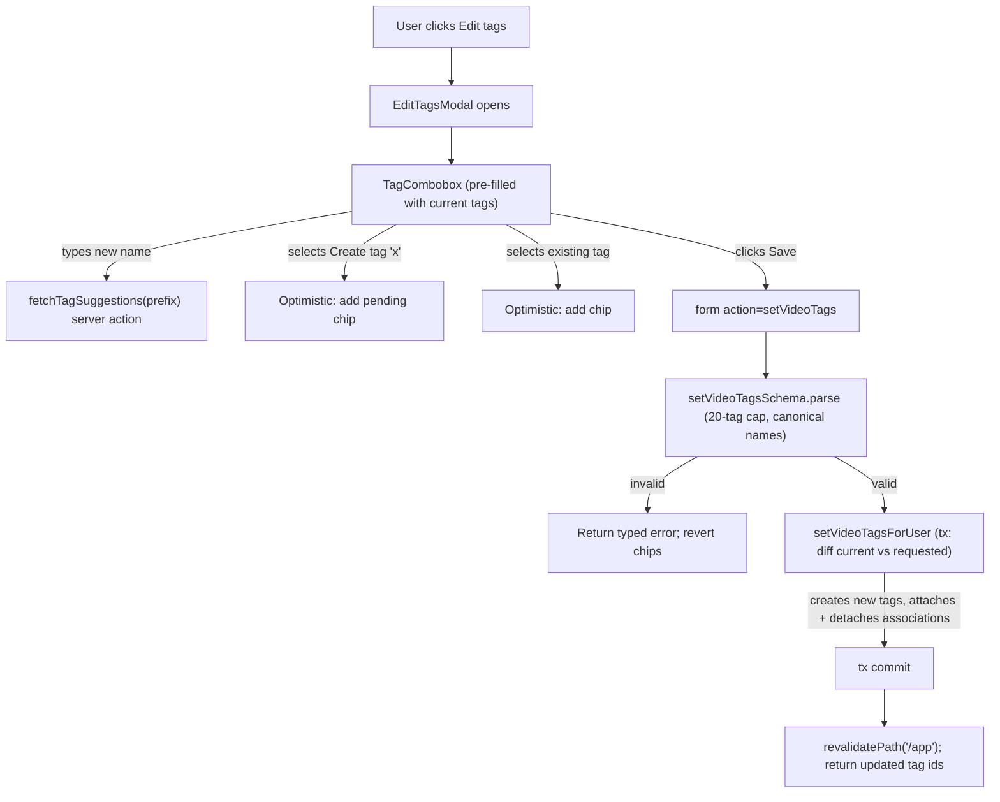
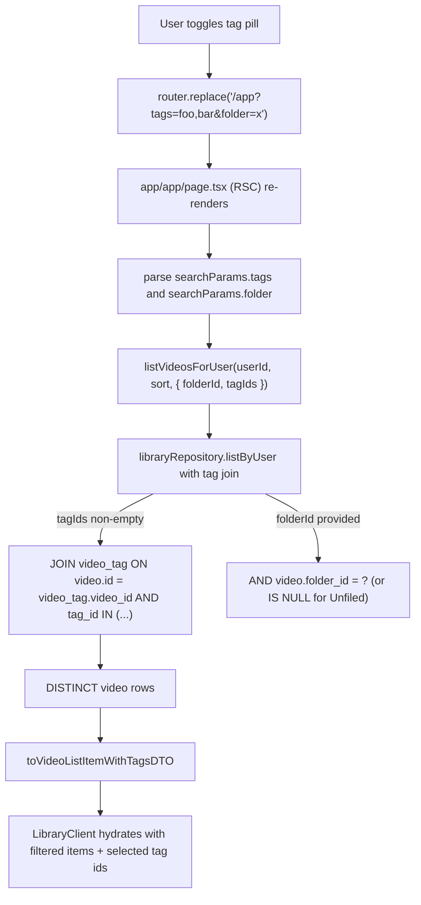
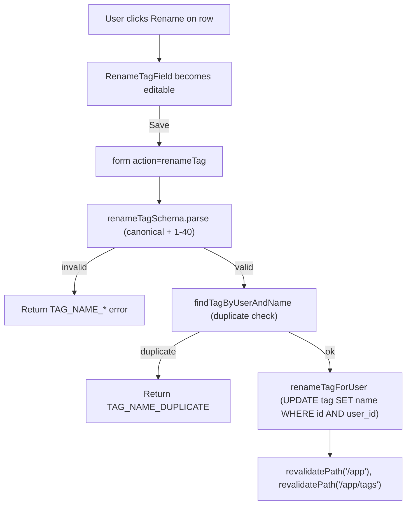
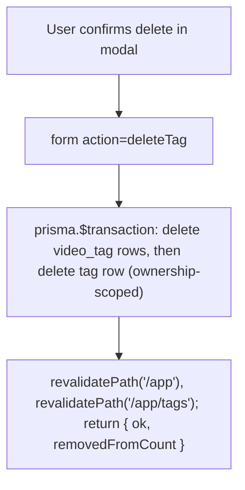

# F06. Tag Organization — Technical Specification

**Scope tag:** full scope — no Core/Full split (PRD has neither a `Core Scope` block nor a `Full Scope additions` block for F06, so the entire feature definition is in scope)

**Complexity:** medium

---

## 1. Technical Overview

**What:** Implement user-owned tags that can be attached to videos and used to filter the library at `/app`. A tag has a lowercase, 1–40 character name (hyphens allowed, no spaces), is scoped to the owning user (no cross-account sharing), and is reused across many videos via a many-to-many association. A video accepts between 0 and 20 tags. Tags are created, applied, and removed through a combobox that lives in the video card's context menu (`Edit tags`) and in the video detail page header (placeholder route owned by F04 today, F08 later); typing a new name that does not match any existing tag offers `Create tag "<name>"` inline and performs an optimistic creation. Selected tags in the library header's filter pill row filter the list with OR semantics between tags and compose with F05's folder filter (`All videos`, `Unfiled`, or a specific folder) using AND semantics. A dedicated "Manage tags" view under the library (`/app/tags`) lists every tag with its video count and exposes rename and delete actions; rename updates the tag in place (every associated video follows), delete removes the tag from every video it was on (the videos themselves are not deleted).

**Why:** F06 is a Wave 4 sibling of F05 (folder organization) and F08/F11, all consuming F03's video records and F04's library page. Tags are a secondary, cross-cutting classification on top of F05's single-folder-per-video grouping — PRD explicitly requires both axes and specifies they compose with AND between axes (folder ∧ tag-set) and OR within the tag axis. Because F06 must integrate with F04's existing library RSC + client island without reflowing it, the spec keeps F04's `LibraryClient` contract intact (the existing `initialItems`, `initialView`, `initialSort` props stay; two new props are added for the tag data and the currently selected tag filter) and introduces a new `/api/videos/{id}/tags` Server Action surface and a `/app/tags` route for the Manage view. The tag combobox is a new reusable client island shared by the context menu entry and the detail header. The many-to-many link is modeled via a classic join table (`video_tag`) rather than Postgres arrays because it makes the "rename cascades to every video that uses it" criterion a zero-row-change operation, lets the filter query use ordinary indexed joins, and gives F12 (admin delete user) a predictable cascade path.

**Scope:**

Included:
- New `tag` table scoped to the owning user, with a unique `(user_id, name)` constraint (so the same name can coexist across users) and a case-insensitive uniqueness guarantee enforced by storing the canonical lowercase form
- New `video_tag` join table with composite primary key `(video_id, tag_id)` and the FKs needed so deleting either side cascades cleanly; the table carries the owning `user_id` to allow F12's user-cascade delete to nuke every association in one statement and to defend against cross-user joins at the query layer
- A per-video tag cap of 20 enforced at the application layer (inside the `setVideoTags` action's zod schema and repository) and defended by an integration test; PRD does not prescribe a DB-level enforcement so none is added
- Tag creation is inline from the combobox: typing `ch` shows any existing tag matching that prefix plus `Create tag "ch"` if no exact match exists; selecting the create option optimistically inserts a tag and attaches it to the current video in one Server Action round-trip
- A combobox island (`<TagCombobox />`) that is used both from the video card context menu ("Edit tags") and from the detail page header; the combobox is the single source of truth for filtered suggestions, selection state, optimistic creation, and the "+N overflow" rendering rules
- Per-card tag chips on the library card: up to 3 tags are rendered inline (the first 3 by alphabetical order, matching the combobox's sort), additional tags collapse into a `+N` chip that surfaces a tooltip with the full list on hover/focus
- A library-header tag filter pill row (`<TagFilterPillRow />`): each pill shows the tag name and a toggle state; clicking toggles selection; a `Clear tags` link removes all selected tags; selection is reflected in the URL as `?tags=foo,bar` so the filter is deep-linkable and survives a reload; `LibraryClient` reads the value and asks F04's updated `listVideosForUser` query for the AND-of-folder / OR-of-tags filter
- AND composition with F05's folder filter: when both a folder (or `Unfiled`) and a tag set are active, the server query returns videos where the folder predicate holds AND at least one of the selected tags is present; an empty tag set means no tag filter
- Manage tags view at `/app/tags`: server-rendered list of every tag for the current user with `name`, `videoCount`, and Rename + Delete buttons; Rename opens an inline field that posts `renameTag`; Delete opens a confirmation modal that posts `deleteTag`
- Optimistic UX for: (a) tag creation inline in the combobox, (b) attaching/detaching a tag from a video, (c) renaming a tag from the Manage view; on server rejection the optimistic state is rolled back and a typed error message is shown
- New Server Actions: `createTag`, `renameTag`, `deleteTag`, `setVideoTags` (replaces the full tag set for one video in a single transaction), plus a thin `fetchTagSuggestions` for the combobox's typeahead when the seed list is insufficient
- Read helpers: `listTagsForUser(userId, opts)`, `listTagsForVideo(videoId, userId)`, `listVideoIdsForTagFilter(userId, tagIds)`, reused by the library RSC and the Manage view
- Extension points on F04: the library RSC now reads the `?tags` query param and forwards it into a single Prisma query that joins `video_tag` when the filter is active; `LibraryClient` receives the active tag ids, the user's full tag list (for the filter pill row), and a per-video tag map (for chip rendering)
- Unit tests for validation (lowercase normalization, hyphen allowed, space/uppercase rejected, length bounds), repository (ownership-scoped, many-to-many), actions (happy + every PRD error path), components (combobox, pill row, chips, Manage view), plus integration tests against `testcontainers` Postgres and one Playwright spec for the user-visible flows

Excluded (owned by other features or explicitly out of scope per PRD Section 7):
- Folder sidebar, folder filter, `Unfiled` / `All videos` entries — F05 (F06 only composes with whatever folder predicate F05 provides; the AND-composition code lives in the library repository query and works with or without F05 shipped — when F05 is not present, folder filter is a no-op)
- Video detail page header tag editor visuals beyond the placeholder route already owned by F04 — F08 will slot the combobox into the real detail header without schema changes
- Suggested tags from transcription content — not in PRD
- Tag colors, icons, or hierarchies — not in PRD
- Cross-account tag sharing — not in PRD
- Bulk tag assignment to multiple videos — not in PRD
- Tag-based analytics on `/admin` — PRD Section 7 excludes it
- Search within the Manage tags view (PRD does not specify one; list is alphabetical)
- Pagination for the tag list at MVP scale

---

## 2. Architecture Impact

**Affected components:**

| Path | Role |
|------|------|
| `prisma/schema.prisma` | Modified — add `Tag` model, `VideoTag` join model, relations on `User` and `Video` |
| `prisma/migrations/<timestamp>_add_tags/migration.sql` | New — creates `tag` and `video_tag` tables with indexes, FKs, CHECK constraints, and the `(user_id, name)` unique index |
| `app/_lib/tags/validation.ts` | New — zod schemas (`tagNameSchema`, `createTagSchema`, `renameTagSchema`, `deleteTagSchema`, `setVideoTagsSchema`, `tagFilterQuerySchema`); also exports the canonicalization helper |
| `app/_lib/tags/errors.ts` | New — typed error codes (`TAG_FORBIDDEN`, `TAG_NOT_FOUND`, `TAG_NAME_EMPTY`, `TAG_NAME_TOO_LONG`, `TAG_NAME_INVALID_CHARS`, `TAG_NAME_DUPLICATE`, `TAG_LIMIT_EXCEEDED`, `TAG_VIDEO_NOT_FOUND`, `TAG_INVALID_INPUT`) + human-readable messages |
| `app/_lib/tags/repository.ts` | New — ownership-scoped Prisma accessors: `listTagsForUser`, `listTagsWithCountsForUser`, `listTagsForVideo`, `findTagByUserAndName`, `createTagForUser`, `renameTagForUser`, `deleteTagForUser`, `setVideoTagsForUser`, `listVideoIdsMatchingTagFilter` |
| `app/_lib/tags/actions.ts` | New — Server Actions: `createTag`, `renameTag`, `deleteTag`, `setVideoTags`, plus `fetchTagSuggestions` helper (marked `"use server"`) |
| `app/_lib/videos/libraryRepository.ts` | Modified — `listByUser(userId, sort, filter?)` gains an optional `filter` parameter carrying `{ folderId?, tagIds? }` and joins `video_tag` when `tagIds` is non-empty |
| `app/_lib/videos/library.ts` | Modified — `listVideosForUser` now accepts a `filter` option and returns tag ids alongside the DTOs; new `VideoListItemWithTagsDTO` extends `VideoListItemDTO` with `tagIds: string[]` |
| `app/_components/library/LibraryClient.tsx` | Modified — accepts new props: `initialTags: TagDTO[]`, `initialSelectedTagIds: string[]`, `initialVideoTagMap: Record<string, string[]>`; renders `<TagFilterPillRow />` above the grid/list; renders `<TagChips />` inside each card/row via the existing `titleSlot`/card composition; embeds `<TagCombobox />` inside a new `EditTagsModal` opened from the context menu |
| `app/_components/library/VideoCard.tsx` | Modified — accepts a `tagsSlot` prop so the grid card can render the chips under the title without F06 owning the card layout |
| `app/_components/library/VideoRow.tsx` | Modified — same `tagsSlot` addition for the list row |
| `app/_components/library/ContextMenu.tsx` | Modified — adds an `Edit tags` entry between `Edit description` and `Delete` |
| `app/_components/tags/TagCombobox.tsx` | New — client combobox with typeahead, inline `Create tag "x"` option, chip rendering of already-selected tags, 20-tag cap UI feedback |
| `app/_components/tags/TagChips.tsx` | New — presentational chips; renders up to 3 chips plus a `+N` overflow chip with a tooltip listing the rest |
| `app/_components/tags/TagFilterPillRow.tsx` | New — pill row in the library header; each pill has `on/off` visual state; URL-driven selection via `useRouter` + `router.replace(url)` |
| `app/_components/tags/EditTagsModal.tsx` | New — dialog wrapping `<TagCombobox />`; posts a `setVideoTags` action on Save |
| `app/app/page.tsx` | Modified — reads `searchParams.tags`, loads the user's tag list and per-video tag map, passes them to `LibraryClient`; embeds `<TagFilterPillRow />` contract via the new props |
| `app/app/tags/page.tsx` | New — Server component for the Manage tags view; loads `listTagsWithCountsForUser`, renders `<ManageTagsClient />` |
| `app/_components/tags/ManageTagsClient.tsx` | New — client island for the Manage view; renders a list row per tag with Rename + Delete; owns the modal open-state |
| `app/_components/tags/RenameTagField.tsx` | New — inline editable name field on the Manage view row; wires to `renameTag` |
| `app/_components/tags/DeleteTagModal.tsx` | New — confirmation modal ("Delete tag 'X'? It will be removed from N videos."); wires to `deleteTag` |
| `app/_lib/tags/__tests__/*` | New — unit and integration tests |
| `app/_components/tags/__tests__/*` | New — component tests |
| `e2e/tags.spec.ts` | New — Playwright spec covering the user-visible acceptance criteria |

**Data flow — apply tag to a video (from library card context menu):**



**Data flow — library listing with folder + tag filter:**



**Data flow — rename tag from Manage view:**



**Data flow — delete tag from Manage view:**



---

## 3. Technical Decisions

| Decision | Chosen Approach | Alternative Considered | Trade-off |
|----------|-----------------|------------------------|-----------|
| Tag storage model | Dedicated `tag` table with `(user_id, name)` unique constraint + `video_tag` many-to-many join carrying `user_id` | Postgres `text[]` column on `video` | Join table makes rename a single UPDATE that reflects across every video immediately and makes delete-on-every-video a single `DELETE FROM video_tag WHERE tag_id = ?`. Arrays would require per-row rewrites and lose referential integrity. Industry-standard pattern for reusable tags |
| Canonical name | Store and compare lowercase; validation layer normalizes incoming names with `String.prototype.toLowerCase()` and rejects anything outside `[a-z0-9-]` plus length bounds (1–40) | Case-insensitive collation with original casing preserved | PRD explicitly requires lowercase enforcement. Storing the canonical form removes a class of "looks different but collides" bugs and keeps the unique index trivially correct |
| Name validation regex | `/^[a-z0-9]+(?:-[a-z0-9]+)*$/` (no leading/trailing hyphen, no consecutive hyphens) | `/^[a-z0-9-]{1,40}$/` permissive hyphen placement | PRD does not prohibit `--` explicitly but the stricter form matches common tag-slug conventions (`web-dev`, not `web--dev` or `-web`). Documented in Assumptions |
| Per-video tag cap | 20, enforced in `setVideoTagsSchema` (zod `max(20)`) and defended in the repository (`if (tagIds.length > 20) throw TAG_LIMIT_EXCEEDED`) | DB-level CHECK via trigger | PRD states "0 to 20 tags". A trigger is overkill; a zod + service-layer guard is enforceable and testable |
| Mutation style | **Server Actions** for `createTag`, `renameTag`, `deleteTag`, `setVideoTags`, `fetchTagSuggestions` | Route Handlers under `/api/tags/*` | Matches F02/F04 conventions; CSRF for free; one `revalidatePath` line invalidates `/app` and `/app/tags`; no public REST surface to secure |
| `setVideoTags` semantics | Replace-the-whole-set: accepts the full list of tag names for the video, diffs against current, creates missing tags, attaches new, detaches removed, inside one transaction | Separate `attachTag`/`detachTag` actions | The combobox always knows the full desired set; replace-set is idempotent and avoids mid-state inconsistencies; matches the modal UX ("Save" commits the whole picker at once) |
| Tag creation inline from combobox | When the user selects `Create tag "x"`, the combobox optimistically adds a chip with a provisional id, and the enclosing form's Save posts the full desired set via `setVideoTags`; creation happens server-side as part of the tag-diff | Separate `createTag` call before `setVideoTags` | One round trip; server owns the canonicalization + uniqueness check; if two clicks collide on the same new name, the second tx picks up the tag created by the first |
| Standalone `createTag` action | Still provided (used by the Manage view's "add tag" affordance if later added, and kept for unit testing and API symmetry) | Only `setVideoTags` creates tags | Two entry points cost nothing and make the Manage view's extension easy |
| Filter composition | Library RSC reads `searchParams.folder` and `searchParams.tags`; passes both to `listVideosForUser`; repository builds a single Prisma query: `where: { userId, AND: [ folderPredicate, tagPredicate ] }` where `tagPredicate` is `{ tags: { some: { tagId: { in: ids } } } }` | Two sequential queries (intersect in Node) | Database does the work; one round trip; existing indexes on `video_tag` handle the join. Matches PRD's AND-between-axes / OR-within-tags rule |
| Tag filter OR semantics | Use Prisma `some` on the many-to-many — a video matches if it has at least one of the selected tag ids | AND — video must have all selected tags | PRD explicitly says OR between tags |
| URL encoding of active tag filter | `?tags=<id-1>,<id-2>` using tag ids (not names) to avoid URL-encoding issues with hyphenated names and to keep the URL stable across renames | `?tags=<name-1>,<name-2>` | Ids are 25–32 char cuids; URL stays short enough; rename does not invalidate a pinned URL |
| Filter selection round-trip | `<TagFilterPillRow />` calls `router.replace('/app?' + params.toString())` on toggle; the RSC re-renders with new `searchParams`; no Server Action involved | Server Action that sets a persistent user preference | The filter is session-local and meant to be ephemeral per PRD Experience. A URL-driven filter is shareable and replayable without schema changes |
| Chip overflow rendering | Render the first 3 tags (alphabetical) then a `+N` chip on both card and row; `+N` shows the remaining names in a native `title` tooltip | Dropdown showing full list on click | PRD: "Video cards show up to 3 tags inline; additional tags are indicated with '+N'" — tooltip is the smallest functional disambiguator and matches lightweight UX |
| Optimistic state | `TagCombobox` uses `useOptimistic` for create + add + remove; rollback on server error with a toast | Full pessimistic UI | PRD Experience explicitly requires optimistic creation ("Tag creation is optimistic (appears immediately in the UI) and is confirmed after the server save") |
| Rename cascade | Single `UPDATE tag SET name = ? WHERE id = ? AND user_id = ?`; associations keep referencing the same `tag_id` | Update associations too | Tag id is the stable anchor; rename is naturally transparent to `video_tag` |
| Delete cascade | Transaction: `DELETE FROM video_tag WHERE tag_id = ? AND user_id = ?; DELETE FROM tag WHERE id = ? AND user_id = ?` | Rely on FK `ON DELETE CASCADE` only | Prisma's `ON DELETE CASCADE` handles it at the FK level, but the transaction also returns the `removedFromCount` so the action can show "Removed from N videos" to the user. The FK cascade is still declared as a safety net |
| Duplicate-name handling at creation | Server checks `(user_id, name)` uniqueness; on conflict, reuse the existing tag (idempotent create) | Return `TAG_NAME_DUPLICATE` error | `setVideoTags` must be idempotent (user may select the same tag twice in a session without issue); the standalone `createTag` action returns `TAG_NAME_DUPLICATE` because the user explicitly asked to create a new one |
| Duplicate-name handling at rename | Server checks `(user_id, new_name)` uniqueness; on conflict returns `TAG_NAME_DUPLICATE` | Silently merge two tags into one | Merging is destructive and not in the PRD; blocking is the safer default |
| Tag-filter pill row placement | Library header row, below the view-toggle / sort selector and above the grid/list | Sidebar | PRD: "The library header exposes a tag filter pill row" |
| `/app/tags` route | RSC that loads `listTagsWithCountsForUser` and renders `<ManageTagsClient />` | Modal from the library page | PRD: "Rename a tag from a dedicated 'Manage tags' view under the library" — a dedicated route is the straightforward reading |
| Data-shape handoff to F04 | Extend `VideoListItemDTO` into `VideoListItemWithTagsDTO` (adds `tagIds: string[]`); `LibraryClient` receives a separate `tagsById` map so chip rendering is a cheap lookup | Embed full tag objects per DTO | Keeps per-row payload small; the tag master list is sent once via `initialTags` |
| URL param parsing | Tag ids in `?tags=a,b,c` split by comma, trimmed, validated with zod (all must be cuids); unknown ids are silently dropped (no filter applied for them); this prevents a stale URL from showing an error | Strict reject on unknown id | Better UX for deep links that outlived a tag |
| Interaction with F05 folder filter | Repository accepts `{ folderId: string | null | undefined }`: `undefined` = no folder filter (All videos), `null` = Unfiled, any other string = that specific folder. F06 is a no-op when `folderId` is absent; when both are present, Prisma's `AND` combines them | Two separate queries and intersect | One round-trip and respects AND semantics |
| Suggestion fetching | The RSC seeds `initialTags` (full list); the combobox filters client-side for typeahead; `fetchTagSuggestions` exists as a reserved action used only when the seed list is stale (currently just invoked after any create/rename/delete inside the same page session for graceful recovery — feature-flagged off in MVP via a simple `useTagsList` hook that refreshes on `router.refresh()`) | Always hit the server for suggestions | Personal libraries have a small tag count; client-side filtering is near-instant and keystroke-free of round trips |
| Tag name display vs storage | Store and display identical canonical lowercase; the combobox input element auto-lowercases on blur and rejects spaces at type-time | Accept any casing, lowercase on save | PRD: "lowercase enforced, no spaces" — enforce at every layer so the user sees immediate feedback |
| Route guard | `/app/tags` requires a session (same `getSession()` guard as `/app`); unauthenticated → redirect to `/login` | Middleware | Consistent with F04's page-level guard |
| Testing layout | Vitest unit + integration (testcontainers Postgres) for repository and actions; RTL for components; one Playwright spec for the DOM-dependent acceptance criteria | All E2E | CLAUDE.md testing policy: E2E only for DOM-dependent criteria |
| Index strategy | `ix_tag_user_name` on `tag(user_id, name)` (already the unique index) covers typeahead; `ix_video_tag_tag_id` and `ix_video_tag_video_id` cover both directions of the many-to-many; `ix_video_tag_user_id` (composite second column `tag_id`) covers the filter query when joined with `video` | Fewer indexes | Three small indexes cover every query path the feature introduces; cost is trivial at MVP scale |

---

## 4. Component Overview

**Frontend (App Router):**

| File Path | New/Modified | Purpose | Key Responsibilities |
|-----------|--------------|---------|----------------------|
| `app/app/page.tsx` | Modified | Library RSC shell | Reads `searchParams.tags` (and `searchParams.folder` when F05 ships); loads `listTagsForUser`, per-video tag map, and tag-filtered items; forwards new props into `LibraryClient`; embeds the existing upload zone and progress list unchanged |
| `app/app/tags/page.tsx` | New | Manage tags RSC | Session guard; calls `listTagsWithCountsForUser`; renders `<ManageTagsClient />` with the initial list; sets page title "Manage tags" |
| `app/_components/library/LibraryClient.tsx` | Modified | Main client island | New props `initialTags`, `initialSelectedTagIds`, `initialVideoTagMap`; renders `<TagFilterPillRow />` in the header area; feeds `tagsSlot` into `<VideoCard />` / `<VideoRow />` via a presentational `<TagChips />`; hosts the new `<EditTagsModal />` triggered from the context menu |
| `app/_components/library/VideoCard.tsx` | Modified | Grid card | Accepts a new optional `tagsSlot: ReactNode` prop; renders it beneath the title region; no other change |
| `app/_components/library/VideoRow.tsx` | Modified | List row | Same `tagsSlot` addition for the row layout |
| `app/_components/library/ContextMenu.tsx` | Modified | Popover menu | Adds an `Edit tags` entry between `Edit description` and `Delete`; consumers pass `onEditTags` callback |
| `app/_components/tags/TagCombobox.tsx` | New | Reusable combobox | `"use client"`; input with lowercase-on-type + reject-space; renders matching tags, selected chips, and a `Create tag "x"` option when no exact match exists; `useOptimistic` for the selected set; surfaces the 20-tag cap with a disabled input + inline message; keyboard navigable (arrow up/down, Enter, Backspace on empty input removes the last chip) |
| `app/_components/tags/TagChips.tsx` | New | Chip row | Presentational; receives `tags: TagDTO[]` and renders up to 3 alphabetically, then a `+N` chip with `title` tooltip listing the rest |
| `app/_components/tags/TagFilterPillRow.tsx` | New | Filter pill row | `"use client"`; receives `allTags: TagDTO[]` and `selectedIds: string[]`; click toggles the id in the URL via `router.replace`; renders a `Clear tags` link when any selection is active; empty state (user has no tags) renders nothing (row is hidden) |
| `app/_components/tags/EditTagsModal.tsx` | New | Edit-tags dialog | Wraps `<TagCombobox />` for a single video; on Save posts `setVideoTags`; on success closes and reports the new tag set up to `LibraryClient` via callback |
| `app/_components/tags/ManageTagsClient.tsx` | New | Manage view client island | Renders a list row per tag; owns rename + delete modal state; uses `useOptimistic` for rename + delete |
| `app/_components/tags/RenameTagField.tsx` | New | Inline tag rename | Editable span → input; posts `renameTag`; inline error display |
| `app/_components/tags/DeleteTagModal.tsx` | New | Delete confirmation | `<dialog>` with the copy "Delete tag 'X'? It will be removed from N videos."; posts `deleteTag` |
| `app/_components/library/__tests__/LibraryClient.tsx` | Modified | Extend existing tests for the new props | Preserves F04 coverage; adds tag-prop rendering paths |

**Backend (server-side modules + Server Actions):**

| File Path | New/Modified | Purpose | Key Responsibilities |
|-----------|--------------|---------|----------------------|
| `app/_lib/tags/actions.ts` | New | Server Actions | `"use server"`; `createTag`, `renameTag`, `deleteTag`, `setVideoTags`, `fetchTagSuggestions`. Each reads the session, validates with zod, delegates to the repository, calls `revalidatePath('/app')` and `revalidatePath('/app/tags')`, returns a typed `ActionState` with `item | items | count | code | fieldErrors` |
| `app/_lib/tags/repository.ts` | New | Ownership-scoped Prisma accessors | `listTagsForUser(userId)`, `listTagsWithCountsForUser(userId)` (aggregates `_count.videos`), `listTagsForVideo(videoId, userId)`, `findTagByUserAndName(userId, name)`, `createTagForUser(userId, name)` (idempotent on `(user_id, name)` conflict — returns existing), `renameTagForUser(id, userId, newName)`, `deleteTagForUser(id, userId)` (transaction), `setVideoTagsForUser({ videoId, userId, tagNames })` (transaction: ensure tags exist, diff current vs requested, attach + detach, return the new tag list), `listVideoIdsMatchingTagFilter(userId, tagIds)` (used when the library needs the id list without full rows) |
| `app/_lib/tags/validation.ts` | New | zod schemas + helpers | `canonicalizeTagName(input)` (trim + lowercase + single-hyphen pattern); `tagNameSchema` (applies canonicalization + regex + length); action-specific composite schemas; `tagFilterQuerySchema` (parses the `?tags=a,b` query param into a `string[]`); exports shared constants `TAG_NAME_MIN`, `TAG_NAME_MAX`, `TAGS_PER_VIDEO_MAX` |
| `app/_lib/tags/errors.ts` | New | Typed error codes | Exports `TagError`, `TagErrorCode`, and `tagErrorMessage(code)` following F04's `libraryErrors` pattern |
| `app/_lib/videos/libraryRepository.ts` | Modified | Library list query | `listByUser(userId, sort, filter?)` — adds an optional `{ folderId?, tagIds? }` parameter; when `tagIds` is non-empty, builds a `where.AND` that joins `video_tag` via Prisma's `tags: { some: { tagId: { in: tagIds } } }`; `distinct: ['id']` on the result to protect against duplicate rows from the join |
| `app/_lib/videos/library.ts` | Modified | Library DTO mapper | Adds `VideoListItemWithTagsDTO` with `tagIds: string[]`; `listVideosForUser(userId, sort, filter?)` now returns the new DTO and also returns `tagsById: Record<string, string[]>` (per-video tag id list) to avoid an N+1 round trip in the RSC |
| `app/_lib/db.ts` | Re-used (no change) | Prisma client singleton | — |
| `app/_lib/session.ts` | Re-used (no change) | Session reader | — |

**Database:**

| Migration File | Tables Affected | Operation | Notes |
|----------------|-----------------|-----------|-------|
| `prisma/migrations/<timestamp>_add_tags/migration.sql` | `tag`, `video_tag` | CREATE | Two new tables; FKs to `user(id)` and `video(id)` with `ON DELETE CASCADE`; unique `(user_id, name)` on `tag`; composite PK `(video_id, tag_id)` on `video_tag`; indexes listed below; CHECK constraint on `tag.name` matching the canonical regex |

**Static assets:** none.

---

## 5. API Contracts

F06 ships no HTTP endpoints of its own. All mutations are App Router Server Actions invoked from forms inside the library and Manage-tags client islands. The following describe each action's shape.

### Server Action: `createTag`

- **Module:** `app/_lib/tags/actions.ts`
- **Form invocation:** reserved (not wired to a specific form in MVP); exposed for parity and tests
- **Authentication:** `getSession()`; no session → `{ ok: false, code: 'TAG_FORBIDDEN' }`

**Input (from `FormData`):**

| Field | Type | Required | Validation | Description |
|-------|------|----------|------------|-------------|
| `name` | `string` | Yes | Canonicalized (lowercase, trimmed); matches `/^[a-z0-9]+(?:-[a-z0-9]+)*$/`; 1–40 chars | Desired tag name |

**Response State:**

| Field | Type | Description |
|-------|------|-------------|
| `ok` | `boolean` | `true` on success |
| `code` | `string?` | Error code on failure |
| `tag` | `TagDTO?` | Created (or reused) tag on success |
| `fieldErrors` | `Record<string, string[]>?` | Per-field errors keyed as `{ name: [...] }` |

**Example success:**

```json
{
  "ok": true,
  "tag": {
    "id": "clt...",
    "name": "web-dev",
    "createdAt": "2026-04-19T10:00:00.000Z"
  }
}
```

**Error codes:**

| Code | Meaning |
|------|---------|
| `TAG_FORBIDDEN` | No session |
| `TAG_NAME_EMPTY` | Empty or whitespace-only after trim |
| `TAG_NAME_TOO_LONG` | Exceeds 40 chars |
| `TAG_NAME_INVALID_CHARS` | Contains uppercase, whitespace, or disallowed punctuation |
| `TAG_NAME_DUPLICATE` | Reserved for strict-create callers (the modal path reuses via `setVideoTags` instead of surfacing this) |

### Server Action: `renameTag`

- **Module:** `app/_lib/tags/actions.ts`
- **Form invocation:** `<form action={renameTag}>` inside `<RenameTagField />`

**Input:**

| Field | Type | Required | Validation | Description |
|-------|------|----------|------------|-------------|
| `id` | `string` (cuid) | Yes | Valid cuid | Target tag id |
| `name` | `string` | Yes | Same as `createTag.name` | New tag name |

**Response State:**

| Field | Type | Description |
|-------|------|-------------|
| `ok` | `boolean` | `true` on success |
| `code` | `string?` | Error code on failure |
| `tag` | `TagDTO?` | Updated tag on success |
| `fieldErrors` | `Record<string, string[]>?` | Keyed as `{ name: [...] }` |

**Error codes:** `TAG_FORBIDDEN`, `TAG_NOT_FOUND`, `TAG_NAME_EMPTY`, `TAG_NAME_TOO_LONG`, `TAG_NAME_INVALID_CHARS`, `TAG_NAME_DUPLICATE`.

### Server Action: `deleteTag`

- **Module:** `app/_lib/tags/actions.ts`
- **Form invocation:** `<form action={deleteTag}>` inside `<DeleteTagModal />`

**Input:**

| Field | Type | Required | Validation | Description |
|-------|------|----------|------------|-------------|
| `id` | `string` (cuid) | Yes | Valid cuid | Target tag id |

**Response State:**

| Field | Type | Description |
|-------|------|-------------|
| `ok` | `boolean` | `true` on success |
| `code` | `string?` | `TAG_NOT_FOUND` if already gone |
| `removedFromCount` | `number?` | Count of videos the tag was removed from |

**Error codes:** `TAG_FORBIDDEN`, `TAG_NOT_FOUND`.

### Server Action: `setVideoTags`

- **Module:** `app/_lib/tags/actions.ts`
- **Form invocation:** `<form action={setVideoTags}>` inside `<EditTagsModal />` (also usable from the detail header when F08 ships)

**Input:**

| Field | Type | Required | Validation | Description |
|-------|------|----------|------------|-------------|
| `videoId` | `string` (cuid) | Yes | Valid cuid | Target video id |
| `names` | `string[]` | Yes | 0–20 items; each canonicalized + regex-matched + 1–40 chars; no duplicates after canonicalization | Desired full tag set |

**Behaviour:**
- Reads the video, returns `TAG_VIDEO_NOT_FOUND` for non-ownership
- Enforces the 20-tag cap; returns `TAG_LIMIT_EXCEEDED` with a `count` hint if violated
- For each name in `names`, ensures a tag exists for `(user_id, name)` (creates on miss); diffs against the video's current tag set; detaches removed and attaches added in one transaction
- Returns the final `TagDTO[]` for the video

**Response State:**

| Field | Type | Description |
|-------|------|-------------|
| `ok` | `boolean` | `true` on success |
| `code` | `string?` | Error code on failure |
| `tags` | `TagDTO[]?` | The video's updated tag set on success |
| `fieldErrors` | `Record<string, string[]>?` | Keyed as `{ names: [...] }` for item-level errors |

**Error codes:** `TAG_FORBIDDEN`, `TAG_VIDEO_NOT_FOUND`, `TAG_NAME_EMPTY`, `TAG_NAME_TOO_LONG`, `TAG_NAME_INVALID_CHARS`, `TAG_LIMIT_EXCEEDED`, `TAG_INVALID_INPUT`.

### Server Action: `fetchTagSuggestions`

- **Module:** `app/_lib/tags/actions.ts`
- **Form invocation:** called from `<TagCombobox />` on-demand (not a form submit; invoked through a Server Action call in a `useTransition`)

**Input:**

| Field | Type | Required | Validation | Description |
|-------|------|----------|------------|-------------|
| `prefix` | `string` | No | 0–40 chars | Typeahead prefix; empty returns the full list |

**Response State:**

| Field | Type | Description |
|-------|------|-------------|
| `ok` | `boolean` | `true` on success |
| `suggestions` | `TagDTO[]` | Matching tags (alphabetical) |

**Error codes:** `TAG_FORBIDDEN`.

### Data shapes

`TagDTO`:

| Field | Type | Description |
|-------|------|-------------|
| `id` | `string` | cuid |
| `name` | `string` | Canonical lowercase name |
| `createdAt` | `string (ISO 8601)` | Creation timestamp |

`TagWithCountDTO` (used on `/app/tags`):

| Field | Type | Description |
|-------|------|-------------|
| `id` | `string` | cuid |
| `name` | `string` | Canonical lowercase name |
| `videoCount` | `number` | Count of videos currently tagged |
| `createdAt` | `string (ISO 8601)` | Creation timestamp |

`VideoListItemWithTagsDTO` extends F04's `VideoListItemDTO`:

| Field | Type | Description |
|-------|------|-------------|
| ...all `VideoListItemDTO` fields | | |
| `tagIds` | `string[]` | Tag ids attached to this video (alphabetical by name) |

---

## 6. Data Model

F06 adds two new tables and adds one new relation field to the existing `Video` model (the reverse side of the many-to-many). It does not modify any existing column.

### Table: `tag` (NEW)

| Column | Type | Nullable | Default | Description |
|--------|------|----------|---------|-------------|
| `id` | `varchar(32)` | No | `cuid()` | Primary key (cuid) |
| `user_id` | `varchar(32)` | No | - | Owning user (FK to `user.id` ON DELETE CASCADE) |
| `name` | `varchar(40)` | No | - | Canonical lowercase tag name |
| `created_at` | `timestamptz` | No | `NOW()` | Creation timestamp |

**Indexes:**

| Index Name | Columns | Type | Purpose |
|------------|---------|------|---------|
| `ux_tag_user_name` | `(user_id, name)` | btree (UNIQUE) | Enforce unique tag per user and power typeahead by prefix within a user |
| `ix_tag_user_created` | `(user_id, created_at DESC)` | btree | Secondary ordering for any future "recent tags" UI |

**Constraints:**

| Constraint | Type | Definition | Purpose |
|------------|------|------------|---------|
| `pk_tag` | PRIMARY KEY | `id` | Unique identifier |
| `fk_tag_user` | FOREIGN KEY | `user_id REFERENCES user(id) ON DELETE CASCADE` | Owner cascade on account delete (F12) |
| `ck_tag_name_format` | CHECK | `name ~ '^[a-z0-9]+(-[a-z0-9]+)*$'` | Defensive; matches app-layer validation |
| `ck_tag_name_length` | CHECK | `char_length(name) BETWEEN 1 AND 40` | Defensive |

### Table: `video_tag` (NEW)

| Column | Type | Nullable | Default | Description |
|--------|------|----------|---------|-------------|
| `video_id` | `varchar(32)` | No | - | FK to `video.id` ON DELETE CASCADE |
| `tag_id` | `varchar(32)` | No | - | FK to `tag.id` ON DELETE CASCADE |
| `user_id` | `varchar(32)` | No | - | Denormalized owner (FK to `user.id` ON DELETE CASCADE) |
| `created_at` | `timestamptz` | No | `NOW()` | Attachment timestamp |

**Indexes:**

| Index Name | Columns | Type | Purpose |
|------------|---------|------|---------|
| `ix_video_tag_tag_id` | `(tag_id)` | btree | Fast reverse lookup for filter queries and delete-tag cascade |
| `ix_video_tag_video_id` | `(video_id)` | btree | Fast forward lookup for per-video tag list |
| `ix_video_tag_user_tag` | `(user_id, tag_id)` | btree | Covers the filter query's ownership-scoped join |

**Constraints:**

| Constraint | Type | Definition | Purpose |
|------------|------|------------|---------|
| `pk_video_tag` | PRIMARY KEY | `(video_id, tag_id)` | Composite PK — one attachment per (video, tag) |
| `fk_video_tag_video` | FOREIGN KEY | `video_id REFERENCES video(id) ON DELETE CASCADE` | Video-delete cascades to its attachments |
| `fk_video_tag_tag` | FOREIGN KEY | `tag_id REFERENCES tag(id) ON DELETE CASCADE` | Tag-delete cascades to its attachments (safety net for the `deleteTag` transaction) |
| `fk_video_tag_user` | FOREIGN KEY | `user_id REFERENCES user(id) ON DELETE CASCADE` | User-delete cascades to all attachments (F12) |

**Cross-Database Notes:**
- Both tables use `varchar(32)` for ids, matching F02's `cuid()` convention
- CHECK constraints are plain-regex `~` (Postgres-specific) — acceptable because `schema.prisma` targets `postgresql` only
- `ON DELETE CASCADE` is declared at the FK level so F12's user-delete is a single statement; app-layer transactions still mirror the cascade to return useful counts

**Migration (`prisma/migrations/<timestamp>_add_tags/migration.sql`):**

```sql
CREATE TABLE "tag" (
  "id" VARCHAR(32) NOT NULL,
  "user_id" VARCHAR(32) NOT NULL,
  "name" VARCHAR(40) NOT NULL,
  "created_at" TIMESTAMPTZ(6) NOT NULL DEFAULT NOW(),

  CONSTRAINT "pk_tag" PRIMARY KEY ("id"),
  CONSTRAINT "fk_tag_user" FOREIGN KEY ("user_id")
    REFERENCES "user"("id") ON DELETE CASCADE,
  CONSTRAINT "ck_tag_name_format"
    CHECK ("name" ~ '^[a-z0-9]+(-[a-z0-9]+)*$'),
  CONSTRAINT "ck_tag_name_length"
    CHECK (char_length("name") BETWEEN 1 AND 40)
);

CREATE UNIQUE INDEX "ux_tag_user_name" ON "tag"("user_id", "name");
CREATE INDEX "ix_tag_user_created" ON "tag"("user_id", "created_at" DESC);

CREATE TABLE "video_tag" (
  "video_id" VARCHAR(32) NOT NULL,
  "tag_id" VARCHAR(32) NOT NULL,
  "user_id" VARCHAR(32) NOT NULL,
  "created_at" TIMESTAMPTZ(6) NOT NULL DEFAULT NOW(),

  CONSTRAINT "pk_video_tag" PRIMARY KEY ("video_id", "tag_id"),
  CONSTRAINT "fk_video_tag_video" FOREIGN KEY ("video_id")
    REFERENCES "video"("id") ON DELETE CASCADE,
  CONSTRAINT "fk_video_tag_tag" FOREIGN KEY ("tag_id")
    REFERENCES "tag"("id") ON DELETE CASCADE,
  CONSTRAINT "fk_video_tag_user" FOREIGN KEY ("user_id")
    REFERENCES "user"("id") ON DELETE CASCADE
);

CREATE INDEX "ix_video_tag_tag_id" ON "video_tag"("tag_id");
CREATE INDEX "ix_video_tag_video_id" ON "video_tag"("video_id");
CREATE INDEX "ix_video_tag_user_tag" ON "video_tag"("user_id", "tag_id");
```

**Prisma schema additions:**

```prisma
model Tag {
  id        String     @id @default(cuid())
  userId    String     @map("user_id")
  name      String     @db.VarChar(40)
  createdAt DateTime   @default(now()) @map("created_at") @db.Timestamptz(6)
  user      User       @relation(fields: [userId], references: [id], onDelete: Cascade)
  videos    VideoTag[]

  @@unique([userId, name], map: "ux_tag_user_name")
  @@index([userId, createdAt(sort: Desc)], map: "ix_tag_user_created")
  @@map("tag")
}

model VideoTag {
  videoId   String   @map("video_id")
  tagId     String   @map("tag_id")
  userId    String   @map("user_id")
  createdAt DateTime @default(now()) @map("created_at") @db.Timestamptz(6)
  video     Video    @relation(fields: [videoId], references: [id], onDelete: Cascade)
  tag       Tag      @relation(fields: [tagId], references: [id], onDelete: Cascade)
  user      User     @relation(fields: [userId], references: [id], onDelete: Cascade)

  @@id([videoId, tagId], map: "pk_video_tag")
  @@index([tagId], map: "ix_video_tag_tag_id")
  @@index([videoId], map: "ix_video_tag_video_id")
  @@index([userId, tagId], map: "ix_video_tag_user_tag")
  @@map("video_tag")
}
```

The `User` model gains `tags Tag[]` and `videoTags VideoTag[]` relation fields; the `Video` model gains `tags VideoTag[]`. No column changes on existing tables.

---

## 7. Testing Strategy

F06 reuses the Vitest + React Testing Library + `testcontainers` Postgres harness established by F02 and extended by F03/F04. Server Actions are tested by calling them directly with a mocked session (the F02/F03 harness already exposes a helper for this). The Playwright spec boots the dev server against the same `DATABASE_URL` and exercises the user-visible PRD acceptance criteria.

**Test File Structure:**

| Test File | Test Type | Target | Coverage Goal |
|-----------|-----------|--------|---------------|
| `app/_lib/tags/__tests__/validation.test.ts` | Unit | Canonicalization + every zod schema | 100% branches |
| `app/_lib/tags/__tests__/repository.integration.test.ts` | Integration (Postgres) | Every repository function | All branches |
| `app/_lib/tags/__tests__/actions.integration.test.ts` | Integration (Postgres + session mock) | Every Server Action | Every PRD Section 9 F06 criterion + error matrix |
| `app/_lib/videos/__tests__/libraryRepository.tagFilter.integration.test.ts` | Integration | `listByUser(userId, sort, { tagIds })` and its composition with `{ folderId }` | AND-between-axes / OR-within-tags |
| `app/_components/tags/__tests__/TagCombobox.test.tsx` | Unit (component) | Combobox typeahead, create option, chip add/remove, 20-tag cap, keyboard nav | All branches |
| `app/_components/tags/__tests__/TagChips.test.tsx` | Unit (component) | 0–3 tag render, +N overflow, tooltip content | All branches |
| `app/_components/tags/__tests__/TagFilterPillRow.test.tsx` | Unit (component) | Toggle pill, Clear link, hidden when user has no tags | All branches |
| `app/_components/tags/__tests__/EditTagsModal.test.tsx` | Unit (component) | Open/close, Save submits `setVideoTags`, rollback on error | All branches |
| `app/_components/tags/__tests__/ManageTagsClient.test.tsx` | Unit (component) | Rename flow, delete flow, empty state | All branches |
| `app/_components/tags/__tests__/RenameTagField.test.tsx` | Unit (component) | Inline edit, validation inline, escape cancels | All branches |
| `app/_components/tags/__tests__/DeleteTagModal.test.tsx` | Unit (component) | Confirmation copy with count, confirm invokes `deleteTag` | All branches |
| `app/app/__tests__/libraryPage.tagFilter.integration.test.tsx` | Integration | `/app?tags=...` filters items and wires `LibraryClient` with the right props | All branches |
| `app/app/__tests__/manageTagsPage.integration.test.tsx` | Integration | `/app/tags` RSC renders counts and auth-redirects | All branches |
| `e2e/tags.spec.ts` | E2E (Playwright) | User-visible flows from PRD Section 9 F06 | All DOM-dependent criteria |

**Per-file test functions:**

`app/_lib/tags/__tests__/validation.test.ts`

| Test Function | Description | Assertions |
|---------------|-------------|------------|
| `canonicalize_lowercases_and_trims` | `"  Web-Dev  "` | Returns `"web-dev"` |
| `tag_name_accepts_1_char_lowercase` | `"a"` | Parses ok |
| `tag_name_accepts_40_char_hyphenated` | 40-char valid name | Parses ok |
| `tag_name_rejects_empty_with_TAG_NAME_EMPTY` | `""` | zod issue `TAG_NAME_EMPTY` |
| `tag_name_rejects_whitespace_only_with_TAG_NAME_EMPTY` | `"   "` | Same |
| `tag_name_rejects_41_chars_with_TAG_NAME_TOO_LONG` | 41 chars | `TAG_NAME_TOO_LONG` |
| `tag_name_rejects_space_with_TAG_NAME_INVALID_CHARS` | `"web dev"` | `TAG_NAME_INVALID_CHARS` |
| `tag_name_rejects_uppercase_before_canonicalize` | n/a — canonicalization lowercases; test guards against bypass | Canonical form still passes the regex |
| `tag_name_rejects_leading_hyphen_with_TAG_NAME_INVALID_CHARS` | `"-web"` | Error |
| `tag_name_rejects_consecutive_hyphens_with_TAG_NAME_INVALID_CHARS` | `"web--dev"` | Error |
| `tag_name_rejects_punctuation_with_TAG_NAME_INVALID_CHARS` | `"web_dev"` | Error |
| `set_video_tags_accepts_20_names` | Array of 20 | Parses ok |
| `set_video_tags_rejects_21_names_with_TAG_LIMIT_EXCEEDED` | Array of 21 | Error |
| `set_video_tags_dedupes_after_canonicalization` | `["Web-Dev","web-dev"]` | Treated as 1; parses ok with single item |
| `tag_filter_query_parses_comma_list` | `"a,b,c"` | Returns `["a","b","c"]` |
| `tag_filter_query_drops_invalid_cuids` | `"a,!!,b"` | Returns `["a","b"]` |
| `tag_filter_query_empty_returns_empty_array` | `""` or absent | `[]` |

`app/_lib/tags/__tests__/repository.integration.test.ts`

| Test Function | Description | Assertions |
|---------------|-------------|------------|
| `list_tags_for_user_returns_only_owner_tags` | Seed two users | Only caller's tags returned |
| `list_tags_with_counts_for_user_reports_video_count` | Seed tag attached to 0, 1, 3 videos | Counts match |
| `list_tags_for_video_returns_attached_tags_alphabetical` | Attach three tags | Ordered by name |
| `create_tag_for_user_is_idempotent_on_duplicate_name` | Create `"web-dev"` twice | Second call returns the existing row; no new row |
| `rename_tag_for_user_updates_name_in_place` | Rename `"web"` → `"web-dev"` | Row updated; video_tag rows unchanged |
| `rename_tag_for_user_rejects_duplicate_name` | Rename into an existing name | Returns null / throws `TAG_NAME_DUPLICATE` |
| `rename_tag_for_user_returns_null_for_non_owner` | Other user's tag | No change |
| `delete_tag_for_user_removes_tag_and_cascades_video_tag` | Tag attached to 2 videos | Tag gone; 2 `video_tag` rows gone; videos intact |
| `delete_tag_for_user_returns_null_for_non_owner` | Other user | No change |
| `set_video_tags_for_user_creates_missing_tags_and_diffs_set` | Current = [a,b], requested = [b,c] | `a` detached, `c` created + attached, `b` unchanged |
| `set_video_tags_for_user_rejects_21_names` | 21 names | Throws `TAG_LIMIT_EXCEEDED` |
| `set_video_tags_for_user_rejects_non_owner_video` | Other user's video | Throws `TAG_VIDEO_NOT_FOUND` |
| `set_video_tags_for_user_is_idempotent_on_identical_set` | Same set twice | Second call makes zero DB changes |
| `list_video_ids_matching_tag_filter_returns_union` | Videos tagged with a or b | Returns union (OR semantics) |

`app/_lib/tags/__tests__/actions.integration.test.ts`

| Test Function | Description | Assertions |
|---------------|-------------|------------|
| `create_tag_happy_path_returns_tag_dto` | Valid name | `{ ok: true, tag }` |
| `create_tag_no_session_returns_TAG_FORBIDDEN` | No session | Error code |
| `create_tag_invalid_chars_returns_TAG_NAME_INVALID_CHARS` | `"Web Dev"` | Error |
| `rename_tag_happy_path_updates_and_revalidates` | Valid rename | `{ ok: true, tag }`; DB persisted |
| `rename_tag_duplicate_returns_TAG_NAME_DUPLICATE` | Collides | Error |
| `rename_tag_not_found_returns_TAG_NOT_FOUND` | Unknown id | Error |
| `delete_tag_happy_path_reports_removed_count` | Tag on 2 videos | `{ ok: true, removedFromCount: 2 }` |
| `delete_tag_already_gone_returns_TAG_NOT_FOUND` | Unknown id | Error |
| `set_video_tags_happy_path_returns_final_set` | `names=["a","b"]` | `tags` length 2 |
| `set_video_tags_at_cap_accepts_20` | 20 valid names | Ok |
| `set_video_tags_over_cap_returns_TAG_LIMIT_EXCEEDED` | 21 names | Error |
| `set_video_tags_invalid_name_returns_TAG_NAME_INVALID_CHARS` | `"Web Dev"` | Error |
| `set_video_tags_non_owner_video_returns_TAG_VIDEO_NOT_FOUND` | Other user's video | Error |
| `fetch_tag_suggestions_prefix_filters_alphabetically` | Seeded `["apple","apricot","banana"]`, prefix `"ap"` | Returns first two |
| `fetch_tag_suggestions_empty_prefix_returns_full_list` | `""` | Full list |

`app/_lib/videos/__tests__/libraryRepository.tagFilter.integration.test.ts`

| Test Function | Description | Assertions |
|---------------|-------------|------------|
| `list_by_user_with_no_filter_matches_F04_behavior` | No filter | Returns all user videos as F04 |
| `list_by_user_with_single_tag_returns_matching_videos` | `tagIds=[a]` | Returns only videos tagged `a` |
| `list_by_user_with_two_tags_uses_OR_semantics` | `tagIds=[a,b]` | Returns videos tagged `a` OR `b` (union, no duplicates) |
| `list_by_user_with_folder_and_tags_uses_AND_composition` | `folderId=F1`, `tagIds=[a]` | Returns videos in F1 tagged `a`; no F1-tagged-`b`, no other-folder-tagged-`a` |
| `list_by_user_with_unfiled_and_tags_uses_AND_composition` | `folderId=null`, `tagIds=[a]` | Returns only unfiled videos tagged `a` |
| `list_by_user_with_tags_does_not_leak_other_user_videos` | Two users, same tag name | Caller sees only their own |

`app/_components/tags/__tests__/TagCombobox.test.tsx`

| Test Function | Description | Assertions |
|---------------|-------------|------------|
| `combobox_lists_existing_tags_matching_prefix` | Type `"w"` | `"web-dev"` visible |
| `combobox_offers_create_option_when_no_exact_match` | Type `"new-tag"` | `Create tag "new-tag"` row visible |
| `combobox_hides_create_option_when_exact_match_exists` | Type `"web-dev"` where tag exists | Create option absent |
| `combobox_rejects_space_at_type_time` | Press space | Char swallowed; input unchanged |
| `combobox_lowercases_input_on_type` | Type `"Web"` | Input shows `"web"` |
| `combobox_add_chip_via_enter` | Select a suggestion | Chip appended |
| `combobox_remove_chip_via_x_button` | Click chip `×` | Chip removed |
| `combobox_backspace_on_empty_input_removes_last_chip` | Selected chips + Backspace | Last chip removed |
| `combobox_disables_input_at_20_chips` | 20 chips selected | Input is readonly + helper text visible |
| `combobox_is_keyboard_navigable` | Arrow up/down | Focus advances |

`app/_components/tags/__tests__/TagChips.test.tsx`

| Test Function | Description | Assertions |
|---------------|-------------|------------|
| `chips_empty_state_renders_nothing` | `tags=[]` | Empty output |
| `chips_renders_up_to_3_alphabetical` | 5 tags | First 3 by name visible |
| `chips_renders_overflow_pill_with_remaining_count` | 5 tags | `+2` pill visible |
| `chips_overflow_tooltip_lists_remaining_names` | 5 tags | `title` attr contains the 2 extras |

`app/_components/tags/__tests__/TagFilterPillRow.test.tsx`

| Test Function | Description | Assertions |
|---------------|-------------|------------|
| `pill_row_hidden_when_user_has_no_tags` | `allTags=[]` | Row absent |
| `pill_row_toggles_selection_via_url` | Click pill | `router.replace` called with `?tags=<id>` |
| `pill_row_appends_to_existing_selection` | Click second pill while one active | URL contains both ids |
| `pill_row_clear_link_removes_tag_param` | Click Clear | URL has no `tags` param |

`app/_components/tags/__tests__/EditTagsModal.test.tsx`

| Test Function | Description | Assertions |
|---------------|-------------|------------|
| `modal_opens_prefilled_with_current_tags` | Open | Chips reflect current set |
| `modal_save_submits_setVideoTags_with_full_set` | Save | Action called with the names array |
| `modal_close_on_escape_without_save_reverts` | Change + Escape | No action call |
| `modal_shows_error_and_rolls_back_on_TAG_LIMIT_EXCEEDED` | Force error | Chips rolled back; toast shown |

`app/_components/tags/__tests__/ManageTagsClient.test.tsx`

| Test Function | Description | Assertions |
|---------------|-------------|------------|
| `manage_renders_each_tag_with_video_count` | Seeded list | All rows rendered |
| `manage_rename_flow_happy_path` | Rename a tag | Row updates; action called |
| `manage_delete_flow_opens_modal_and_removes_row` | Delete a tag | Row removed after success |
| `manage_empty_state_renders_message` | `tags=[]` | "No tags yet" visible |

`app/_components/tags/__tests__/RenameTagField.test.tsx`

| Test Function | Description | Assertions |
|---------------|-------------|------------|
| `field_enters_edit_mode` | Activate | Input visible |
| `field_rejects_empty_inline` | Save empty | Error visible |
| `field_rejects_invalid_chars_inline` | Save with space | Error visible |
| `field_cancels_on_escape` | Escape | Reverts |

`app/_components/tags/__tests__/DeleteTagModal.test.tsx`

| Test Function | Description | Assertions |
|---------------|-------------|------------|
| `modal_copy_includes_tag_name_and_count` | tag `"web"` used on 3 videos | Copy reads `Delete tag 'web'? It will be removed from 3 videos.` |
| `modal_confirm_submits_deleteTag` | Confirm | Action called |
| `modal_cancel_closes_without_action` | Cancel | No action call |

`app/app/__tests__/libraryPage.tagFilter.integration.test.tsx`

| Test Function | Description | Assertions |
|---------------|-------------|------------|
| `rsc_with_no_tags_param_returns_full_list` | `/app` | All videos rendered |
| `rsc_with_tags_param_filters_items` | `/app?tags=<id>` | Only matching videos |
| `rsc_with_unknown_tag_id_silently_drops` | Stale id in query | Full list (no filter applied) |
| `rsc_passes_initialTags_and_videoTagMap_to_LibraryClient` | Seeded data | Props contain the expected ids |

`app/app/__tests__/manageTagsPage.integration.test.tsx`

| Test Function | Description | Assertions |
|---------------|-------------|------------|
| `manage_rsc_redirects_to_login_when_unauthenticated` | No session | Redirect |
| `manage_rsc_renders_tags_with_counts_for_owner_only` | Two users | Only caller's tags visible |
| `manage_rsc_shows_zero_count_for_unattached_tag` | New tag, no videos | Count = 0 |

**E2E (Playwright) — `e2e/tags.spec.ts`:**

| Test Function | Description | Assertions |
|---------------|-------------|------------|
| `create_tag_from_combobox_and_attach_to_video` | Open Edit tags → type new name → Create → Save | Video card shows new chip |
| `filter_library_by_tag_shows_matching_videos_only` | Toggle pill | Grid shows only matching |
| `tag_filter_OR_semantics_between_two_tags` | Toggle two pills | Shows union |
| `manage_tags_rename_updates_every_video_that_uses_it` | Rename a tag used on two videos | Both videos show the new name |
| `manage_tags_delete_removes_tag_from_every_video_but_keeps_videos` | Delete a tag used on two videos | Tag gone; both videos still present |
| `tag_combobox_rejects_space_and_lowercases_input` | Type `"Web Dev"` | Input shows `"webdev"` (space swallowed, case lowered) |

**Mapping to PRD Section 9 acceptance criteria (F06):**

| PRD Acceptance Criterion | Covered By |
|---|---|
| User can create tags with lowercase 1–40 character names (hyphens allowed, no spaces) | `canonicalize_lowercases_and_trims` + `tag_name_rejects_space_with_TAG_NAME_INVALID_CHARS` + `create_tag_happy_path_returns_tag_dto` + `create_tag_from_combobox_and_attach_to_video` (E2E) |
| A video accepts between 0 and 20 tags | `set_video_tags_at_cap_accepts_20` + `set_video_tags_over_cap_returns_TAG_LIMIT_EXCEEDED` + `combobox_disables_input_at_20_chips` |
| Tags are shared across the library and reused across videos | `create_tag_for_user_is_idempotent_on_duplicate_name` + `set_video_tags_for_user_creates_missing_tags_and_diffs_set` |
| Library can be filtered by one or more tags using OR semantics between tags and AND with an active folder filter | `list_by_user_with_two_tags_uses_OR_semantics` + `list_by_user_with_folder_and_tags_uses_AND_composition` + `list_by_user_with_unfiled_and_tags_uses_AND_composition` + `filter_library_by_tag_shows_matching_videos_only` (E2E) + `tag_filter_OR_semantics_between_two_tags` (E2E) |
| Renaming a tag updates every video that uses it | `rename_tag_for_user_updates_name_in_place` + `rename_tag_happy_path_updates_and_revalidates` + `manage_tags_rename_updates_every_video_that_uses_it` (E2E) |
| Deleting a tag removes it from every video; videos are not deleted | `delete_tag_for_user_removes_tag_and_cascades_video_tag` + `delete_tag_happy_path_reports_removed_count` + `manage_tags_delete_removes_tag_from_every_video_but_keeps_videos` (E2E) |
| "Manage tags" view lists every tag with its usage count | `manage_rsc_renders_tags_with_counts_for_owner_only` + `list_tags_with_counts_for_user_reports_video_count` + `manage_renders_each_tag_with_video_count` |

**Mapping to PRD Section 6 (F06) Experience rules:**

| PRD Experience rule | Covered By |
|---|---|
| Video cards show up to 3 tags inline; additional tags are indicated with "+N" | `chips_renders_up_to_3_alphabetical` + `chips_renders_overflow_pill_with_remaining_count` |
| Applying tags opens a tag combobox in the video detail header and inside the video card's context menu | `modal_opens_prefilled_with_current_tags` + `create_tag_from_combobox_and_attach_to_video` (E2E) |
| Library header exposes a tag filter pill row; `Clear tags` link removes all selected | `pill_row_clear_link_removes_tag_param` + `filter_library_by_tag_shows_matching_videos_only` (E2E) |
| Tag creation is optimistic | `modal_shows_error_and_rolls_back_on_TAG_LIMIT_EXCEEDED` (rollback path covers the optimistic mechanism) |
| "Manage tags" view lists tags with usage count and rename/delete actions | `manage_renders_each_tag_with_video_count` + `manage_rename_flow_happy_path` + `manage_delete_flow_opens_modal_and_removes_row` |

**Cross-Feature Integration criteria (PRD Section 9) where F06 is the consumer:**

| PRD Cross-Feature Integration Criterion | Covered By F06 |
|---|---|
| Video records provided by upload (F03) can be associated with tags (F06) and filtered in a tag-filtered view | `set_video_tags_for_user_creates_missing_tags_and_diffs_set` + `list_by_user_with_single_tag_returns_matching_videos` + `filter_library_by_tag_shows_matching_videos_only` (E2E) |

---

## 8. Assumptions / Decisions (Auto-Accept)

Because F06 was generated in Batch Mode without an interactive interview, the following decisions were auto-resolved using the spec-writer's Auto-Accept Policy. Each is flagged so the user can review and override.

| # | Decision | Auto-Accept rationale | Policy row |
|---|----------|-----------------------|------------|
| 1 | Mutations use App Router **Server Actions**, not Route Handlers | Matches F02/F04 conventions; tags are non-binary | "Technical decisions with a clear recommendation" |
| 2 | Tag storage model is a `tag` table + `video_tag` many-to-many join table (not a Postgres `text[]` column) | Rename-across-videos and delete-everywhere are zero-row-change / single-statement operations; matches industry standard for reusable tags | "Partial PRD specifications" |
| 3 | Canonical form is lowercase-on-store; regex `/^[a-z0-9]+(?:-[a-z0-9]+)*$/`; no leading/trailing hyphen, no consecutive hyphens | PRD says "lowercase enforced, no spaces (hyphens allowed)"; the stricter slug-style form matches common tag UX and prevents `--` / leading-hyphen traps | "Partial PRD specifications" |
| 4 | `(user_id, name)` unique index — tags are scoped per user, same name can coexist across users | PRD: "Tags are shared across the user's library" (not across users) | "Description too vague" — best practice |
| 5 | Per-video cap of 20 enforced at zod + repository level; no DB trigger | PRD explicitly states the cap; a trigger is overkill at MVP | Explicit PRD requirement |
| 6 | `setVideoTags` action replaces the whole set in one transaction (diffs against current) | Matches the combobox UX: modal commits the whole picker at once on Save | "Description too vague" — best practice |
| 7 | Inline creation from the combobox optimistically adds a provisional chip; the final commit is one `setVideoTags` call | PRD Experience: "Tag creation is optimistic" — one round trip is simplest | Explicit PRD requirement |
| 8 | Chip overflow: render 3 tags + `+N` chip with a native `title` tooltip | PRD: "Video cards show up to 3 tags inline; additional tags are indicated with '+N'"; tooltip is the minimum disambiguator | Explicit PRD requirement |
| 9 | Tag filter selection is URL-driven (`?tags=id1,id2`), not a persistent user preference | Shareable deep links; keeps tag filter ephemeral as PRD implies; consistent with a future F05 folder filter sharing the same pattern | "Description too vague" — best practice |
| 10 | Tag filter OR semantics use `video.tags.some(tagId IN (...))`; combined with folder filter via Prisma `AND` | PRD explicit rule: OR between tags, AND with folder | Explicit PRD requirement |
| 11 | Filter query uses tag ids (not names) in the URL for stability across renames | Rename does not invalidate a pinned URL | "Description too vague" — best practice |
| 12 | Unknown tag ids in the URL are silently dropped (no error) | Better UX for stale deep links; no disclosure risk because ids are scoped per user | "Description too vague" — best practice |
| 13 | `/app/tags` is a dedicated route (not a modal) | PRD: "a dedicated 'Manage tags' view under the library" | Explicit PRD requirement |
| 14 | Rename-duplicate is a hard error (no merge); delete is irreversible | PRD describes both as user-initiated independent actions; merging would be a silent data change | "Description too vague" — best practice |
| 15 | `createTag` is idempotent when called with a duplicate name (returns the existing tag) | Keeps `setVideoTags` simple; the standalone `createTag` entry point still surfaces `TAG_NAME_DUPLICATE` when callers explicitly want strict-create | "Description too vague" — best practice |
| 16 | `video_tag` join table carries `user_id` denormalized for single-statement cascade in F12 and for query-layer defence against cross-user joins | Makes the F12 user-delete cascade trivial; index on `(user_id, tag_id)` speeds the ownership-scoped filter query | "Description too vague" — best practice |
| 17 | CHECK constraints mirror the zod regex and length at the DB level | Defense-in-depth; matches F04's CHECK pattern for library prefs | Consistent with codebase patterns |
| 18 | `LibraryClient` props are extended additively (`initialTags`, `initialSelectedTagIds`, `initialVideoTagMap`); no breaking signature change | F04's contract is preserved; F05 can add folder props in the same additive style | Consistent with codebase patterns |
| 19 | `VideoCard` and `VideoRow` gain an optional `tagsSlot` prop so the chip row is rendered by the caller | Keeps F04's card/row layout responsibilities intact; F06 owns only the slot content | Consistent with codebase patterns |
| 20 | Combobox rejects space at type-time and lowercases on type (not only on save) | Faster user feedback; matches PRD's "no spaces" and "lowercase enforced" as UX rules, not just server rules | "Description too vague" — best practice |
| 21 | `+N` tooltip uses the native `title` attribute, not a bespoke tooltip component | No new dependencies; adequate for MVP | "Feature requires new technology not present in the codebase" — declined; best practice |
| 22 | `fetchTagSuggestions` is reserved for recovery after tag-create/rename/delete within the same page session; MVP paths rely on the RSC-seeded full tag list for typeahead | Personal libraries have a small tag count; client-side filtering of the seed list is near-instant and free | "Description too vague" — best practice |
| 23 | `revalidatePath('/app')` and `revalidatePath('/app/tags')` are called from every mutation action | Keeps both views fresh; matches F04's invalidation pattern | Consistent with codebase patterns |
| 24 | `/app/tags` is session-guarded the same way as `/app` (page-level `getSession()` + redirect to `/login`) | Consistent with F04 | Consistent with codebase patterns |
| 25 | No pagination on the Manage view at MVP scale | PRD does not specify; personal libraries stay small | "Partial PRD specifications" |
| 26 | Tests follow F02/F03/F04's split: `*.test.ts` for unit, `*.integration.test.ts` for Postgres-backed; one Playwright spec for DOM-dependent criteria | Matches CLAUDE.md testing policy | CLAUDE.md project instruction |
| 27 | No new runtime dependencies added (no Radix / Headless UI / tooltip libraries) | Matches F04's decision to keep the dependency surface small | "Feature requires new technology not present in the codebase" — declined; best practice |
| 28 | Rename and delete actions return typed counts so the UI can show "Removed from N videos" affordance in confirmations | Better confirmation UX; aligns with the Manage view's usage-count column | "Description too vague" — best practice |
| 29 | When F05 ships, the library RSC reads `searchParams.folder` identically and the repository's `{ folderId }` branch activates; F06 ships today as a no-op when no folder filter is active | Keeps F05 and F06 independently shippable; both integrate through the repository's `filter` parameter | "Description too vague" — best practice |
| 30 | Combobox chip order inside the card/row chip list is alphabetical (same order as overflow rule) | Stable render order; matches `listTagsForVideo` ordering | "Description too vague" — best practice |

**Traceability — which PRD blocks informed which parts of the spec:**

| PRD block | Where it landed in the spec |
|-----------|-----------------------------|
| Section 5 user stories for F06 (create tags, apply multiple tags to one video, filter by one or more tags, rename/delete tags) | Technical Overview (What) + Component Overview + Testing Strategy |
| Section 6 F06 Consumes (F03 video id, title) | `VideoListItemWithTagsDTO` extension + repository's ownership-scoped joins |
| Section 6 F06 Capabilities (1–40 char + lowercase + no spaces + hyphens allowed; 0–20 per video; shared across library; inline create; rename updates all; delete removes from all; OR-between-tags + AND-with-folder) | Technical Decisions + API Contracts (validation rules) + Data Model (indexes, CHECK) + Assumptions #3, #4, #5, #10 |
| Section 6 F06 Experience (up to 3 chips + `+N`; combobox in detail header + card context menu; header pill row with Clear tags; optimistic creation; Manage view with counts + rename + delete) | Component Overview (`<TagChips />`, `<TagFilterPillRow />`, `<TagCombobox />`, `<EditTagsModal />`, `<ManageTagsClient />`) + Testing Strategy mapping |
| Section 7 Out of Scope (no tag analytics, no bulk assignment, no search/global) | Technical Overview (Scope → Excluded) |
| Section 8 Dependencies (F06 depends on F02, F03, F04; composes with F05) | Technical Overview (Why) + Assumption #29 |
| Section 9 F06 per-feature acceptance criteria | Testing Strategy — direct mapping table |
| Section 9 Cross-Feature Integration criterion referencing F06 (line 665 "Video records provided by upload (F03) can be associated with tags (F06) and filtered in a tag-filtered view") | Testing Strategy — integration test + Playwright `filter_library_by_tag_shows_matching_videos_only` |
| F02's `getSession()`, cookie machinery, `User` model | Session guard on every action + new relation fields on `User` |
| F03's `Video` model, `findVideoForUser`, `VideoDTO` | Relation on `Video`, `VideoListItemWithTagsDTO` extension |
| F04's library RSC, `LibraryClient`, `VideoCard`/`VideoRow`, `libraryRepository.listByUser`, `libraryErrors` / `libraryValidation` pattern | Additive prop extensions + `filter` parameter extension + mirror error/validation module style |
| Project CLAUDE.md instructions (Docker Postgres, `.env.example` → `.env.local`, test policy split, Playwright for DOM-dependent criteria) | Testing Strategy + Assumption #26 |
