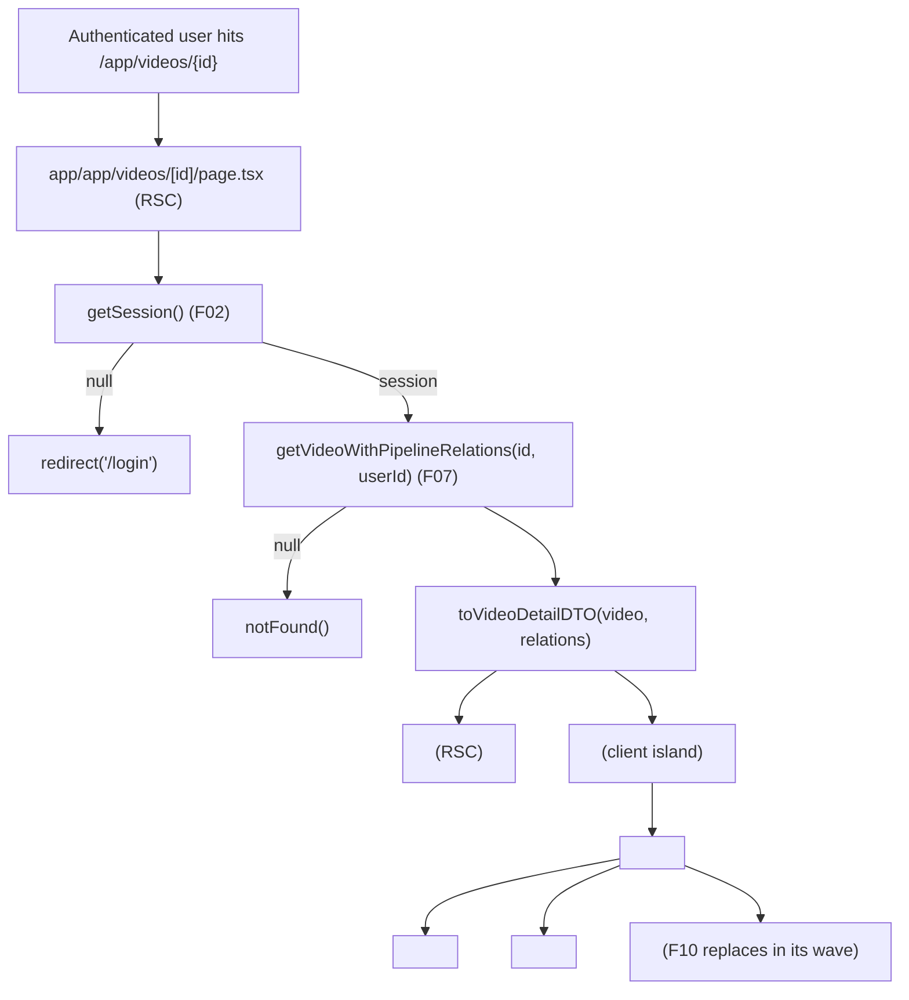
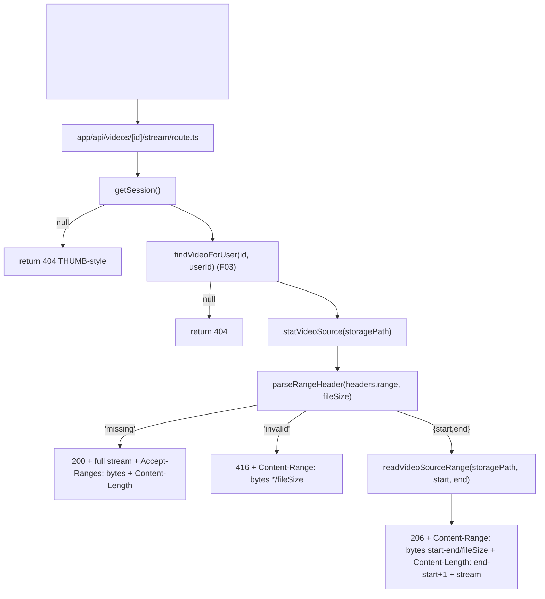
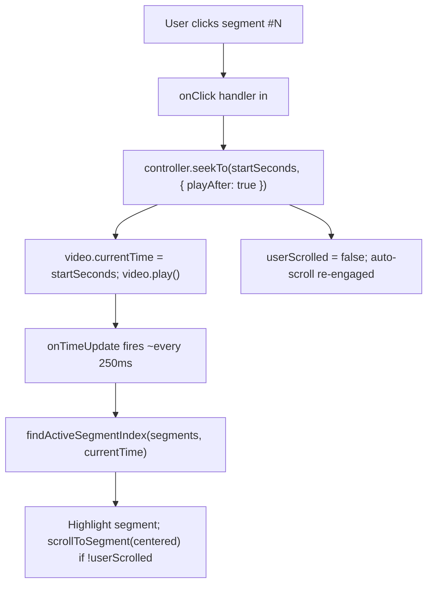
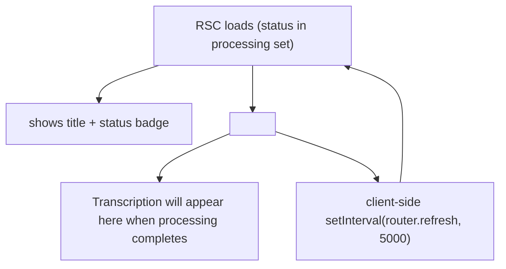
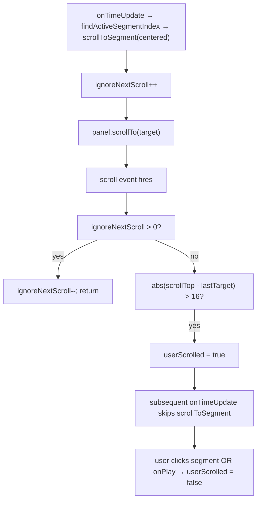

# F08. Video Player with Transcription Panel — Technical Specification

**Scope tag:** full scope — no Core/Full split (PRD has neither a `Core Scope` block nor a `Full Scope additions` block for F08, so the entire feature definition is in scope)

**Complexity:** complex

---

## 1. Technical Overview

**What:** Implement the authenticated video detail experience at `/app/videos/{id}` that replaces the F04-shipped placeholder (`app/app/videos/[id]/page.tsx`) with the three-region layout called out by the PRD: a streaming HTML5 video player on the left (~60% of viewport width on wide screens), a scrollable transcription panel on the right (~40%) whose segments are click-to-seek and auto-scroll with the playhead, and the AI summary block below the player (F10 will fill the summary content — F08 ships the slot and the bordering layout). F08 also owns the detail-page header (back link, inline-editable title that reuses F04's `<RenameField />`, description editor that reuses F04's `<DescriptionModal />`, current folder placeholder, tag placeholder, delete action that reuses F04's `<DeleteConfirmModal />`, and a Retry action that calls F07's `/api/videos/{id}/retry`), and the "still-processing" and "failed" branches that render the current pipeline stage plus the explanatory message in place of the player + panel. A new authenticated HTTP Range-aware Route Handler at `/api/videos/{id}/stream` serves the stored source file so the `<video>` element can progressively buffer and seek without the file ever being exposed publicly; like F03's thumbnail handler, it performs session + ownership checks on every request. Finally, F08 exposes a typed "player controller" context (seek controller + rendered transcription panel state) that F09's search and F10's summary consume without touching the `<video>` element directly.

**Why:** F08 is the Wave 4 feature that unlocks the single most important user goal of the product: watching a ready video while navigating its transcription. Every upstream feature up to now (F03 upload, F04 library, F07 pipeline) has been feeding into this moment, and two downstream features (F09 in-video search, F10 summary rendering) read directly from the surfaces F08 introduces. The detail route already exists as a stub created by F04 (it renders the status + title for still-processing rows and a short "Playable detail coming in F08" note for ready rows), so F08's job is to replace the body while keeping the authentication, ownership check, and header shell that F04 already put in place. Because the PRD says "the page loads the video lazily; playback can start before the full file is buffered," the player must use HTTP Range requests against a private, auth-checked endpoint — the existing thumbnail Route Handler (`app/api/videos/[id]/thumbnail/route.ts`) is the direct pattern for the new `/api/videos/{id}/stream` handler (`getSession` → `findVideoForUser` → stream or 404), extended to honor the `Range` request header and to return `206 Partial Content` with the correct `Content-Range`, `Accept-Ranges: bytes`, and chunked bytes. The rest of the feature is a client island: native HTML5 `<video>` plus custom control bar (so shortcuts and segment-sync can be wired reliably without a third-party library), a virtualized-when-needed transcription list with highlight + auto-scroll + manual-scroll suspension, a provider component (`PlayerControllerProvider`) that exports `seekTo(seconds)` and the list of `VideoSegmentDTO`s to F09/F10, and the same keyboard-shortcut listeners the PRD specifies (space toggles play, `←`/`→` seek ±5 s), scoped to the player region via `data-player-area` + focus gating so they do not fire when the user is typing in a form field or searching in F09.

**Scope:**

Included:
- Replace the body of `app/app/videos/[id]/page.tsx` (the F04 placeholder) with a full three-region detail layout: header bar (breadcrumb/back, title with inline rename, description edit trigger, folder label slot, tag chips slot, delete, retry-on-failed), main grid (player on the left, transcription panel on the right), and a summary section below the player (F10 renders into it)
- New Route Handler `app/api/videos/[id]/stream/route.ts` that streams the private video file via HTTP `GET` with full `Range` support (returns `200 OK` + full file when no `Range` header; `206 Partial Content` + bytes for a valid `Range: bytes=start-end`; `416 Range Not Satisfiable` for an out-of-range request); auth + ownership mirrored from the existing thumbnail handler
- New server-side helper `readVideoSourceRange(absOrRelPath, start, end)` (extends `app/_lib/videos/storage.ts`) that opens a `ReadStream` for the requested byte slice, validates the path stays inside `VIDEO_STORAGE_ROOT`, and returns `{ stream, size, contentRange }`
- New DTO builder `toVideoDetailDTO(row, relations)` (in `app/_lib/videos/detail.ts`) that returns everything the detail page needs on first paint in one serialized shape: video metadata (`id`, `title`, `description`, `durationSeconds`, `status`, `createdAt`, `sizeBytes`, `containerFormat`), detected language, ordered transcription segments (when present), current pipeline stage (for still-processing / failed videos), whether the summary exists (a boolean; F10 owns the summary content shape), and the streaming/thumbnail URL strings
- Reuse (not re-author) `findVideoForUser`, `getVideoWithPipelineRelations`, `getSession`, `StatusBadge`, `RenameField`, `DescriptionModal`, `DeleteConfirmModal`, `ContextMenu` (for the header "More" popover), `formatDuration` from F02/F03/F04/F07
- A new client island tree: `<PlayerShell />` is the only `"use client"` island on the page; it composes `<VideoPlayer />` (native `<video>` + `<PlayerControlBar />`), `<TranscriptionPanel />`, and re-exports the `PlayerControllerProvider` that wraps both so F09 and F10 can read from a shared context
- `<VideoPlayer />`: native HTML5 `<video>` element with `src="/api/videos/{id}/stream"`, `preload="metadata"`, `playsInline`, controls hidden via `controls={false}` so we render the custom control bar instead; wired to the provider via refs and `onTimeUpdate`/`onDurationChange`/`onPlay`/`onPause`/`onEnded`/`onError` handlers
- `<PlayerControlBar />`: custom controls for Play/Pause, current-time / total-time readout (`MM:SS` / `HH:MM:SS`), seek bar (`<input type="range">` bound to `currentTime`), volume slider + mute toggle, playback-speed selector (options: 0.5x, 0.75x, 1x, 1.25x, 1.5x, 2x; default 1x), and fullscreen toggle; the bar is rendered below the `<video>` element inside the same focus container so the keyboard shortcuts fire while the user interacts with either
- Keyboard shortcuts registered on the `<PlayerShell />` root (not `window`) via a `useEffect` with `keydown` listener gated by (a) the event target NOT being an `<input>`, `<textarea>`, `<select>`, or `contentEditable` element, and (b) `document.activeElement` being inside `data-player-area` or the player being the most-recently-clicked region (tracked via a `focused` state set on player click and cleared on panel click): Space toggles play/pause, ArrowLeft seeks `-5` s (clamped at 0), ArrowRight seeks `+5` s (clamped at duration); `e.preventDefault()` is called when the shortcut fires to avoid scroll
- `<TranscriptionPanel />`: fixed-height right-column list of segments (each shows `MM:SS` start timestamp left-aligned and the segment text right-aligned), detected-language label near the panel title (for example, `EN`, `PT-BR` — normalized from `detectedLanguage` via `normalizeLanguageLabel`), click handler that calls `seekTo(segment.startSeconds)` and resumes playback, highlight on the segment whose `[startSeconds, endSeconds)` range contains the current playhead, and auto-scroll that centers the active segment in the panel's scroll container
- Manual-scroll suspension: the panel subscribes to its own `scroll` event and, when `scrollTop` drifts by more than a configurable delta from the auto-scroll-driven target (default 16 px), flips a `userScrolled` ref to `true`; auto-scroll is suspended until either (a) the user clicks any segment (explicit re-engage) or (b) playback transitions from paused → playing (`onPlay` resets the flag); the hook only treats scroll deltas originating from user input (the program-driven `scrollTo` call bumps an `ignoreNextScroll` counter before dispatching to avoid false positives)
- Virtualization: when `segments.length <= PANEL_VIRTUALIZE_THRESHOLD` (default `500`), render all segments; above it, render via a lightweight windowed list that keeps ~20 segments in the DOM (buffer above + below). The threshold is conservative (Whisper on a 2-hour video at one segment per ~5–10 s yields ~800–1400 segments) and is documented in Assumptions
- Lazy-load: the `<video>` element uses `preload="metadata"` so only the duration + codec header is fetched on first paint; playback starts fetching bytes when the user hits Play or clicks a segment, and the browser's Range requests back-fill beyond the current playhead progressively
- `PlayerControllerProvider` (context): exposes `{ seekTo(seconds: number, opts?: { playAfter?: boolean }): void, currentTime: number, duration: number, isPlaying: boolean, segments: VideoSegmentDTO[], activeSegmentIndex: number | null, focusPanelSegment(index: number): void }`. F08's own transcription panel consumes the same context via `usePlayerController()`; F09 (in-video search) and F10 (summary, when it wants to link key-topic jumps) will consume the same hook without knowing about the `<video>` ref
- Still-processing branch (`status` ∈ {`validating`, `transcribing`, `summarizing`}): the body shows a centered card with the current stage name, the PRD explanatory message "Transcription will appear here when processing completes", and a live status label refreshed via `router.refresh()` every 5 s (no SSE here — F07's SSE endpoint is F11's responsibility; for F08 the periodic RSC refetch is enough to reflect a stage transition without leaving the page)
- Failed branch (`status = 'failed'`): the body shows "Processing failed" plus the last error reason from `video_job.last_error_message` (fallback: the generic reason per PRD Section 6 F07 Error Handling, mapped from `last_error_code`), a Retry button that posts to `/api/videos/{id}/retry` (F07's existing endpoint) and then `router.refresh()`, and a Delete button that opens `<DeleteConfirmModal />`
- Header actions: reuse `<RenameField />` (in inline mode on the title), reuse `<DescriptionModal />` (triggered by "Edit description"), reuse `<DeleteConfirmModal />` (triggered by "Delete"), Retry (only on `failed`), a folder label slot that reads `null` at F08 time (filled later by F05) and a tag chip slot (filled later by F06); no folder/tag edit interactions ship in F08 because F05/F06 are Wave 4 with F08
- Provider contract: `app/_lib/player/controller.ts` exports the React context + `usePlayerController` hook + the `VideoSegmentDTO` type so F09 can `useContext` it without circular imports from `_components/player/`
- Error boundaries: a thin `<PlayerErrorBoundary />` that catches client errors from the media element (`<video onError>`) and shows "Video could not be loaded — please retry"; ownership failures and 404 from the Route Handler are handled by the RSC (404 → `notFound()`)
- Unit tests for the Range header parser, the segment-to-active-index mapper, the manual-scroll suspension hook, the language-label normalizer, the control-bar rendering, the keyboard shortcut gating, the segment highlight + auto-scroll hook, the focus-gating, the controller context; integration tests for the stream Route Handler against the `testcontainers` Postgres + a `tmpdir` source file (Range, out-of-range, 401, 404, unauthorized-user); Playwright E2E for the user-visible PRD criteria (play/pause via keyboard, click-to-seek, highlight visible, auto-scroll active, still-processing branch renders the stage)

Excluded (handled by other features or explicitly out of scope per PRD Section 7):
- In-video transcription search box, match counter, next/previous navigation — F09 (F08 exposes the segment list + seek controller it will consume)
- AI summary rendering (overview paragraph + key-topic bullets) — F10 (F08 ships the layout slot below the player; F10 fills it)
- Folder assignment and folder label wiring — F05 (the header reserves a folder label slot that renders nothing until F05 attaches to it)
- Tag assignment and tag chip wiring — F06 (the header reserves a tag chip slot that renders nothing until F06 attaches to it)
- Real-time stage transitions via SSE from F07 — F11 will consume the SSE endpoint; F08 uses a cheap 5 s `router.refresh()` poll on the still-processing branch and relies on `router.refresh()` fired by the Retry button on the failed branch
- Video transcoding, alternative renditions, HLS manifest generation — not in PRD; F08 streams the source file bytes as stored by F03
- Captions track (VTT) rendered over the video — PRD routes captions into the transcription panel instead of as a video text track overlay
- Picture-in-picture, mini-player, floating player when scrolling away — not in PRD
- Download source video or transcription — PRD Section 7 excludes it
- Summary edit / transcription edit — PRD Section 7 excludes editing
- Multi-bitrate or adaptive streaming — not in PRD; progressive Range-based playback of the source file is what the `<video>` element and the PRD call for

---

## 2. Architecture Impact

**Affected components:**

| Path | Role |
|------|------|
| `app/app/videos/[id]/page.tsx` | Modified — replace the F04 placeholder body with the full three-region layout (header + player shell + summary slot); still an RSC; still calls `getSession()` + `getVideoWithPipelineRelations()`; hydrates a single `<PlayerShell />` client island |
| `app/_lib/videos/detail.ts` | New — server-side DTO builder for the detail page; `toVideoDetailDTO(row, relations)` returns `VideoDetailDTO`; lives beside `library.ts` to reuse its `VideoListItemDTO` shape + helpers |
| `app/_lib/videos/storage.ts` | Modified — add `readVideoSourceRange(storagePath, range)` that opens a Node `ReadStream` at `{ start, end }`, validates the path stays inside `VIDEO_STORAGE_ROOT`, and returns `{ stream, size, fileSize }`; also a `statVideoSource(storagePath)` helper used to resolve the full file size when no `Range` is provided |
| `app/api/videos/[id]/stream/route.ts` | New — Node-runtime `GET` Route Handler; session + ownership guards mirrored from the thumbnail handler; parses the `Range` header; returns `200`/`206`/`416` with the correct streaming headers |
| `app/_lib/player/range.ts` | New — pure function `parseRangeHeader(header: string \| null, fileSize: number)` → `{ start, end } \| 'invalid' \| 'missing'`; used by the Route Handler and unit-tested directly |
| `app/_lib/player/controller.ts` | New — React context + `PlayerControllerProvider` + `usePlayerController` + `VideoSegmentDTO` type + the `PlayerController` API; lives under `_lib/` (not `_components/`) because F09/F10 import the hook from here |
| `app/_lib/player/language.ts` | New — `normalizeLanguageLabel(code: string \| null): string` (e.g., `en` → `EN`, `pt` → `PT`, `pt-BR` → `PT-BR`, `null` → `"—"`); unit-tested |
| `app/_lib/player/timing.ts` | New — pure helpers: `findActiveSegmentIndex(segments, currentTime)`, `clampSeek(next, duration)`; both pure and unit-tested |
| `app/_components/player/PlayerShell.tsx` | New — `"use client"`; composes the provider, player, control bar, transcription panel; owns the top-level focus region (`data-player-area`) and the `focused` state used by keyboard gating |
| `app/_components/player/VideoPlayer.tsx` | New — renders the native `<video>` element bound to the controller; wires `onTimeUpdate`, `onDurationChange`, `onPlay`, `onPause`, `onEnded`, `onError`; exposes a `seek` imperative via the controller |
| `app/_components/player/PlayerControlBar.tsx` | New — Play/Pause, time readout, seek bar, volume + mute, playback-speed selector, fullscreen toggle; all visuals in Tailwind v4 tokens; a11y roles |
| `app/_components/player/PlayerKeyboardShortcuts.tsx` | New — `"use client"`; installs the `keydown` listener scoped to the shell; wraps the Space/Left/Right logic and the focus-gating predicate |
| `app/_components/player/TranscriptionPanel.tsx` | New — scroll container + segment list + virtualization toggle; owns `userScrolled` ref and the scroll-delta detector |
| `app/_components/player/TranscriptionSegmentItem.tsx` | New — presentational `<li>` with `MM:SS` timestamp + text + highlight state; `onClick` calls `seekTo(segment.startSeconds, { playAfter: true })` and `focusPanelSegment(index)` |
| `app/_components/player/VirtualizedSegmentList.tsx` | New — lightweight windowed renderer activated when `segments.length > PANEL_VIRTUALIZE_THRESHOLD`; renders a top-spacer, the visible window, and a bottom-spacer; no external virtualization dependency |
| `app/_components/player/LanguageBadge.tsx` | New — tiny pill near the transcription panel heading; reads `detectedLanguage` via `normalizeLanguageLabel` |
| `app/_components/player/ProcessingStageCard.tsx` | New — renders the "Transcription will appear here when processing completes" message for still-processing videos; reads `status` and the current stage and pairs with the header |
| `app/_components/player/FailedStateCard.tsx` | New — renders the "Processing failed" card with the reason + Retry button that posts to `/api/videos/{id}/retry` + Delete trigger (opens `<DeleteConfirmModal />`) |
| `app/_components/player/DetailHeader.tsx` | New — RSC-driven header with back link, title (via `<RenameField />`), description (via `<DescriptionModal />`), folder slot, tag slot, Retry (failed only), Delete (via `<DeleteConfirmModal />`); reuses F04's existing components |
| `app/_components/player/SummaryPlaceholder.tsx` | New — a small "Summary will appear here once processing completes" block that F10 will later replace; F08 ships the slot so the layout renders correctly in both the processing and the post-summary states |
| `app/_components/player/PlayerErrorBoundary.tsx` | New — `"use client"`; React error boundary around the `<VideoPlayer />` that falls back to "Video could not be loaded — please retry" |
| `app/_components/player/__tests__/*` | New — component tests per Testing Strategy |
| `app/_lib/player/__tests__/*` | New — unit tests for `range.ts`, `language.ts`, `timing.ts`, `controller.ts` |
| `app/_lib/videos/__tests__/detail.test.ts` | New — `toVideoDetailDTO` mapper tests |
| `app/_lib/videos/__tests__/storage.stream.test.ts` | New — `readVideoSourceRange` and `statVideoSource` tests against a tmpdir |
| `app/api/videos/[id]/stream/__tests__/route.integration.test.ts` | New — integration tests for the stream Route Handler (Range, out-of-range, auth, ownership) |
| `e2e/video-detail.spec.ts` | New — Playwright coverage for the user-visible PRD Section 9 F08 criteria (layout present, click-to-seek updates time, keyboard shortcuts, still-processing branch) |
| `app/_lib/videos/repository.ts` | Re-used (no change) — `getVideoWithPipelineRelations` already returns `{ video, job, transcription: { segments }, summary, events }` |
| `app/_lib/session.ts` | Re-used (no change) |
| `app/_lib/videos/status.ts` | Re-used (no change) |
| `app/_lib/videos/formatting.ts` | Re-used (no change) — `formatDuration` is already the MM:SS / HH:MM:SS formatter |

**Data flow — first paint of `/app/videos/{id}` (ready video):**



**Data flow — video streaming (Range request):**



**Data flow — click-to-seek:**



**Data flow — keyboard shortcut gating:**

```mermaid
graph TD
    K["keydown event"] --> Target["Is target <input>/<textarea>/<select>/contentEditable?"]
    Target -->|"yes"| Ignore["Ignore"]
    Target -->|"no"| Focus["Is document.activeElement inside data-player-area OR focused=true?"]
    Focus -->|"no"| Ignore
    Focus -->|"yes"| Switch["key?"]
    Switch -->|"Space"| Toggle["togglePlay(); preventDefault"]
    Switch -->|"ArrowLeft"| Back["seekTo(clampSeek(currentTime-5, duration)); preventDefault"]
    Switch -->|"ArrowRight"| Fwd["seekTo(clampSeek(currentTime+5, duration)); preventDefault"]
```



**Data flow — still-processing branch:**



**Data flow — manual-scroll suspension:**



---

## 3. Technical Decisions

| Decision | Chosen Approach | Alternative Considered | Trade-off |
|----------|-----------------|------------------------|-----------|
| Streaming strategy | Progressive HTTP Range requests against a new private Route Handler (`/api/videos/{id}/stream`) that returns the stored source file with `206 Partial Content` | HLS (chunked `.ts` + `m3u8` manifest), presigned object-store URLs, public filesystem | No transcoding dependency, no third-party player runtime, works with every modern browser's native `<video>`. PRD says "local filesystem" storage and "playback can start before the full file is buffered" — Range on the source satisfies both. HLS would require F07 to produce a second rendition and add `hls.js`; not in PRD. Documented in Assumptions |
| Player library | Native HTML5 `<video>` + custom React control bar | `video.js`, `plyr`, `react-player`, `hls.js` | Zero new runtime dependencies; total control over the seek behavior the PRD requires (click-to-seek from a transcription segment); custom bar is ~150 LOC of Tailwind. Third-party players would have to be forced to expose the same imperative `seek(seconds)` API the provider needs. Documented in Assumptions |
| Seek target semantics | `video.currentTime = seekTarget` is always followed by a `play()` attempt when called from a segment click, and ignores the play attempt when called from keyboard shortcut or search navigation | Always play, never play | PRD: "Clicking any transcription segment seeks the video to that segment's start time and resumes (or starts) playback" — explicit play. Arrow keys should not start playback if the video is paused — canonical media player behavior |
| Transcription panel virtualization | Render all segments when `segments.length <= 500`; switch to a windowed renderer above that threshold | Always virtualize; never virtualize | At PRD scale (≤ 2 h video at Whisper's ~5–10 s segments ≈ 800–1400 segments) virtualization matters; for shorter videos the simpler non-virtualized path avoids the windowing bug surface. Documented in Assumptions |
| Virtualization library | In-house lightweight windowed list component | `react-window`, `@tanstack/react-virtual` | The panel is a flat list with uniform-height estimate; a ~80 LOC windowed renderer suffices and keeps the dependency surface zero. Swappable if a richer layout is ever needed |
| Auto-scroll trigger | `onTimeUpdate` → compute active index via `findActiveSegmentIndex` → if index changed AND `!userScrolled`, call `panel.scrollTo(centeredOffset)` | `requestAnimationFrame` polling loop | `onTimeUpdate` fires at ~4 Hz on every browser (enough to keep the highlight smooth), and only firing on index changes avoids layout thrash |
| Active segment detection | Binary search over segments by `startSeconds` (since Whisper delivers them ordered); O(log n) per time update | Linear scan | O(log n) is cheap, but more importantly it avoids re-scanning from segment 0 on every tick which a naive `findIndex` would do for long videos |
| Manual-scroll suspension state | Plain refs + a single `ignoreNextScroll` counter incremented before programmatic scroll and decremented on the next scroll event | `IntersectionObserver`, complex state machine | Simple to reason about, survives fast time updates, does not rely on DOM visibility checks. The 16 px threshold is forgiving enough to ignore momentum-scroll noise without missing a deliberate drag. Documented in Assumptions |
| Re-engage auto-scroll | On segment click OR on paused → playing transition | On each 1-second tick, on explicit user button | PRD: "resumes after the user clicks a segment or playback pauses and resumes" — matches exactly |
| Keyboard shortcut gating | Global `keydown` listener filtered by: (a) target not in form field / contentEditable, (b) `document.activeElement` inside `data-player-area` OR player focus state | Listener bound only to the `<video>` element | Native `<video>` swallows Space/Arrow keys unpredictably across browsers; a shell-level listener with explicit focus gating is reliable and matches the PRD criterion "active only when the player has focus" |
| Detected language label source | `Transcription.detectedLanguage` column from F07 (ISO 639-1 like `en`, `pt`); normalized to uppercase 2–5 chars for display (`EN`, `PT`, `PT-BR`) | Hard-coded "EN"; Accept-Language header; client browser language | F07 already stores the detected code; F08 simply reads and formats it. Documented in Assumptions |
| DTO shape | Single `VideoDetailDTO` returned by `toVideoDetailDTO` serializes every field the client needs on first paint (video metadata, segments, detected language, pipeline stage/error, has-summary boolean, streaming URL, thumbnail URL) | Separate fetches for video / transcription / summary from the client | One query server-side, one serialization hop; avoids a client waterfall. Matches the F04 single-DTO pattern for `VideoListItemDTO` |
| Summary integration | F08 reserves a `<SummaryPlaceholder />` slot; F10 replaces it by importing the same slot position; `VideoDetailDTO.hasSummary` is a boolean so F08 can render "Summary not yet generated" without depending on F10's shape | F08 ignores the summary entirely; F10 adds the section separately | The two features live in the same page and wave; carving out a named slot prevents layout drift when F10 lands |
| Header action reuse | Import `<RenameField />`, `<DescriptionModal />`, `<DeleteConfirmModal />`, `<ContextMenu />` from `app/_components/library/` verbatim | Re-author detail-specific variants | The F04 components are already parametric on `videoId`/`videoTitle`; reusing them keeps behavior and tests in sync across library and detail |
| Retry entry-point | Header Retry button posts to `/api/videos/{id}/retry` (F07's existing Route Handler) | Re-implement via a Server Action | F07 is Wave 3 (already implemented) and exposes the endpoint; reusing it keeps F08 a pure consumer |
| Still-processing refresh | `setInterval(router.refresh, 5000)` on the still-processing branch only | SSE consumer, `Tanstack Query`, WebSocket | F11 owns real-time; for a detail page the user lands on, a 5 s interval is "fast enough" and costs one `GET` to `/app/videos/{id}` every 5 s per open tab. F11 will eventually replace this with SSE, but F08 ships independent of F11 |
| Route Handler runtime | `runtime = 'nodejs'` | Edge | `ReadStream` and `fs.createReadStream` are Node-only; matches the thumbnail handler |
| `Content-Length` / `Accept-Ranges` headers | Always include `Accept-Ranges: bytes`; always include `Content-Length` on `200` and `206`; include `Content-Range` on `206` and `416` | Drop `Content-Length` for streams | Without `Content-Length` some browsers refuse to seek; the file size is known from `stat` |
| Out-of-range semantics | Out-of-range Range returns `416` with `Content-Range: bytes */fileSize` and an empty body | Silently clamp | Matches RFC 7233; browsers interpret the 416 and fall back to a fresh request |
| Range parser location | Pure function in `app/_lib/player/range.ts`, directly unit-tested | Inline in the route | Regex + size math is the bug surface; isolating it in a pure module pays back the indirection |
| Segment item timestamp format | `MM:SS` for videos under 1 hour, `HH:MM:SS` otherwise | Always `HH:MM:SS` | Consistent with F04's duration overlay; the formatter already exists in `app/_lib/videos/formatting.ts` |
| Playback speed options | Fixed list `[0.5, 0.75, 1, 1.25, 1.5, 2]`; default `1` | Free-form number input | PRD enumerates exactly these values |
| Volume + mute | Slider (0–1) + mute toggle; persist to `localStorage` under `videomax:playerVolume` and `videomax:playerMuted` so preferences survive reloads | Persist to `user` table | The PRD does not require cross-device persistence; local storage is enough and keeps the DB schema minimal. Documented in Assumptions |
| Fullscreen | Native `HTMLVideoElement.requestFullscreen()` on the player container (not on `<video>` alone so the control bar is still visible) | API on the `<video>` itself | A fullscreen `<video>` without the custom controls means the PRD's speed selector and timestamp are hidden while fullscreen; wrapping the shell keeps the full UX |
| Provider placement | `app/_lib/player/controller.ts` (not `_components/`) | Colocate with `<PlayerShell />` | F09 and F10 import `usePlayerController` from here; keeping the context in a shared path avoids circular imports between `_components/search/*` and `_components/player/*` |
| Segment ordering | Trust the `segment_index` column from F07; do not re-sort client-side | Sort on the fly | F07 guarantees ordering via `ux_transcription_segment_order` UNIQUE; re-sorting wastes cycles |
| Error handling for streaming 500s | Client `<video onError>` flips a state flag and the shell renders `<PlayerErrorBoundary />` fallback; Retry button does a `router.refresh()` to re-issue the metadata request | Full-page error | Keeping the user on the page preserves their scroll position in the transcription |
| Tests for the client islands | React Testing Library for interaction + a `HTMLMediaElement` jsdom shim for `play` / `pause` / `currentTime` (jsdom does not implement media) | Cypress only | Existing F02/F03/F04 pattern; keeps the unit + integration split; E2E covers the actual browser media element in Playwright |
| Stream handler tests | `testcontainers` Postgres for ownership + a `tmpdir` file for the byte slice; direct invocation of the Route Handler's `GET` with a fabricated `NextRequest` | Playwright end-to-end | Faster feedback; the actual byte-range math is the risk, not the network |

---

## 4. Component Overview

**Frontend (App Router):**

| File Path | New/Modified | Purpose | Key Responsibilities |
|-----------|--------------|---------|----------------------|
| `app/app/videos/[id]/page.tsx` | Modified | Detail RSC | Calls `getSession()`, redirects to `/login` if absent; calls `getVideoWithPipelineRelations(id, userId)`; on null → `notFound()`; calls `toVideoDetailDTO`; renders `<DetailHeader />` + (if processing) `<ProcessingStageCard />` or (if failed) `<FailedStateCard />` or (if ready) `<PlayerShell />` with the serialized DTO |
| `app/_components/player/PlayerShell.tsx` | New | Root client island | `"use client"`; composes `<PlayerControllerProvider>` → `<VideoPlayer />` + `<PlayerControlBar />` + `<TranscriptionPanel />` + `<SummaryPlaceholder />` + `<PlayerKeyboardShortcuts />`; owns the `data-player-area` wrapper div; sets `focused` on click |
| `app/_components/player/VideoPlayer.tsx` | New | Media element | Renders `<video src='/api/videos/{id}/stream' preload='metadata' playsInline>`; binds refs to the controller; handles `onTimeUpdate`, `onDurationChange`, `onPlay`, `onPause`, `onEnded`, `onError`; exposes `ref.current.seek(s)` and `play()/pause()` to the controller |
| `app/_components/player/PlayerControlBar.tsx` | New | Custom controls | Play/Pause button, time readout (`formatDuration`), seek range, volume slider + mute, playback-speed selector (0.5x–2x), fullscreen toggle; fully a11y-labeled |
| `app/_components/player/PlayerKeyboardShortcuts.tsx` | New | Global shortcut installer | `useEffect` with `keydown` listener; focus-gating predicate; Space/Arrow handlers; no DOM of its own |
| `app/_components/player/TranscriptionPanel.tsx` | New | Panel container | Fixed-height scroll container with the language badge + search-slot (F09 plugs in) + the list (virtualized above threshold); owns `userScrolled` ref + `ignoreNextScroll` counter |
| `app/_components/player/TranscriptionSegmentItem.tsx` | New | Segment row | Presentational; timestamp on the left (`formatDuration(startSeconds)`), text on the right; `data-active` when highlighted; clicking calls `seekTo(startSeconds, { playAfter: true })` |
| `app/_components/player/VirtualizedSegmentList.tsx` | New | Windowed list | When above threshold, renders `{topSpacer, visible items, bottomSpacer}`; listens to panel scroll to compute visible range; cushions ~5 items above/below |
| `app/_components/player/LanguageBadge.tsx` | New | Detected-language pill | `normalizeLanguageLabel(code)`; small `<span>` near the panel heading |
| `app/_components/player/ProcessingStageCard.tsx` | New | Still-processing body | Card with the current stage (`validating` / `transcribing` / `summarizing`), the PRD copy, and a 5 s `router.refresh()` interval |
| `app/_components/player/FailedStateCard.tsx` | New | Failed body | Card with the reason, a Retry button that `POST`s to `/api/videos/{id}/retry` then `router.refresh()`, and a Delete trigger |
| `app/_components/player/DetailHeader.tsx` | New | Header | Back link, `<StatusBadge />`, title via `<RenameField />`, description via `<DescriptionModal />` trigger, folder slot (no-op today), tag slot (no-op today), Retry (failed only), Delete (opens `<DeleteConfirmModal />`); RSC-first with small client wrappers for the modals |
| `app/_components/player/SummaryPlaceholder.tsx` | New | Summary slot | Renders nothing visible when `hasSummary === false` (processing); renders an "Summary will appear here" card when `hasSummary === false` on a ready video (transient window before F10 ships); F10 replaces this component in its wave |
| `app/_components/player/PlayerErrorBoundary.tsx` | New | Error boundary | `"use client"`; catches render errors from `<VideoPlayer />`; fallback UI with a Retry button |

**Backend (server-side modules + Route Handlers):**

| File Path | New/Modified | Purpose | Key Responsibilities |
|-----------|--------------|---------|----------------------|
| `app/_lib/videos/detail.ts` | New | DTO builder | `toVideoDetailDTO(row: VideoWithPipelineRelations): VideoDetailDTO`; serializes `BigInt`, `Decimal`, `Date`; maps segments; derives `streamUrl`, `thumbnailUrl`, `hasSummary`, `lastErrorMessage`, normalized `detectedLanguage` |
| `app/_lib/videos/storage.ts` | Modified | Range streaming helpers | Add `statVideoSource(storagePath)` and `readVideoSourceRange(storagePath, start, end)`; guard that `path.resolve(abs).startsWith(storageRoot)`; never throw on user input — return `null` for missing |
| `app/api/videos/[id]/stream/route.ts` | New | Video streaming handler | Node runtime; `GET` with auth + ownership; `parseRangeHeader`; responds with 200 / 206 / 416; correct `Accept-Ranges`, `Content-Range`, `Content-Length`, `Content-Type` (from `containerFormat`); `Cache-Control: private, no-store` |
| `app/_lib/player/range.ts` | New | Range parser | `parseRangeHeader(header, fileSize)` returning `{ start, end }` / `'invalid'` / `'missing'`; supports `bytes=start-`, `bytes=start-end`, `bytes=-suffix`; clamps `end` to `fileSize - 1` |
| `app/_lib/player/controller.ts` | New | Player controller | React context + `PlayerControllerProvider` + `usePlayerController` hook + `VideoSegmentDTO` type; API: `seekTo(seconds, opts?)`, `togglePlay()`, `isPlaying`, `currentTime`, `duration`, `segments`, `activeSegmentIndex`, `focusPanelSegment(index)` |
| `app/_lib/player/timing.ts` | New | Timing helpers | `findActiveSegmentIndex(segments, currentTime)` (binary search over `startSeconds`); `clampSeek(next, duration)` |
| `app/_lib/player/language.ts` | New | Language normalizer | `normalizeLanguageLabel(code)` maps ISO 639-1 + optional region to uppercase label |
| `app/_lib/videos/repository.ts` | Re-used | Detail data | `getVideoWithPipelineRelations` already returns everything we need |

**Database:**

F08 introduces no schema changes. It reads from existing tables (`video`, `transcription`, `transcription_segment`, `summary`, `video_job`) established by F03 and F07. The existing indexes cover its queries:

| Existing Index | Used by |
|---|---|
| `ix_video_user_id_created_at` | (indirect) RSC page navigation from the library |
| `ux_transcription_segment_order` | Ordered segment fetch inside `getVideoWithPipelineRelations` |
| `ix_transcription_segment_time` | Future-proofing (binary search on segments is client-side but the DB index helps any future server-side jumps) |

No migration is part of F08.

**Static assets:**

F08 ships no new static assets. The existing `/placeholder-thumbnail.jpg` served by F03's thumbnail route covers the edge case of a video without a custom thumbnail.

---

## 5. API Contracts

### Route Handler: Stream Video Source

- **Method:** `GET`
- **Path:** `/api/videos/[id]/stream`
- **Authentication:** session cookie (`getSession()`); 404 on unauthenticated request (matches the thumbnail handler, does not disclose existence)
- **Runtime:** Node.js
- **Dynamic:** `force-dynamic` (per-request session evaluation)

**Path parameters:**

| Field | Type | Required | Validation | Description |
|-------|------|----------|------------|-------------|
| `id` | `string` (cuid) | Yes | cuid shape | Target video id |

**Request headers:**

| Header | Required | Accepted values | Description |
|--------|----------|-----------------|-------------|
| `Cookie` | Yes | session cookie from F02 | Authenticated session |
| `Range` | No | `bytes=<start>-[<end>]` or `bytes=-<suffix>` | RFC 7233 byte range |

**Responses:**

| Scenario | Status | Headers | Body |
|----------|--------|---------|------|
| No session OR video not owned OR file missing | `404` | `Content-Type: application/json` | `{ "code": "VIDEO_STREAM_NOT_FOUND" }` |
| No Range header on a readable file | `200` | `Content-Type: video/<container>`, `Content-Length: <fileSize>`, `Accept-Ranges: bytes`, `Cache-Control: private, no-store` | Full stream body |
| Valid Range (in bounds) | `206` | `Content-Type: video/<container>`, `Content-Length: <end - start + 1>`, `Content-Range: bytes <start>-<end>/<fileSize>`, `Accept-Ranges: bytes`, `Cache-Control: private, no-store` | Sliced stream body |
| Range syntactically invalid or out of bounds | `416` | `Content-Range: bytes */<fileSize>`, `Cache-Control: private, no-store` | empty |

**Response example (successful Range request):**

```
HTTP/1.1 206 Partial Content
Content-Type: video/mp4
Content-Length: 1048576
Content-Range: bytes 0-1048575/524288000
Accept-Ranges: bytes
Cache-Control: private, no-store

<binary>
```

**Error codes:**

| Code | HTTP Status | Description |
|------|-------------|-------------|
| `VIDEO_STREAM_NOT_FOUND` | 404 | No session / not owner / missing file on disk |
| (no code body) | 416 | Range invalid or out of bounds |

**Content-Type mapping (from `video.containerFormat`):**

| `containerFormat` | `Content-Type` |
|---|---|
| `mp4` | `video/mp4` |
| `mov` | `video/quicktime` |
| `mkv` | `video/x-matroska` |
| `webm` | `video/webm` |
| `avi` | `video/x-msvideo` |

### Route Handler: (consumer) Video Retry

F08 does not add a retry endpoint — it consumes the existing `POST /api/videos/[id]/retry` introduced by F07. No new contract here; F08 calls it from the failed-state card with an empty body and handles `200` / `401` / `404` / `409` per F07's contract, then calls `router.refresh()`.

### Provider Contract: `PlayerController` (client-side API for F09 and F10)

Exported from `app/_lib/player/controller.ts` via the `usePlayerController()` hook. F09 imports this directly to implement seek-on-match; F10 imports `segments` and (optionally) `seekTo` to implement jumping from a key-topic to the first matching segment.

**Type:**

| Field | Type | Description |
|-------|------|-------------|
| `currentTime` | `number` | Current playhead in seconds |
| `duration` | `number` | Video duration in seconds (0 until metadata loads) |
| `isPlaying` | `boolean` | True when the element is actively playing |
| `segments` | `VideoSegmentDTO[]` | Ordered transcription segments; empty for a still-processing video |
| `activeSegmentIndex` | `number \| null` | Index into `segments` of the segment whose range contains `currentTime`; `null` when no segment matches |
| `detectedLanguage` | `string \| null` | Normalized language label (or `null` when not known) |
| `seekTo(seconds, opts?)` | `(seconds: number, opts?: { playAfter?: boolean }) => void` | Seeks the media element to `seconds` (clamped to `[0, duration]`) and optionally resumes playback |
| `togglePlay` | `() => void` | Play if paused, pause if playing |
| `focusPanelSegment` | `(index: number) => void` | Scrolls the transcription panel so segment `index` is centered (used by F09 next/prev navigation) |

**`VideoSegmentDTO` type:**

| Field | Type | Description |
|-------|------|-------------|
| `id` | `string` | Segment cuid (from `transcription_segment.id`) |
| `index` | `number` | `segment_index` from F07 |
| `startSeconds` | `number` | Segment start |
| `endSeconds` | `number` | Segment end |
| `text` | `string` | Segment text |

### Data shape consumed by the client: `VideoDetailDTO`

Serialized by the RSC and passed into `<PlayerShell initialDTO />`.

| Field | Type | Description |
|-------|------|-------------|
| `id` | `string` | Video cuid |
| `title` | `string` | Current title |
| `description` | `string` | Current description |
| `originalFilename` | `string` | Original upload filename |
| `sizeBytes` | `number` | Size in bytes |
| `durationSeconds` | `number \| null` | Duration (null for still-processing videos that have not yet been probed) |
| `containerFormat` | `string` | Lowercased extension |
| `status` | `VideoStatus` | One of `validating`, `transcribing`, `summarizing`, `ready`, `failed` |
| `currentStageLabel` | `string \| null` | Display label for the current pipeline stage (null when `ready`) |
| `streamUrl` | `string` | `/api/videos/{id}/stream` |
| `thumbnailUrl` | `string` | `/api/videos/{id}/thumbnail` |
| `createdAt` | `string` | ISO 8601 |
| `detectedLanguage` | `string \| null` | Normalized language label (e.g., `EN`) |
| `segments` | `VideoSegmentDTO[]` | Empty for not-yet-transcribed videos |
| `hasSummary` | `boolean` | True when the `summary` row exists |
| `lastErrorCode` | `string \| null` | `video_job.last_error_code` (failed rows only) |
| `lastErrorMessage` | `string \| null` | `video_job.last_error_message` or mapped reason |

---

## 6. Data Model

F08 adds no tables and no columns. It reads from the existing `video`, `transcription`, `transcription_segment`, `summary`, and `video_job` tables established by F03 and F07. All queries hit indexes already present:

- `video.ix_video_user_id_created_at` (F03) — not directly, but keeps the library → detail navigation fast
- `transcription_segment.ux_transcription_segment_order` (F07) — `getVideoWithPipelineRelations` fetches segments `orderBy: { segmentIndex: 'asc' }`
- `video_job` is accessed via Prisma's generated unique `video_id` index

No migration ships in F08.

**Cross-Database Notes:**
- Every Decimal/BigInt field in the DTO is serialized to `number` at the mapper boundary (same pattern as `toVideoListItemDTO`); no native type leaks into the client payload
- No new CHECK constraints — all validation lives in F08's Zod schemas and the reused F04 modals

---

## 7. Testing Strategy

F08 re-uses the Vitest + React Testing Library + `testcontainers` Postgres harness established by F02 and extended by F03, F04, and F07. The Route Handler integration test creates a tmpdir source file and exercises the handler via a fabricated `NextRequest`. The client components use a jsdom `HTMLMediaElement` shim (stub for `play`, `pause`, `currentTime` setter, `onTimeUpdate` dispatch) because jsdom does not implement media. The Playwright spec boots the dev server against the session's own `DATABASE_URL` and seeds a fixture video using the repository + `video-sample/video-test.mkv` fixture from CLAUDE.md so the `<video>` element actually loads bytes in a real browser.

**Test File Structure:**

| Test File | Test Type | Target | Coverage Goal |
|-----------|-----------|--------|---------------|
| `app/_lib/player/__tests__/range.test.ts` | Unit | `parseRangeHeader` | 100% branches |
| `app/_lib/player/__tests__/timing.test.ts` | Unit | `findActiveSegmentIndex`, `clampSeek` | 100% branches |
| `app/_lib/player/__tests__/language.test.ts` | Unit | `normalizeLanguageLabel` | 100% branches |
| `app/_lib/player/__tests__/controller.test.tsx` | Unit (component) | `PlayerControllerProvider`, `usePlayerController` | All branches |
| `app/_lib/videos/__tests__/detail.test.ts` | Unit | `toVideoDetailDTO` | All branches |
| `app/_lib/videos/__tests__/storage.stream.test.ts` | Integration (tmpdir) | `statVideoSource`, `readVideoSourceRange` | All branches + out-of-range |
| `app/api/videos/[id]/stream/__tests__/route.integration.test.ts` | Integration (Postgres + tmpdir) | `/api/videos/[id]/stream` Route Handler | All 200 / 206 / 416 / 404 paths |
| `app/_components/player/__tests__/VideoPlayer.test.tsx` | Unit (component) | `<VideoPlayer />` wiring to controller | All branches |
| `app/_components/player/__tests__/PlayerControlBar.test.tsx` | Unit (component) | Play/Pause, seek, volume, speed, fullscreen | All branches |
| `app/_components/player/__tests__/PlayerKeyboardShortcuts.test.tsx` | Unit (component) | Space/Arrow keys with focus gating | All branches |
| `app/_components/player/__tests__/TranscriptionPanel.test.tsx` | Unit (component) | Render, highlight, auto-scroll, manual-scroll suspension | All branches |
| `app/_components/player/__tests__/TranscriptionSegmentItem.test.tsx` | Unit (component) | Timestamp + text + click-to-seek | All branches |
| `app/_components/player/__tests__/VirtualizedSegmentList.test.tsx` | Unit (component) | Threshold branch + windowing | All branches |
| `app/_components/player/__tests__/LanguageBadge.test.tsx` | Unit (component) | Label + null fallback | All branches |
| `app/_components/player/__tests__/ProcessingStageCard.test.tsx` | Unit (component) | Stage label + refresh interval | All branches |
| `app/_components/player/__tests__/FailedStateCard.test.tsx` | Unit (component) | Reason + Retry + Delete | All branches |
| `app/_components/player/__tests__/DetailHeader.test.tsx` | Unit (component) | Rename trigger, description trigger, delete trigger, Retry (failed only) | All branches |
| `app/_components/player/__tests__/PlayerShell.test.tsx` | Unit (component) | Composition of provider + player + panel + summary | All branches |
| `app/app/videos/[id]/__tests__/page.integration.test.tsx` | Integration | RSC renders correct branch for each status | All branches |
| `e2e/video-detail.spec.ts` | E2E (Playwright) | User-visible PRD Section 9 F08 criteria | PRD criteria coverage |

**Per-file test functions:**

`app/_lib/player/__tests__/range.test.ts`

| Test Function | Description | Assertions |
|---|---|---|
| `range_missing_header_returns_missing` | Null header | Returns `'missing'` |
| `range_bytes_0_1023_returns_start_end` | `bytes=0-1023` | `{ start: 0, end: 1023 }` |
| `range_bytes_1024_returns_start_fileEnd` | `bytes=1024-` | `{ start: 1024, end: fileSize-1 }` |
| `range_bytes_suffix_500_returns_lastBytes` | `bytes=-500` | `{ start: fileSize-500, end: fileSize-1 }` |
| `range_end_beyond_filesize_is_clamped_to_fileEnd` | `bytes=0-99999999999` | `end = fileSize-1` |
| `range_start_beyond_filesize_returns_invalid` | `bytes=9999999999-` | Returns `'invalid'` |
| `range_negative_or_malformed_returns_invalid` | `bytes=abc-xyz`, `bytes=` | Returns `'invalid'` |
| `range_start_greater_than_end_returns_invalid` | `bytes=200-100` | Returns `'invalid'` |

`app/_lib/player/__tests__/timing.test.ts`

| Test Function | Description | Assertions |
|---|---|---|
| `find_active_returns_null_when_no_segment_contains_time` | Time before first segment | `null` |
| `find_active_returns_correct_index_mid_video` | Time inside segment #5 | `5` |
| `find_active_prefers_earlier_segment_on_boundary` | `currentTime === segment[N].endSeconds` | `N` (half-open range) |
| `find_active_binary_search_stays_logN` | 10 000 segments | Returns correct index under 1 ms |
| `clamp_seek_below_zero_returns_zero` | `-5` | `0` |
| `clamp_seek_above_duration_returns_duration` | `duration + 10` | `duration` |
| `clamp_seek_inside_range_passes_through` | `120.5` | `120.5` |

`app/_lib/player/__tests__/language.test.ts`

| Test Function | Description | Assertions |
|---|---|---|
| `language_null_returns_em_dash` | `null` | `"—"` |
| `language_en_returns_EN` | `"en"` | `"EN"` |
| `language_pt_br_returns_PT_BR` | `"pt-BR"` | `"PT-BR"` |
| `language_unknown_returns_uppercased_3` | `"xx"` | `"XX"` |

`app/_lib/player/__tests__/controller.test.tsx`

| Test Function | Description | Assertions |
|---|---|---|
| `provider_exposes_initial_state` | Mount provider with empty segments | `duration === 0`, `isPlaying === false`, `segments === []` |
| `seek_to_updates_current_time_and_plays_when_requested` | Call `seekTo(12, { playAfter: true })` | Media `currentTime === 12`; `play()` invoked |
| `seek_to_clamps_above_duration` | Call `seekTo(999999)` | `currentTime === duration` |
| `use_player_controller_throws_outside_provider` | Use hook without provider | Throws a descriptive error |
| `active_segment_index_updates_on_time_update` | Fire `onTimeUpdate` | `activeSegmentIndex` reflects current segment |
| `toggle_play_flips_playing` | Call `togglePlay` from paused | `isPlaying === true` |

`app/_lib/videos/__tests__/detail.test.ts`

| Test Function | Description | Assertions |
|---|---|---|
| `detail_dto_serializes_bigint_and_decimal` | Row with BigInt size + Decimal duration | DTO returns `number` for both |
| `detail_dto_sets_stream_url_and_thumbnail_url` | Any row | URLs match `/api/videos/{id}/stream` and `/api/videos/{id}/thumbnail` |
| `detail_dto_maps_ordered_segments` | Row with segments | `segments[0].index < segments[1].index`; all fields present |
| `detail_dto_empty_segments_for_processing` | Processing row without transcription | `segments === []` |
| `detail_dto_has_summary_true_when_summary_row_present` | Row with summary | `hasSummary === true` |
| `detail_dto_last_error_from_job_row_when_failed` | Failed row with `last_error_message` | DTO exposes both `lastErrorCode` and `lastErrorMessage` |
| `detail_dto_current_stage_label_null_when_ready` | Ready row | `currentStageLabel === null` |
| `detail_dto_normalizes_detected_language` | `detectedLanguage: 'en'` | DTO returns `"EN"` |

`app/_lib/videos/__tests__/storage.stream.test.ts`

| Test Function | Description | Assertions |
|---|---|---|
| `stat_video_source_returns_size_for_existing_file` | tmpdir file of known size | Size matches |
| `stat_video_source_returns_null_for_missing` | Nonexistent path | `null` |
| `stat_video_source_rejects_paths_outside_storage_root` | `../../etc/passwd` style | `null` |
| `read_video_source_range_returns_stream_for_in_range` | `[0, 1023]` of 10 KB file | Stream yields exactly 1024 bytes |
| `read_video_source_range_returns_null_for_out_of_range` | `[20000, 30000]` of 10 KB file | `null` |
| `read_video_source_range_rejects_path_traversal` | Traversal path | `null` |

`app/api/videos/[id]/stream/__tests__/route.integration.test.ts`

| Test Function | Description | Assertions |
|---|---|---|
| `stream_unauthenticated_returns_404` | No session cookie | Status 404, body `VIDEO_STREAM_NOT_FOUND` |
| `stream_non_owner_returns_404` | Session for user B, video owned by A | Status 404 |
| `stream_video_file_missing_returns_404` | Row exists, file absent | Status 404 |
| `stream_no_range_returns_200_full_body` | Authenticated owner + no Range header | Status 200; Content-Length matches file size; Accept-Ranges: bytes; Content-Type matches container |
| `stream_valid_range_returns_206_with_slice` | Range `bytes=0-1023` | Status 206; Content-Range `bytes 0-1023/<size>`; Content-Length 1024 |
| `stream_open_ended_range_returns_206_from_start_to_end` | Range `bytes=2048-` | Status 206; correct slice to fileSize-1 |
| `stream_suffix_range_returns_206_last_bytes` | Range `bytes=-500` | Status 206; last 500 bytes |
| `stream_out_of_bounds_range_returns_416_with_content_range_star` | Range `bytes=9999999-` | Status 416; `Content-Range: bytes */<size>` |
| `stream_malformed_range_returns_416` | Range `bytes=abc-xyz` | Status 416 |
| `stream_content_type_matches_container_format` | Table-driven per container | Header matches the mapping table |

`app/_components/player/__tests__/VideoPlayer.test.tsx`

| Test Function | Description | Assertions |
|---|---|---|
| `renders_video_with_stream_url_and_preload_metadata` | Mount with `streamUrl` | `<video src=... preload='metadata' playsInline>` present |
| `wires_on_time_update_to_controller` | Fire synthetic event | Controller `currentTime` updates |
| `wires_on_duration_change_to_controller` | Fire synthetic event | Controller `duration` updates |
| `on_play_and_on_pause_update_is_playing` | Fire events | `isPlaying` flips |
| `on_error_renders_error_boundary_fallback` | Fire error event | "Video could not be loaded" visible |

`app/_components/player/__tests__/PlayerControlBar.test.tsx`

| Test Function | Description | Assertions |
|---|---|---|
| `play_pause_button_toggles` | Click | `togglePlay` called |
| `time_readout_shows_current_and_duration` | currentTime=65, duration=3660 | Shows `01:05 / 01:01:00` |
| `seek_bar_updates_current_time_on_change` | Drag range to 120 | `seekTo(120)` called |
| `volume_slider_mutates_video_volume` | Slide to 0.5 | Volume updated |
| `mute_toggle_sets_and_unsets_muted` | Click twice | Muted flips |
| `playback_speed_selector_offers_exact_values` | Render | Options are `[0.5, 0.75, 1, 1.25, 1.5, 2]` |
| `playback_speed_change_updates_video_playback_rate` | Select 1.5 | `video.playbackRate === 1.5` |
| `fullscreen_toggle_calls_request_fullscreen_on_shell` | Click | `requestFullscreen` invoked |

`app/_components/player/__tests__/PlayerKeyboardShortcuts.test.tsx`

| Test Function | Description | Assertions |
|---|---|---|
| `space_toggles_play_when_focused_inside_player_area` | Focus player, press Space | `togglePlay` called, `preventDefault` invoked |
| `arrow_left_seeks_minus_5_seconds` | Focus player, press ArrowLeft | `seekTo(currentTime - 5)` called |
| `arrow_right_seeks_plus_5_seconds` | Focus player, press ArrowRight | `seekTo(currentTime + 5)` called |
| `arrow_left_clamps_at_zero` | currentTime=2, press ArrowLeft | `seekTo(0)` called |
| `arrow_right_clamps_at_duration` | currentTime near end, press ArrowRight | `seekTo(duration)` called |
| `shortcuts_ignored_when_focus_is_in_input` | Type in an `<input>` inside the page, press Space | `togglePlay` NOT called |
| `shortcuts_ignored_when_focus_is_outside_player_area` | Focus on the header's logout button | `togglePlay` NOT called |

`app/_components/player/__tests__/TranscriptionPanel.test.tsx`

| Test Function | Description | Assertions |
|---|---|---|
| `panel_renders_every_segment_below_threshold` | 10 segments | 10 `<li>` rendered |
| `panel_renders_virtualized_window_above_threshold` | 800 segments | Much fewer than 800 `<li>` in the DOM |
| `panel_highlights_active_segment` | Set `activeSegmentIndex=3` | `<li>` at index 3 has `data-active='true'` |
| `panel_auto_scrolls_active_segment_into_center_when_not_user_scrolled` | Change active index | `scrollTo` called with centered offset |
| `panel_suspends_auto_scroll_on_manual_scroll` | Fire scroll event with drift | Subsequent index change does NOT call `scrollTo` |
| `panel_resumes_auto_scroll_on_segment_click` | Manual scroll then click segment | `scrollTo` called again |
| `panel_resumes_auto_scroll_on_paused_to_playing_transition` | Manual scroll, then `isPlaying` flips true | Auto-scroll re-engaged |
| `panel_shows_language_badge_from_controller` | `detectedLanguage='EN'` | Badge renders `EN` |

`app/_components/player/__tests__/TranscriptionSegmentItem.test.tsx`

| Test Function | Description | Assertions |
|---|---|---|
| `item_renders_timestamp_and_text` | Segment at 125s | Shows `02:05` and text |
| `item_click_calls_seek_to_and_play_after` | Click | `seekTo(125, { playAfter: true })` called |
| `item_marks_active_data_attribute` | Pass `isActive=true` | `data-active='true'` |

`app/_components/player/__tests__/VirtualizedSegmentList.test.tsx`

| Test Function | Description | Assertions |
|---|---|---|
| `windowed_list_renders_visible_slice_plus_buffer` | 1000 items, scrollTop=0 | ~20 rendered (buffer + viewport) |
| `windowed_list_updates_visible_slice_on_scroll` | Scroll down 5000 px | Window re-computed, top spacer grows |
| `windowed_list_finds_active_item_when_outside_window` | `activeIndex` far from viewport | Spacers still calculated correctly; `scrollTo` target reachable |

`app/_components/player/__tests__/LanguageBadge.test.tsx`

| Test Function | Description | Assertions |
|---|---|---|
| `badge_renders_uppercased_code` | `en` | `EN` |
| `badge_renders_dash_for_null` | `null` | `—` |

`app/_components/player/__tests__/ProcessingStageCard.test.tsx`

| Test Function | Description | Assertions |
|---|---|---|
| `card_shows_stage_label` | `stage='transcribing'` | Label visible |
| `card_shows_prd_copy` | Any stage | "Transcription will appear here when processing completes" visible |
| `card_triggers_router_refresh_every_5s` | Mount + advance timers 5s | `router.refresh` called |

`app/_components/player/__tests__/FailedStateCard.test.tsx`

| Test Function | Description | Assertions |
|---|---|---|
| `card_shows_processing_failed` | Any failed video | Copy present |
| `card_shows_reason_from_last_error_message` | `lastErrorMessage='Transcription service unavailable'` | Visible |
| `card_retry_button_posts_to_retry_endpoint_and_refreshes` | Click Retry | `fetch` called with `/api/videos/{id}/retry`; `router.refresh` called |
| `card_delete_button_opens_delete_confirm_modal` | Click Delete | Modal appears |

`app/_components/player/__tests__/DetailHeader.test.tsx`

| Test Function | Description | Assertions |
|---|---|---|
| `header_renders_back_link_title_and_status_badge` | Any DTO | Elements present |
| `header_opens_rename_field_on_title_click` | Click title | `<RenameField />` edit mode on |
| `header_opens_description_modal_on_description_button_click` | Click | Modal open |
| `header_shows_retry_only_on_failed_status` | Ready vs failed | Retry gated |
| `header_delete_triggers_confirm_modal` | Click Delete | Modal open |

`app/_components/player/__tests__/PlayerShell.test.tsx`

| Test Function | Description | Assertions |
|---|---|---|
| `shell_renders_video_player_control_bar_and_transcription_panel` | Ready DTO | All three present |
| `shell_provides_controller_to_descendants` | Render deep consumer | Hook returns current state |
| `shell_wraps_children_in_data_player_area` | Render | `data-player-area` attribute on root |
| `shell_sets_focused_true_on_player_click` | Click player | `data-focused='true'` |
| `shell_clears_focused_on_panel_click` | Click segment | `data-focused` removed |

`app/app/videos/[id]/__tests__/page.integration.test.tsx`

| Test Function | Description | Assertions |
|---|---|---|
| `detail_page_renders_player_shell_for_ready_video` | Seed ready video | `<PlayerShell />` DOM present |
| `detail_page_renders_processing_stage_card_for_validating` | Seed validating | Stage card present |
| `detail_page_renders_processing_stage_card_for_transcribing` | Seed transcribing | Stage card present |
| `detail_page_renders_processing_stage_card_for_summarizing` | Seed summarizing | Stage card present |
| `detail_page_renders_failed_state_card_for_failed` | Seed failed with reason | Failed card + reason visible |
| `detail_page_returns_404_when_not_owner` | Seed user B's video, session of A | `notFound()` invoked |
| `detail_page_redirects_to_login_when_unauthenticated` | No session | `redirect('/login')` |
| `detail_page_passes_serialized_dto_to_player_shell` | Ready seeded video with segments | Segments available to the provider |

**E2E (Playwright) — `e2e/video-detail.spec.ts`:**

| Test Function | Description | Assertions |
|---|---|---|
| `detail_page_shows_three_region_layout_for_ready_video` | Register + seed a ready video with a fixture + open detail | Player, transcription, summary slot all visible |
| `click_transcription_segment_seeks_video_and_plays` | Click segment #3 | `<video>` `currentTime` near segment #3 start; playing |
| `space_key_toggles_playback_when_player_focused` | Focus player, press Space | Playing flips |
| `arrow_keys_seek_plus_minus_5_seconds` | Press Right, then Left | `currentTime` advances 5 s, returns to previous value |
| `currently_playing_segment_is_highlighted` | Let playback advance | `data-active='true'` on the current segment |
| `transcription_panel_auto_scrolls_to_active_segment` | Play past multiple segments | Panel's scrollTop updates |
| `manual_scroll_suspends_auto_scroll` | Scroll the panel manually during playback | Scroll position stays despite further time updates |
| `manual_scroll_is_resumed_by_clicking_a_segment` | Manual scroll, then click | Auto-scroll re-engaged |
| `detected_language_label_is_visible` | Ready video with `detectedLanguage='en'` | `EN` label visible near the panel heading |
| `still_processing_branch_renders_current_stage` | Video in `transcribing` state | Stage card + PRD copy visible; player NOT rendered |
| `failed_branch_renders_retry_button` | Failed video | Retry button visible |
| `keyboard_shortcuts_ignored_inside_transcription_search_input` | (Placeholder for when F09 ships; F08 verifies the negative by typing into the description modal) | Space does not toggle playback |

**Mapping to PRD Section 9 acceptance criteria (F08):**

| PRD Acceptance Criterion | Covered By |
|---|---|
| Detail page at `/app/videos/{id}` shows video on the left, transcription on the right, summary below | `detail_page_renders_player_shell_for_ready_video` + `detail_page_shows_three_region_layout_for_ready_video` (E2E) |
| Player supports play/pause, seek, volume, fullscreen, and playback speeds 0.5x through 2x | `play_pause_button_toggles` + `seek_bar_updates_current_time_on_change` + `volume_slider_mutates_video_volume` + `fullscreen_toggle_calls_request_fullscreen_on_shell` + `playback_speed_selector_offers_exact_values` |
| Keyboard shortcuts: space toggles play, left/right seeks ±5 seconds, active only when the player has focus | `space_toggles_play_when_focused_inside_player_area` + `arrow_left_seeks_minus_5_seconds` + `arrow_right_seeks_plus_5_seconds` + `shortcuts_ignored_when_focus_is_in_input` + `shortcuts_ignored_when_focus_is_outside_player_area` + `space_key_toggles_playback_when_player_focused` (E2E) |
| Clicking a transcription segment seeks the video to that segment's start time | `item_click_calls_seek_to_and_play_after` + `click_transcription_segment_seeks_video_and_plays` (E2E) |
| The currently playing segment is visually highlighted during playback | `panel_highlights_active_segment` + `currently_playing_segment_is_highlighted` (E2E) |
| Transcription panel auto-scrolls to keep the current segment in view | `panel_auto_scrolls_active_segment_into_center_when_not_user_scrolled` + `transcription_panel_auto_scrolls_to_active_segment` (E2E) |
| Manual scroll inside the panel temporarily suspends auto-scroll until the user clicks a segment or playback pauses and resumes | `panel_suspends_auto_scroll_on_manual_scroll` + `panel_resumes_auto_scroll_on_segment_click` + `panel_resumes_auto_scroll_on_paused_to_playing_transition` + `manual_scroll_suspends_auto_scroll` + `manual_scroll_is_resumed_by_clicking_a_segment` (E2E) |
| Detected language code label is displayed near the transcription panel title | `badge_renders_uppercased_code` + `panel_shows_language_badge_from_controller` + `detected_language_label_is_visible` (E2E) |
| For still-processing videos, the panel shows the current stage instead of transcription | `detail_page_renders_processing_stage_card_for_validating` + `..._transcribing` + `..._summarizing` + `still_processing_branch_renders_current_stage` (E2E) |

**Cross-Feature Integration criteria (PRD Section 9) where F08 is the consumer or the provider:**

| PRD Cross-Feature Integration Criterion | Covered By F08 |
|---|---|
| (line 666) Video file stored by upload (F03) plays in the detail page's player region (F08) | `stream_no_range_returns_200_full_body` + `stream_valid_range_returns_206_with_slice` + `stream_content_type_matches_container_format` + `detail_page_shows_three_region_layout_for_ready_video` (E2E) |
| (line 667) Transcription segments and detected language produced by the pipeline (F07) render correctly in the transcription panel (F08) with working click-to-seek and auto-scroll | `detail_dto_maps_ordered_segments` + `detail_dto_normalizes_detected_language` + `panel_auto_scrolls_active_segment_into_center_when_not_user_scrolled` + `item_click_calls_seek_to_and_play_after` + `click_transcription_segment_seeks_video_and_plays` (E2E) + `transcription_panel_auto_scrolls_to_active_segment` (E2E) |
| (line 668) Rendered transcription panel and seek controller exposed by the player (F08) drive correct search, highlight, and jump behavior in search (F09) | `provider_exposes_initial_state` + `seek_to_updates_current_time_and_plays_when_requested` + `use_player_controller_throws_outside_provider` + `active_segment_index_updates_on_time_update` + `shell_provides_controller_to_descendants` (F08 ships the provider contract; F09 asserts correct integration in its own spec) |
| (line 669) Summary overview and key topics produced by the pipeline (F07) render correctly in the summary section (F10) inside the detail page layout (F08) | `detail_page_renders_player_shell_for_ready_video` confirms the summary slot exists at the correct DOM location; `detail_dto.hasSummary` is passed through untouched so F10's own tests can assert rendering within the slot |

**Mapping to PRD Section 6 (F08) Experience rules:**

| PRD Experience rule | Covered By |
|---|---|
| Video loads lazily; playback can start before the full file is buffered | `renders_video_with_stream_url_and_preload_metadata` + Route Handler 206 tests (progressive Range) |
| Transcription panel uses fixed height with its own scroll container | Tailwind class assertion inside `panel_renders_every_segment_below_threshold` (scroll container has `overflow-y: auto`, fixed height) |
| Auto-scroll temporarily suspended on manual scroll; resumed on click or paused→playing | `panel_suspends_auto_scroll_on_manual_scroll` + `panel_resumes_auto_scroll_on_segment_click` + `panel_resumes_auto_scroll_on_paused_to_playing_transition` |
| Keyboard shortcuts activate only when the player area has focus | `shortcuts_ignored_when_focus_is_in_input` + `shortcuts_ignored_when_focus_is_outside_player_area` |

---

## 8. Assumptions / Decisions (Auto-Accept)

Because F08 was generated in Batch Mode without an interactive interview, the following decisions were auto-resolved using the spec-writer's Auto-Accept Policy. Each is flagged so the user can review and override.

| # | Decision | Auto-Accept rationale | Policy row |
|---|----------|-----------------------|------------|
| 1 | Video streaming uses progressive HTTP Range requests against a new Route Handler at `/api/videos/{id}/stream`, not HLS or presigned URLs | PRD requires "playback can start before the full file is buffered" from local-filesystem storage; Range is the minimum-dependency fit and works with every browser's native `<video>`. HLS would require F07 to produce a second rendition and a client library (`hls.js`) that is not in the codebase | "Partial PRD specifications" + "Technical decisions with a clear recommendation" |
| 2 | Player is native HTML5 `<video>` plus a custom React control bar | PRD does not name a library; the feature needs full control over seek + shortcut wiring that third-party players complicate. Zero new runtime dependencies | "Technical decisions with a clear recommendation" |
| 3 | Transcription panel virtualizes only when `segments.length > 500` | Non-virtualized rendering is simpler and cheaper for the common case (shorter videos, < 500 segments). Beyond the threshold a lightweight in-house windowed list keeps the panel responsive for 2-hour videos (~800–1400 segments) | "Partial PRD specifications" |
| 4 | Virtualization is implemented in-house, not via `react-window` or `@tanstack/react-virtual` | Panel rows are uniform and the window logic is ~80 LOC; adding a dependency for one component is overkill | "Feature requires new technology not present in the codebase" — declined; applied best practice |
| 5 | Manual-scroll suspension uses a refs-based ignore counter with a 16 px drift threshold | Simpler than `IntersectionObserver`; tolerant of momentum scroll without losing user intent | "Description too vague" — applied best practice |
| 6 | Auto-scroll resumes on segment click OR on paused→playing transition | PRD: "resumes after the user clicks a segment or playback pauses and resumes" — mapped exactly | Explicit PRD requirement |
| 7 | Keyboard shortcuts use a shell-level `keydown` listener with focus gating on `data-player-area` | Native `<video>` swallows Space/Arrow inconsistently across browsers; shell-level listener is predictable and matches the PRD focus rule | "Description too vague" — applied best practice |
| 8 | Detected-language label reads from `Transcription.detectedLanguage` (F07) and normalizes via `normalizeLanguageLabel` | F07 already stores it; F08 is a pure consumer | Explicit PRD requirement |
| 9 | Still-processing branch uses `setInterval(router.refresh, 5000)` to reflect stage transitions | F11 owns SSE; for F08's solo use a 5 s refresh is "fast enough" and does not require new infrastructure | "Partial PRD specifications" |
| 10 | Failed branch Retry button posts to F07's existing `/api/videos/{id}/retry` and calls `router.refresh()` | F07 already exposes the endpoint; reusing it keeps F08 a pure consumer | Consistent with codebase patterns |
| 11 | Header reuses `<RenameField />`, `<DescriptionModal />`, `<DeleteConfirmModal />`, `<ContextMenu />` from F04 | Components are parametric on `videoId`/`videoTitle`; reuse keeps behavior + tests in sync | Consistent with codebase patterns |
| 12 | Volume + mute persist to `localStorage` under `videomax:playerVolume` / `videomax:playerMuted` | PRD does not require cross-device persistence; DB schema stays minimal | "Partial PRD specifications" |
| 13 | Playback speed default is `1x` and options are `[0.5, 0.75, 1, 1.25, 1.5, 2]` | Explicit PRD enumeration | Explicit PRD requirement |
| 14 | Seek arrows clamp at 0 / duration; `seekTo` treats out-of-range targets as clamped, not errors | Standard media-player behavior; matches user expectation | "Description too vague" — applied best practice |
| 15 | Click-to-seek always resumes playback; arrow keys do not start playback if paused | PRD: "Clicking any transcription segment seeks the video to that segment's start time and resumes (or starts) playback"; arrows are a seek, not a play-control | Explicit PRD requirement |
| 16 | Provider context lives at `app/_lib/player/controller.ts` so F09/F10 can import the hook without reaching into `_components/player/` | Avoids circular imports when F09's search component lives under `_components/search/` | "Description too vague" — applied best practice |
| 17 | `VideoDetailDTO` is a single serialized payload returned from the RSC; no client-side detail fetch | Matches the F04 `VideoListItemDTO` pattern | Consistent with codebase patterns |
| 18 | `<video>` uses `preload='metadata'` so only the header is fetched on first paint | PRD: "loads the video lazily" | Explicit PRD requirement |
| 19 | Stream Route Handler returns 404 (not 401) on unauthenticated requests to avoid disclosing video existence | Matches F03's thumbnail handler behavior | Consistent with codebase patterns |
| 20 | Stream Route Handler uses `Cache-Control: private, no-store` | Per-request auth must not be cached by shared caches | "Description too vague" — applied best practice |
| 21 | `Content-Type` for the stream is derived from `video.containerFormat` | Most reliable source; F03 already stores the extension | Consistent with codebase patterns |
| 22 | The transcription panel timestamp format is `MM:SS` for < 1 h, `HH:MM:SS` otherwise | Consistent with F04's duration overlay; `formatDuration` already exists | Consistent with codebase patterns |
| 23 | The player fullscreens the shell container (not the raw `<video>`) so custom controls stay visible | Stock `<video>` fullscreen hides the custom bar, breaking the PRD speed selector | "Description too vague" — applied best practice |
| 24 | Summary slot is a `<SummaryPlaceholder />` component that F10 replaces in its own wave | F10 is Wave 5 (depends on F08); carving a named slot prevents layout drift | "Description too vague" — applied best practice |
| 25 | Folder label and tag chip slots are reserved in the header but render nothing until F05/F06 land | Neither feature exists yet; the header must not block on them | "Description too vague" — applied best practice |
| 26 | Active-segment detection uses binary search over ordered segments | O(log n) is cheap and avoids a pathological re-scan on long videos | "Description too vague" — applied best practice |
| 27 | Test split mirrors F02/F03/F04/F07: `*.test.ts(x)` for unit, `*.integration.test.ts(x)` for Postgres / filesystem-backed | Matches the existing Vitest project configuration | Consistent with codebase patterns |
| 28 | A single Playwright spec covers the user-visible PRD criteria that depend on media playback; API-only assertions live in the Route Handler integration test | Matches CLAUDE.md's testing policy | CLAUDE.md project instruction |
| 29 | Tests stub `HTMLMediaElement` (jsdom does not implement media): expose settable `currentTime`, callable `play` / `pause`, dispatch `timeupdate` / `play` / `pause` events | Existing pattern in modern React codebases; keeps unit tests fast | "Description too vague" — applied best practice |
| 30 | The E2E spec uses `video-sample/video-test.mkv` (CLAUDE.md reference fixture) to seed a ready video | CLAUDE.md explicitly calls out this fixture for video tests | CLAUDE.md project instruction |
| 31 | Provider `focusPanelSegment(index)` is exposed specifically so F09 can scroll to a search match without touching the panel's DOM ref | Decouples F09 from F08's component internals | "Description too vague" — applied best practice |

**Traceability — which PRD blocks informed which parts of the spec:**

| PRD block | Where it landed in the spec |
|-----------|-----------------------------|
| Section 5 user story F08 (play controls, side-by-side layout, click segment seeks, highlight + auto-scroll) | Technical Overview (What) + Component Overview + Testing Strategy |
| Section 6 F08 Consumes (F03 video file path, F07 transcription segments + detected language) | API Contracts (`/api/videos/{id}/stream` new handler) + `VideoDetailDTO` + Data Model (re-used tables) + Testing Strategy (stream integration tests + detail DTO mapper tests) |
| Section 6 F08 Provides (rendered transcription panel + seek controller for F09) | Provider Contract in API Contracts + `app/_lib/player/controller.ts` module + Testing Strategy (`controller.test.tsx`) |
| Section 6 F08 Capabilities (three-region layout, play/pause/seek/volume/fullscreen/speed, keyboard shortcuts, click-to-seek, highlight, auto-scroll, header actions, still-processing branch, detected-language label) | Scope → Included + Technical Decisions + Component Overview + API Contracts + Testing Strategy |
| Section 6 F08 Experience (lazy load, fixed-height panel with its own scroll, manual-scroll suspension + resume rules, focus gating for shortcuts) | Technical Decisions + `TranscriptionPanel` responsibilities + `PlayerKeyboardShortcuts` responsibilities + Testing Strategy (`panel_suspends_auto_scroll_on_manual_scroll`, `shortcuts_ignored_when_focus_is_in_input`) |
| Section 7 Out of Scope (no editing transcription/summary, no download, no HLS) | Scope → Excluded + Assumptions #1 |
| Section 8 Dependencies (F08 depends on F03, F07) | Technical Overview (Why) + Cross-Feature Integration test mapping |
| Section 9 F08 per-feature acceptance criteria | Testing Strategy — direct mapping table |
| Section 9 Cross-Feature Integration criteria 666–669 (F08 consumes F03 file, F07 transcription; F08 provides panel + seek controller to F09; F08 hosts F10's summary slot) | Testing Strategy — cross-feature mapping table + Provider Contract + `<SummaryPlaceholder />` |
| F02's `getSession()` | Auth guard on `/api/videos/{id}/stream` + RSC guard on `/app/videos/[id]/page.tsx` |
| F03's `findVideoForUser`, `storagePath`, thumbnail Route Handler pattern, `containerFormat` | Ownership check + Range streaming helpers + `Content-Type` mapping |
| F04's `<RenameField />`, `<DescriptionModal />`, `<DeleteConfirmModal />`, `<StatusBadge />`, `formatDuration` | `<DetailHeader />` reuse + timestamp format |
| F07's `getVideoWithPipelineRelations`, transcription segments, detected language, summary existence, `last_error_message` | `VideoDetailDTO` mapping + failed-state reason + processing-stage label |
| F07's `/api/videos/{id}/retry` Route Handler | `<FailedStateCard />` Retry button |
| Project CLAUDE.md instructions (Docker Postgres, `.env.local`, test policy split, Playwright for DOM-dependent criteria, `video-sample/video-test.mkv` fixture) | Testing Strategy + Assumptions #27, #28, #30 |
