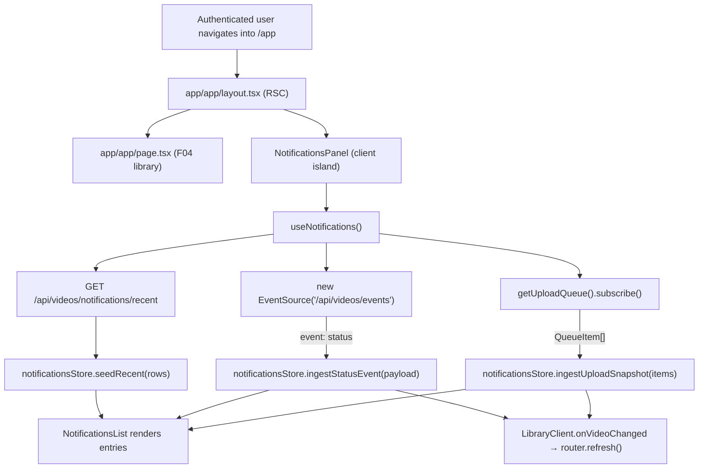
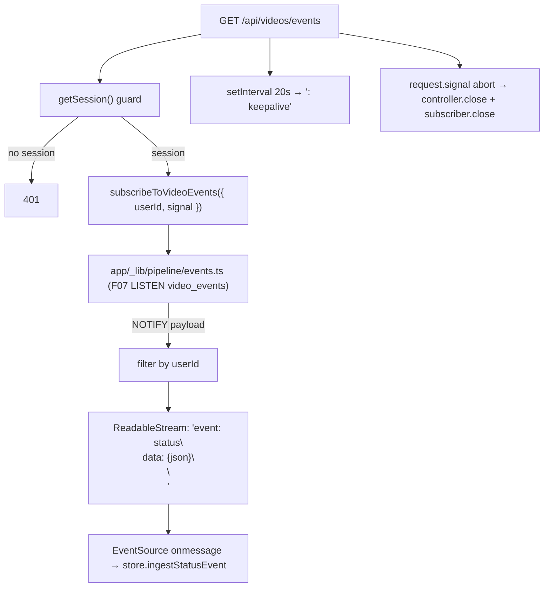
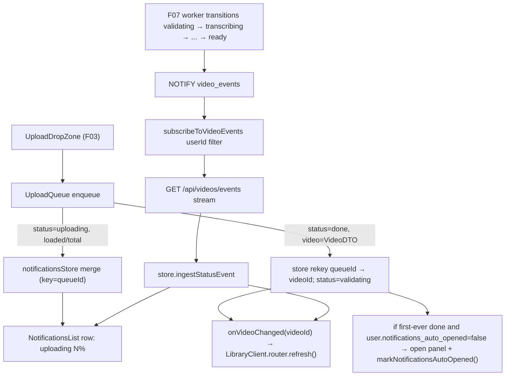
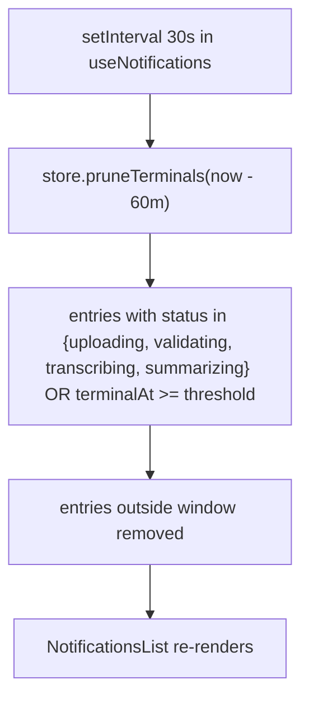
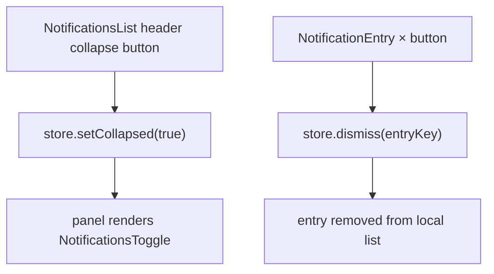

# F11. In-App Processing Notifications — Technical Specification

**Scope tag:** full scope — no Core/Full split (PRD has neither a `Core Scope` block nor a `Full Scope additions` block for F11, so the entire feature definition is in scope)

**Complexity:** complex

---

## 1. Technical Overview

**What:** Implement the persistent in-app notification panel anchored to the bottom-right corner of every authenticated page. The panel is a single long-lived client island mounted from the authenticated route layout (`app/app/layout.tsx`) and reads from two realtime sources combined client-side into one sorted rolling list: (a) the in-browser upload queue (`getUploadQueue()` from F03) for the "uploading" segment of a video's lifetime and (b) a new user-scoped Server-Sent Events endpoint (`GET /api/videos/events`) that multiplexes every `video_event` NOTIFY belonging to the current user from Postgres `LISTEN` (the per-video endpoint `GET /api/videos/:id/events` introduced by F07 stays as-is — F11 does not replace it but adds a sibling that filters by `userId` only). Each panel entry shows the thumbnail, video title, current stage/status (`uploading`, `validating`, `transcribing`, `summarizing`, `ready`, `failed`), and a compact progress indicator (upload byte percentage while uploading; a stage spinner while processing; a solid checkmark or error pill in terminal states). The list contains every currently-active entry plus every entry that reached a terminal state (`ready` or `failed`) within the last 60 minutes; older terminal entries are pruned. Clicking an entry navigates to `/app/videos/{id}`. Completed or failed entries expose a dismiss `×` that hides the entry from the panel only (the underlying video is untouched). When the list is empty the panel collapses to a small toggle button fixed in the same position. The panel is expanded by default while at least one active item exists and can be manually collapsed; a per-user "first successful upload" flag (a new `notificationsAutoOpened` boolean on the existing `user` row) auto-opens the panel the first time any upload completes so the feature introduces itself.

**Why:** F11 is the realtime-presentation surface that unites F03's upload client queue and F07's pipeline event bus into a single glanceable feedback UI. The groundwork is already in place: F07 ships the `video_event` append-only log, the `notify_video_event()` trigger + `video_events` NOTIFY channel, the `subscribeToVideoEvents({ userId?, videoId?, signal })` multiplexer (which already accepts a `userId` filter, so no pipeline change is needed), and a per-video SSE Route Handler at `app/api/videos/[id]/events/route.ts`. F03 ships the module-singleton `UploadQueue` with a subscribe/snapshot API that already carries filename/bytes-transferred/status and the freshly-created `VideoDTO` on `done`. What is missing, and what F11 owns, is (1) a user-scoped SSE endpoint so the panel establishes **one** long-lived connection per tab instead of one per video, (2) the client-side merge of upload-queue state + SSE stream + a one-shot "recent terminals" read, (3) the panel UI and its collapse/auto-open state machine, and (4) the shared store/invalidation that lets the F04 library grid refresh automatically when an upload completes or a stage transitions — a gap explicitly left open between F03 and F04 that F11 is the natural owner of because it is already wired to both event sources. The PRD's "within about one second" latency target is met by piggy-backing on F07's existing LISTEN/NOTIFY bridge; no polling and no new infrastructure are introduced. A fresh-page-load "recent-terminals" backfill reads the last 60 minutes of this user's `video_event` rows from the `ix_video_event_user_created` index F07 already created, so the rolling window survives a reload.

**Scope:**

Included:
- A new user-scoped SSE Route Handler `GET /api/videos/events` (no `:id` segment) that authenticates via `getSession()`, opens `subscribeToVideoEvents({ userId: session.user.id, signal })` against F07's bridge, emits every NOTIFY for this user as `event: status` SSE lines with the same payload shape as F07's per-video endpoint, and sends a `: keepalive` comment every 20 s
- A new "recent terminals" GET endpoint `GET /api/videos/notifications/recent` that returns the current user's last-60-minutes terminal `video_event` rows plus joined `video.title` / `thumbnail` metadata, used on panel mount to hydrate the rolling list before the SSE starts flowing
- A new authenticated layout at `app/app/layout.tsx` that wraps the existing `/app` and `/app/videos/[id]` routes (plus F12's admin area stays unaffected because it has its own layout) and mounts `<NotificationsPanel />` as a sibling of the page content so the panel persists across client-side navigations between `/app` and `/app/videos/...`
- A module-singleton notifications store (`app/_lib/notifications/notificationsStore.ts`) that holds the merged entry list, exposes a subscribe/snapshot/emit API identical in shape to F03's `UploadQueue`, and owns the merge logic: an upload-queue item in `uploading` state produces an entry keyed by the queue `id`; on `done` the entry's key is rekeyed to the new `videoId`; SSE events update or insert entries keyed by `videoId`
- A long-lived client hook (`app/_components/notifications/useNotifications.ts`) that on mount (a) fetches `GET /api/videos/notifications/recent` to seed the store, (b) opens an `EventSource` against `GET /api/videos/events` and feeds each event into the store, (c) subscribes to the F03 `UploadQueue` singleton and feeds each upload-item transition into the store, (d) returns the merged snapshot + actions (`dismiss`, `toggleCollapsed`)
- The panel UI components: `<NotificationsPanel />` (container with collapse state), `<NotificationEntry />` (thumbnail + title + status chip + progress indicator + dismiss), `<NotificationsToggle />` (the small chip shown when the panel is collapsed, with an active-count badge)
- Collapse-to-toggle behavior: when there are zero entries the panel renders as a round toggle button in the bottom-right; when there is at least one entry the panel renders full-size; a user click on the header collapse icon overrides the automatic state for the rest of the tab's life
- First-successful-upload auto-open: a new `user.notifications_auto_opened` boolean column (default `false`); the first time an upload completes in this tab AND the column is `false`, the panel is forced open and a `markNotificationsAutoOpened()` Server Action flips the column to `true` so later tabs/sessions do not re-trigger
- Rolling 60-minute window: the store keeps every active entry (status ∈ {`uploading`, `validating`, `transcribing`, `summarizing`}) indefinitely while active and keeps every terminal entry (status ∈ {`ready`, `failed`}) for 60 minutes from the transition timestamp; a lightweight per-tick timer (every 30 s) prunes terminals past the window
- Individual dismissal: the `×` on `ready` / `failed` entries removes the entry from the store for this tab only (no persistence); dismissal does not fire a server call — it is a purely client-side hide
- Active-count header badge: the panel header shows the count of entries whose status is not terminal; the collapsed toggle shows the same count as a small numeric badge so a collapsed panel still signals activity
- Click-to-open navigation: clicking an entry's row navigates to `/app/videos/{videoId}` via `router.push`; `uploading` entries without a `videoId` yet do not navigate (the row acts as a read-only progress indicator until `done`)
- **Library grid freshness (gap filled by F11):** the notifications store acts as the single event consumer and broadcasts via a new `onVideoChanged(videoId)` callback; the F04 `LibraryClient` island subscribes to this callback and calls `router.refresh()` (or updates its local `items` state) when an upload completes or a video's pipeline status transitions, so the library grid/list reflects new arrivals and badge updates within ≤2 s of the event without a manual page reload. This closes the gap the user flagged between F03 (which inserts the row) and F04 (which reads it only once on first paint)
- `.env.example` and documentation additions: the new SSE endpoint reuses `DATABASE_URL` + the existing pipeline env vars already established by F07; no new env vars are introduced
- Unit tests (Vitest + RTL) for the store, the merge logic, the entry components, the panel collapse/auto-open state machine, the rolling-window pruner, and the "dismiss" behavior; integration tests (Vitest + testcontainers Postgres + session mock) for the user-scoped SSE endpoint and the recent-terminals endpoint; one Playwright spec (`e2e/notifications.spec.ts`) for the user-visible acceptance criteria (panel appears, entry appears within ~1 s of status transition, dismiss works, empty panel collapses, first-upload auto-open, library grid refresh)

Excluded (handled by other features or explicitly out of scope per PRD Section 7):
- Per-video SSE endpoint (`GET /api/videos/:id/events`) — owned by F07 and continues to exist for future per-page subscriptions (F11 uses the new user-scoped endpoint instead)
- The `video_event` log, `LISTEN/NOTIFY` bridge, trigger function, and the `subscribeToVideoEvents` multiplexer — owned by F07
- The upload client queue, `UploadProgressCard`, `UploadProgressList`, and `getUploadQueue()` singleton — owned by F03; F11 reuses them read-only and the progress list stays on `/app` for the full-fidelity upload surface while the notifications panel gives a route-agnostic condensed view
- Thumbnail serving (`GET /api/videos/:id/thumbnail`) — owned by F03
- Video playback, detail page — F08
- Admin notifications / admin-area surfaces — F12 has its own layout and is intentionally out of F11's scope
- Desktop / browser push notifications (native `Notification` API) — not in PRD
- Audio cues on completion — not in PRD
- Cross-tab synchronization via `BroadcastChannel` or `localStorage` events — documented deferred; each tab has its own store instance and its own SSE connection; dismissals and collapse state are per-tab by design
- Persistent (cross-session) dismissals — PRD does not require them; the 60-minute window on terminal events already handles the session-spanning story
- Retry action from a failed notification entry — the Retry UI lives on F04's context menu and F08's detail header; F11 entries route the user there on click

---

## 2. Architecture Impact

**Affected components:**

| Path | Role |
|------|------|
| `prisma/schema.prisma` | Modified — add `notificationsAutoOpened` boolean column to the existing `User` model |
| `prisma/migrations/<timestamp>_add_user_notifications_auto_opened/migration.sql` | New — `ALTER TABLE "user" ADD COLUMN "notifications_auto_opened" BOOLEAN NOT NULL DEFAULT FALSE` |
| `app/app/layout.tsx` | New — authenticated route-group layout that renders its children and mounts `<NotificationsPanel />` so the panel persists across `/app` and `/app/videos/:id` |
| `app/api/videos/events/route.ts` | New — user-scoped SSE Route Handler; authenticates, subscribes via `subscribeToVideoEvents({ userId })`, emits every transition belonging to the user, keepalive every 20 s |
| `app/api/videos/notifications/recent/route.ts` | New — `GET` Route Handler that returns the user's last-60-minutes terminal transitions joined with the latest `video.title` / `thumbnail_path` |
| `app/_lib/notifications/notificationsRepository.ts` | New — Prisma accessor `listRecentTerminalsForUser(userId, since)` returning the rows used by the recent endpoint and the action `markNotificationsAutoOpened(userId)` |
| `app/_lib/notifications/notificationsDTO.ts` | New — serialization helper: maps a `video_event` row + joined video metadata into the `NotificationEntryDTO` shape the client renders |
| `app/_lib/notifications/notificationsStore.ts` | New — module-singleton store that merges upload-queue items + SSE events + recent terminals into a single sorted entry list; exposes `subscribe / getSnapshot / dismiss / setCollapsed / onVideoChanged` |
| `app/_lib/notifications/mergeRules.ts` | New — pure merge/sort/prune functions so the store stays testable without DOM or SSE |
| `app/_lib/notifications/actions.ts` | New — Server Action `markNotificationsAutoOpened()` called once per user after their first successful upload |
| `app/_components/notifications/NotificationsPanel.tsx` | New — `"use client"` container; owns collapse state; renders `<NotificationsToggle />` when collapsed/empty or `<NotificationsList />` otherwise |
| `app/_components/notifications/NotificationsList.tsx` | New — scrollable list header (active-count + collapse button) + list body (mapped `<NotificationEntry />`) |
| `app/_components/notifications/NotificationEntry.tsx` | New — presentational row: thumbnail, title, status chip, progress indicator (bar / spinner / checkmark / error), dismiss `×` for terminals |
| `app/_components/notifications/NotificationsToggle.tsx` | New — round button for the collapsed state; shows the active-count badge when > 0 |
| `app/_components/notifications/useNotifications.ts` | New — hook wiring the store to the `EventSource`, the upload-queue singleton, the recent-terminals fetch, the pruning timer, and the auto-open Server Action |
| `app/_components/notifications/ProgressIndicator.tsx` | New — small presentational component choosing bar (uploading, known percent), spinner (processing), check (ready), error pill (failed) |
| `app/_components/notifications/__tests__/*` | New — component tests |
| `app/_lib/notifications/__tests__/*` | New — unit + integration tests for store, merge rules, recent-terminals endpoint, SSE endpoint, Server Action |
| `app/_components/library/LibraryClient.tsx` | Modified — subscribe to the notifications store's `onVideoChanged` callback; on change call `router.refresh()` so the grid/list reflects new rows and badge updates without a manual reload |
| `app/_components/library/__tests__/LibraryClient.test.tsx` | Modified — add a test that asserts the island subscribes and refreshes on a simulated `onVideoChanged` emission |
| `e2e/notifications.spec.ts` | New — Playwright spec exercising the user-visible PRD acceptance criteria + the library-freshness integration |

**Data flow — first paint of `/app` (panel hydrates from recent terminals + SSE + upload queue):**



**Data flow — user-scoped SSE:**



**Data flow — upload lifecycle → panel → library grid:**



**Data flow — 60-minute rolling window prune:**



**Data flow — collapse / dismiss:**



---

## 3. Technical Decisions

| Decision | Chosen Approach | Alternative Considered | Trade-off |
|----------|-----------------|------------------------|-----------|
| Realtime transport | `EventSource` over a user-scoped SSE endpoint at `GET /api/videos/events` that reuses F07's `subscribeToVideoEvents({ userId })` multiplexer | WebSocket, long-polling, per-video SSE fan-in on the client | SSE is already production-ready in F07; extending the multiplexer's existing `userId` filter is a few lines. One persistent connection per tab means one LISTEN consumer, one subscriber row in `events.ts`, and automatic `EventSource` reconnect on network drop. Matches the PRD's "within about one second" latency |
| Endpoint shape | User-scoped endpoint is a sibling of F07's per-video endpoint, not a replacement: `GET /api/videos/:id/events` stays for F07's existing tests and for future per-page subscriptions | Replace the per-video endpoint with a single user-scoped one | Non-breaking change; the per-video endpoint's auth filter is stricter (ownership on a specific id) and is still the right fit for F08's player page |
| Recent-terminals hydration | A one-shot `GET /api/videos/notifications/recent` on panel mount reads `video_event` rows where `user_id = ?` AND `created_at >= NOW() - INTERVAL '60 minutes'` AND `to_status IN ('ready','failed')`, joins the latest video metadata | Replay the last hour through SSE on connect | Replaying via SSE would force the F07 bridge to track history per subscriber (it does not — it is live-only). A focused index-scan + join is O(N) on the user's recent transitions and uses the existing `ix_video_event_user_created` index |
| Rolling window duration | 60 minutes exact (PRD: "last 60 minutes") | A few recent items, or an infinite history | Explicit PRD requirement. Implemented both server-side (the initial fetch uses `NOW() - INTERVAL '60 minutes'`) and client-side (the 30 s pruner recomputes from `entry.terminalAt`) so neither side drifts |
| Entry keying | Upload-phase entries are keyed by the `UploadQueue` item id; on `done` the entry is rekeyed to the returned `videoId`. SSE entries are keyed by `videoId`. This means a single entry carries through `uploading → validating → transcribing → summarizing → ready` | Two separate entry lists | One visual row per video with a single continuous story matches PRD's "Each entry shows … current stage/status" |
| Panel placement | Fixed to the bottom-right via Tailwind utilities (`fixed bottom-4 right-4`); `z-index` layer above modals but below toasts (class-level `z-30` above F04's `z-20` modal backdrop, below any future toast at `z-50`) | Sidebar docked panel, floating widget with drag | PRD: "persistent panel anchored to the bottom-right corner of every authenticated page". Fixed positioning keeps the panel in view regardless of page scroll; the chosen z-index layer documented in Assumptions |
| Auto-open trigger | Per-user one-shot: on first `upload-done` transition observed by the store, if `user.notifications_auto_opened === false` (passed from the server component as an initial prop), the panel is forced open and a `markNotificationsAutoOpened` Server Action flips the column to `true` | Local-storage flag, client-side cookie | PRD: "On the first successful upload, the panel opens automatically to introduce the feature". Per-user persistence survives browser/device changes; a DB flag is a single boolean co-located with the other `user` preference columns added by F04/F12 |
| Collapse state | Local, per-tab (`useState` inside `<NotificationsPanel />`); initial value is `false` (expanded) if there are active items, `true` (collapsed) otherwise. A manual collapse/expand click persists for the tab's lifetime and overrides the automatic state | Server-persisted collapse preference | PRD Experience: "expanded by default while there are active items" is explicitly automatic; there is no "remember collapsed across sessions" requirement. Documented in Assumptions |
| Panel scope | Mounted only in the authenticated app layout (`app/app/layout.tsx`); admin area (`/admin/*`) has its own layout and is intentionally left untouched | Root layout (`app/layout.tsx`) | PRD: "every authenticated page" in the F11 user-story section refers to the library and video pages; admin is a separate surface with its own ops flow. Documented in Assumptions |
| Store shape | Module-singleton in `app/_lib/notifications/notificationsStore.ts` with the same subscribe/snapshot/emit pattern as F03's `UploadQueue` | React Context, Zustand, Redux | Consistency with the existing codebase pattern (`uploadQueue.ts`). No new dependency; testable as a plain class; listeners drive React rerenders via `useSyncExternalStore`-style subscription |
| Library grid freshness (F11-added responsibility) | Store exposes an `onVideoChanged(videoId)` callback list; `<LibraryClient />` subscribes in a `useEffect` and calls `router.refresh()` on emission | Ship a separate "library refresh bus" or extend F04 to poll | F11 already sees every relevant event (upload done + SSE status transitions) before any other consumer; reusing the same store avoids a second subscription path. The `router.refresh()` call is cheap (RSC re-rendering) and reconciles the grid without a hard reload |
| Merge ordering | `terminalAt || updatedAt || createdAt` descending, so the freshest entry is on top; active items always rank above terminals of the same timestamp via a `bucket` tiebreaker (active = 0, terminal = 1) | Chronological by creation only | PRD: list is meant to be glanceable; most recent activity at the top matches the mental model "what just happened" |
| Progress indicator | Bar with percent for `uploading` (exact, from `loadedBytes/totalBytes`), spinner + stage label for the three pipeline stages, checkmark for `ready`, error pill for `failed` | Percentages for every stage | F07 explicitly chose stage-level progress; Whisper and GPT-4.1 nano emit no progress events. Documented in Assumptions |
| Dismiss semantics | Client-side only; store forgets the entry for the current tab; a subsequent reload re-adds it if it is still inside the 60 min window | Server-side dismissal persisted on a new table | PRD: "Completed or failed entries can be dismissed individually; dismissing does not affect the video itself" — no word about persistence. Simpler state; matches the rolling-window intent |
| Recent endpoint shape | REST JSON (not a Server Action) at `GET /api/videos/notifications/recent` | Server Action called from the client island at mount | Server Actions are POST-only and incur CSRF nonces; a simple authenticated GET is a cleaner match for idempotent reads. Consistent with F07's read-style Route Handlers |
| Panel rendering boundary | Entire panel is a single `"use client"` island at `app/_components/notifications/NotificationsPanel.tsx`; the hosting `app/app/layout.tsx` remains a Server Component that passes `initialAutoOpened` as a prop from `session.user` | Client-only mount with a fetch for the flag | One fewer network round-trip; the flag is already known server-side from the session user read |
| Navigation on entry click | `router.push('/app/videos/{id}')`; the click target explicitly excludes the dismiss `×` and the status chip | `<a href>` | Keeps the panel persistent across client-side nav (App Router transitions preserve the mounted island tree) |
| Reconnect behavior | Rely on the browser's built-in `EventSource` auto-reconnect; on reconnect the store does not re-seed (already has recent terminals) and the SSE stream resumes live events. A missed event during a reconnect gap is tolerated because the next transition will overwrite the entry (terminal states are eventually consistent within the 60 min window) | Track `Last-Event-ID` + server replay | Replay requires storing event sequences; the simpler "live + seeded-once" model meets the PRD's approximate one-second freshness without extra complexity. Documented in Assumptions |
| Testing style | F02/F03/F04 split: `*.test.ts[x]` for unit/component, `*.integration.test.ts` for Postgres-backed, one `e2e/notifications.spec.ts` for user-visible flows | Single integration suite | Matches CLAUDE.md and the existing Vitest project layout |
| No new runtime deps | Reuses `next/navigation` (for `router.push` / `router.refresh`), `@prisma/client`, `zod`, the existing `pg`-backed events bridge; uses browser-native `EventSource` | Add a client library (`@microsoft/fetch-event-source`, etc.) | Browser `EventSource` has enough for our needs (auto-reconnect, simple wire format); avoiding a new dep keeps the client bundle small |

---

## 4. Component Overview

**Frontend (App Router):**

| File Path | New/Modified | Purpose | Key Responsibilities |
|-----------|--------------|---------|----------------------|
| `app/app/layout.tsx` | New | Authenticated route-group layout | Read `getSession()`; render children; mount `<NotificationsPanel initialAutoOpened={session.user.notificationsAutoOpened} />`; no visual chrome of its own |
| `app/_components/notifications/NotificationsPanel.tsx` | New | Panel container | `"use client"`; reads `useNotifications()`; owns manual-collapse override; renders `<NotificationsList />` when expanded with entries, `<NotificationsToggle />` otherwise; applies fixed-position styles |
| `app/_components/notifications/NotificationsList.tsx` | New | Expanded list view | Renders header (active count + collapse button) + scrollable body of `<NotificationEntry />` |
| `app/_components/notifications/NotificationEntry.tsx` | New | Single entry row | Renders thumbnail (``) or placeholder for upload phase, truncated title, status chip, `<ProgressIndicator />`, dismiss `×` when terminal; click navigates to detail via `router.push`; keyboard accessible (`Enter` on the row activates navigation) |
| `app/_components/notifications/NotificationsToggle.tsx` | New | Collapsed toggle button | Round button with count badge when > 0; click expands the panel |
| `app/_components/notifications/ProgressIndicator.tsx` | New | Per-state progress | Choose bar (uploading, shows percent), spinner (processing stages), check (ready), error (failed) |
| `app/_components/notifications/useNotifications.ts` | New | Wiring hook | On mount: fetch recent, open `EventSource`, subscribe to upload queue, start the 30 s pruner; returns `{ entries, activeCount, isCollapsed, setCollapsed, dismiss }`; tears down on unmount |
| `app/_components/library/LibraryClient.tsx` | Modified | Library grid/list island | In an added `useEffect`, subscribe to `notificationsStore.onVideoChanged`; on emit call `router.refresh()` so the grid reflects new rows + status badges without a manual reload |

**Backend (server-side modules and Route Handlers):**

| File Path | New/Modified | Purpose | Key Responsibilities |
|-----------|--------------|---------|----------------------|
| `app/api/videos/events/route.ts` | New | User-scoped SSE | `GET`, `runtime = 'nodejs'`; authenticate; subscribe via `subscribeToVideoEvents({ userId: session.user.id, signal })`; stream each payload as `event: status\ndata: <json>\n\n`; keepalive every 20 s; close on request abort |
| `app/api/videos/notifications/recent/route.ts` | New | Recent terminals | `GET`, `runtime = 'nodejs'`; authenticate; call `listRecentTerminalsForUser(userId, NOW - 60 min)`; return `{ entries: NotificationEntryDTO[] }` |
| `app/_lib/notifications/notificationsRepository.ts` | New | Prisma accessors | `listRecentTerminalsForUser(userId, since)` → joins `video_event` with `video` and returns the rows needed for the DTO; `markNotificationsAutoOpened(userId)` → sets the new user column to `true` |
| `app/_lib/notifications/notificationsDTO.ts` | New | DTO mapper | `toNotificationEntryDTO(eventRow, videoRow)` → `{ videoId, title, thumbnailUrl, status, stage, attempt, terminalAt, errorCode }` |
| `app/_lib/notifications/notificationsStore.ts` | New | Client merge store | Module-singleton class with `subscribe`, `getSnapshot`, `seedRecent`, `ingestStatusEvent`, `ingestUploadSnapshot`, `dismiss`, `setCollapsed`, `onVideoChanged`; uses `mergeRules` pure functions internally |
| `app/_lib/notifications/mergeRules.ts` | New | Pure merge helpers | `mergeUploadItem(entries, item)`, `mergeStatusEvent(entries, event)`, `pruneTerminals(entries, threshold)`, `sortEntries(entries)`; all pure and unit-tested |
| `app/_lib/notifications/actions.ts` | New | Server Action | `"use server"`; `markNotificationsAutoOpened()` reads session and flips the column via the repository |

**Database:**

| Migration File | Tables Affected | Operation | Notes |
|----------------|-----------------|-----------|-------|
| `prisma/migrations/<timestamp>_add_user_notifications_auto_opened/migration.sql` | `user` | ALTER | `ADD COLUMN notifications_auto_opened BOOLEAN NOT NULL DEFAULT FALSE` — safe default for existing users; no backfill needed |

---

## 5. API Contracts

F11 introduces two HTTP endpoints and one Server Action. The user-scoped SSE endpoint mirrors F07's per-video endpoint wire format so the client SSE parser is identical. The recent-terminals endpoint is a plain JSON GET.

### Endpoint: User-Scoped Status Event Stream (SSE)

- **Method:** `GET`
- **Path:** `/api/videos/events`
- **Authentication:** session cookie (`videomax_session`); unauthenticated → `401`
- **Runtime:** `nodejs` (long-lived response)
- **Response Content-Type:** `text/event-stream`

**Query parameters:** none (the `userId` is taken from the session, never from the URL).

**Request Example:**

```
GET /api/videos/events HTTP/1.1
Host: localhost:3001
Accept: text/event-stream
Cookie: videomax_session=<opaque-id>
```

**Response (Success — 200, streaming):**

Each SSE message has the form:

```
event: status
data: {"videoId":"clv...","userId":"clu...","fromStatus":"validating","toStatus":"transcribing","stage":"transcribe","attempt":1,"errorCode":null,"createdAt":"2026-04-19T14:25:30.200Z"}

```

Event payload schema (reused from F07):

| Field | Type | Description |
|-------|------|-------------|
| `videoId` | `string` | Video id |
| `userId` | `string` | Owner id (always equal to `session.user.id`) |
| `fromStatus` | `string \| null` | Previous status |
| `toStatus` | `string` | New status |
| `stage` | `string \| null` | Stage for this transition |
| `attempt` | `integer` | Attempt counter at time of transition |
| `errorCode` | `string \| null` | Set on `failed` transitions |
| `createdAt` | `string (ISO 8601)` | Event timestamp |

A keep-alive comment (`: keepalive\n\n`) is emitted every 20 s.

**Error Codes:**

| Code | HTTP Status | Description |
|------|-------------|-------------|
| `EVENTS_UNAUTHORIZED` | 401 | No active session |

### Endpoint: Recent Terminal Notifications

- **Method:** `GET`
- **Path:** `/api/videos/notifications/recent`
- **Authentication:** session cookie; unauthenticated → `401`
- **Runtime:** `nodejs`

**Query parameters:** none (the 60-minute window is computed server-side from `NOW()`).

**Request Example:**

```
GET /api/videos/notifications/recent HTTP/1.1
Host: localhost:3001
Cookie: videomax_session=<opaque-id>
```

**Response (Success — 200):**

| Field | Type | Description |
|-------|------|-------------|
| `entries` | `NotificationEntryDTO[]` | Zero or more entries ordered by `terminalAt DESC` |

**`NotificationEntryDTO`:**

| Field | Type | Description |
|-------|------|-------------|
| `videoId` | `string` | cuid of the video the event belongs to |
| `title` | `string` | Latest video title |
| `thumbnailUrl` | `string` | Always `/api/videos/{id}/thumbnail` (F03 falls back to placeholder) |
| `status` | `string` | Either `ready` or `failed` (terminal states only) |
| `stage` | `string \| null` | The stage that terminated (null for pure retry-reset which is not terminal) |
| `attempt` | `integer` | Attempt counter at transition time |
| `errorCode` | `string \| null` | Populated when `status = 'failed'` |
| `terminalAt` | `string (ISO 8601)` | `video_event.created_at` for the terminal transition |

**Response Example:**

```json
{
  "entries": [
    {
      "videoId": "clv0example0001",
      "title": "Weekly lecture — Linear Algebra",
      "thumbnailUrl": "/api/videos/clv0example0001/thumbnail",
      "status": "ready",
      "stage": "summarize",
      "attempt": 1,
      "errorCode": null,
      "terminalAt": "2026-04-19T13:42:11.000Z"
    },
    {
      "videoId": "clv0example0002",
      "title": "Interview draft 2",
      "thumbnailUrl": "/api/videos/clv0example0002/thumbnail",
      "status": "failed",
      "stage": "transcribe",
      "attempt": 3,
      "errorCode": "PIPE_TRANSCRIBE_API",
      "terminalAt": "2026-04-19T13:15:00.000Z"
    }
  ]
}
```

**Error Codes:**

| Code | HTTP Status | Description |
|------|-------------|-------------|
| `NOTIFICATIONS_UNAUTHORIZED` | 401 | No active session |

### Server Action: `markNotificationsAutoOpened`

- **Module:** `app/_lib/notifications/actions.ts`
- **Invocation:** called once per user from `useNotifications()` after the first `upload-done` event that flips the panel open
- **Authentication:** `getSession()` guard; no session → `{ ok: false, code: 'NOTIFICATIONS_UNAUTHORIZED' }`

**Input:** empty (`FormData` with no fields; the target user is always the session user).

**Response State:**

| Field | Type | Description |
|-------|------|-------------|
| `ok` | `boolean` | `true` on success |
| `code` | `string?` | Error code when `ok === false` |

**Error codes:**

| Code | Meaning |
|------|---------|
| `NOTIFICATIONS_UNAUTHORIZED` | No session |
| `NOTIFICATIONS_INTERNAL` | Unexpected error during the update |

### Data shape consumed by the client: `NotificationEntry` (store-internal)

Extends `NotificationEntryDTO` with client-only fields for the upload phase and for dismissal.

| Field | Type | Description |
|-------|------|-------------|
| `key` | `string` | Stable entry key (`upload:<queueId>` → rekeyed to `video:<videoId>` on upload `done`) |
| `videoId` | `string \| null` | `null` while the entry is in the `uploading` phase with no server row yet |
| `title` | `string` | Filename during upload; video title after |
| `thumbnailUrl` | `string \| null` | `null` during upload (placeholder in UI); URL once `videoId` is known |
| `status` | `string` | One of `uploading`, `validating`, `transcribing`, `summarizing`, `ready`, `failed` |
| `stage` | `string \| null` | Pipeline stage (null for `uploading`) |
| `attempt` | `integer` | 0 during upload |
| `progress` | `{ loadedBytes, totalBytes } \| null` | Set while status is `uploading`; otherwise null |
| `errorCode` | `string \| null` | Set on `failed` |
| `createdAt` | `string (ISO 8601)` | Queue enqueue time or event time |
| `updatedAt` | `string (ISO 8601)` | Last merge time |
| `terminalAt` | `string (ISO 8601) \| null` | Set when `status` becomes `ready` or `failed` |

---

## 6. Data Model

F11 does not add a new table. It extends the existing `user` table with a single boolean column for the auto-open introduction flag and reads existing `video_event` + `video` rows for the recent-terminals endpoint. All other realtime data is in-memory on the client.

### Table: `user` (MODIFIED — new column only)

| Column | Type | Nullable | Default | Description |
|--------|------|----------|---------|-------------|
| `notifications_auto_opened` | `boolean` | No | `false` | `true` after the first successful upload has auto-opened the notification panel for this user |

**New Constraints:**

None beyond the `NOT NULL` implied by the default.

**Migration (`prisma/migrations/<timestamp>_add_user_notifications_auto_opened/migration.sql`):**

```sql
ALTER TABLE "user"
  ADD COLUMN "notifications_auto_opened" BOOLEAN NOT NULL DEFAULT FALSE;
```

**Prisma schema change (appended to `User` model):**

```prisma
model User {
  // ...existing fields...
  notificationsAutoOpened Boolean @default(false) @map("notifications_auto_opened")
}
```

### Table: `video_event` (UNCHANGED — reused from F07)

No schema changes. F11 reads from the existing index `ix_video_event_user_created` (`user_id, created_at DESC`) for the recent-terminals endpoint and from the existing `LISTEN video_events` channel for the SSE stream. The existing `from_status` / `to_status` / `stage` / `attempt` / `error_code` columns are rendered as-is by the notifications store.

### Table: `video` (UNCHANGED — reused from F03)

No schema changes. The recent-terminals endpoint joins `video_event.video_id = video.id` to pull `title` and `thumbnail_path` (via the `thumbnailUrl` mapper) for display.

**Cross-Database Notes:**
- The single new column is a plain `BOOLEAN` with a safe default, matching F02's `is_admin` / `is_suspended` style.
- Defaults are applied retroactively to existing users by Postgres at the DDL level; no backfill query is needed.

**Query used by `listRecentTerminalsForUser`:**

```sql
SELECT e.video_id,
       e.to_status        AS status,
       e.stage,
       e.attempt,
       e.error_code,
       e.created_at       AS terminal_at,
       v.title,
       v.thumbnail_path
FROM video_event e
JOIN video v ON v.id = e.video_id
WHERE e.user_id = $1
  AND e.created_at >= NOW() - INTERVAL '60 minutes'
  AND e.to_status IN ('ready', 'failed')
ORDER BY e.created_at DESC;
```

The ordering and filter both use `ix_video_event_user_created`; the join is a primary-key lookup on `video.id`.

---

## 7. Testing Strategy

F11 reuses the Vitest + React Testing Library + `testcontainers` Postgres harness established by F02 and extended by F03/F04/F07. The SSE endpoint is tested by opening a raw `fetch` with `Accept: text/event-stream` and parsing the stream; the store and merge rules are pure functions and are covered by unit tests without React. One Playwright spec covers the user-visible PRD acceptance criteria and the library-freshness integration.

**Test File Structure:**

| Test File | Test Type | Target | Coverage Goal |
|-----------|-----------|--------|---------------|
| `app/_lib/notifications/__tests__/mergeRules.test.ts` | Unit | `mergeUploadItem`, `mergeStatusEvent`, `pruneTerminals`, `sortEntries` | 100% branches |
| `app/_lib/notifications/__tests__/notificationsStore.test.ts` | Unit | `NotificationsStore` subscribe/snapshot/emit + dismiss + collapse + onVideoChanged | All branches |
| `app/_lib/notifications/__tests__/notificationsDTO.test.ts` | Unit | `toNotificationEntryDTO` | All branches |
| `app/_lib/notifications/__tests__/notificationsRepository.integration.test.ts` | Integration (Postgres) | `listRecentTerminalsForUser`, `markNotificationsAutoOpened` | All branches |
| `app/_lib/notifications/__tests__/actions.integration.test.ts` | Integration (Postgres + session mock) | `markNotificationsAutoOpened` Server Action | Happy + unauthenticated |
| `app/api/videos/events/__tests__/route.integration.test.ts` | Integration (Postgres + SSE parser) | `GET /api/videos/events` — auth, streaming, owner-only, keepalive | All branches |
| `app/api/videos/notifications/recent/__tests__/route.integration.test.ts` | Integration (Postgres) | `GET /api/videos/notifications/recent` — window filter, auth, owner-only, DTO shape | All branches |
| `app/_components/notifications/__tests__/NotificationEntry.test.tsx` | Unit (component) | Row render for each status, dismiss visibility, click navigation target | All branches |
| `app/_components/notifications/__tests__/NotificationsList.test.tsx` | Unit (component) | Header active-count, collapse button, body renders entries | All branches |
| `app/_components/notifications/__tests__/NotificationsToggle.test.tsx` | Unit (component) | Badge visibility for count 0 / > 0; click expands | All branches |
| `app/_components/notifications/__tests__/ProgressIndicator.test.tsx` | Unit (component) | Bar for uploading, spinner for stages, check for ready, error pill for failed | All branches |
| `app/_components/notifications/__tests__/NotificationsPanel.test.tsx` | Unit (component) | Collapse/expand transitions, auto-open on first upload done, initial state from prop | All branches |
| `app/_components/notifications/__tests__/useNotifications.test.tsx` | Unit (component/hook, mocked SSE + queue) | Seed on mount, ingest SSE event, ingest upload snapshot, pruner, onVideoChanged | All branches |
| `app/_components/library/__tests__/LibraryClient.test.tsx` | Modified | Adds `library_refreshes_on_store_on_video_changed` asserting a mocked store emission triggers `router.refresh` | Plus existing tests |
| `e2e/notifications.spec.ts` | E2E (Playwright) | Panel appears, entry appears ≤ 2 s of status transition, dismiss works, empty panel collapses, first-upload auto-open, library grid shows newly uploaded video ≤ 2 s, badge transition visible without reload | PRD Section 9 F11 user-visible criteria + F11-owned integration criteria |

**Per-file test functions:**

`app/_lib/notifications/__tests__/mergeRules.test.ts`

| Test Function | Description | Assertions |
|---------------|-------------|------------|
| `merge_upload_item_creates_entry_for_new_queue_id` | New `uploading` item | Entry appended with `key='upload:<id>'`, status `'uploading'`, progress set |
| `merge_upload_item_updates_progress_on_same_queue_id` | Same id, new `loadedBytes` | Existing entry's progress is replaced, no duplicate |
| `merge_upload_item_rekeys_on_done_to_video_id` | Item transitions to `done` with `video` | Entry's `key` becomes `video:<videoId>`; `status='validating'`; progress cleared |
| `merge_status_event_inserts_new_entry_when_not_present` | No existing entry | Entry created with `videoId` and `status` |
| `merge_status_event_updates_existing_entry_by_video_id` | Entry already present | Status advances; `terminalAt` set only for terminal transitions |
| `prune_terminals_removes_items_past_threshold` | Mix of active + old terminals + fresh terminals | Only old terminals dropped |
| `prune_terminals_keeps_all_active_items_regardless_of_age` | Active items with old `createdAt` | Kept |
| `sort_entries_orders_active_above_terminals_then_by_updatedAt_desc` | Mixed snapshot | Active group first, within each group newest first |

`app/_lib/notifications/__tests__/notificationsStore.test.ts`

| Test Function | Description | Assertions |
|---------------|-------------|------------|
| `subscribe_emits_current_snapshot_on_change` | Subscribe + seed | Listener called; snapshot matches |
| `ingest_status_event_fires_on_video_changed` | Subscribe to `onVideoChanged` + ingest | Callback called with the `videoId` |
| `ingest_upload_done_fires_on_video_changed_and_rekeys_entry` | Upload queue `done` with a `VideoDTO` | Rekey + `onVideoChanged(videoId)` emitted |
| `dismiss_removes_entry_locally` | Dismiss a terminal entry | Entry absent from snapshot |
| `set_collapsed_updates_snapshot_without_changing_entries` | Toggle collapse | Snapshot collapse flag changes; entries unchanged |
| `store_prunes_on_demand` | Explicit `pruneTerminals(now)` call | Old terminals removed |

`app/_lib/notifications/__tests__/notificationsDTO.test.ts`

| Test Function | Description | Assertions |
|---------------|-------------|------------|
| `dto_includes_video_id_title_thumbnail_url` | Join row with thumbnail path set | `thumbnailUrl === '/api/videos/{id}/thumbnail'` |
| `dto_maps_error_code_only_on_failed_status` | Ready row | `errorCode` null; Failed row — populated |

`app/_lib/notifications/__tests__/notificationsRepository.integration.test.ts`

| Test Function | Description | Assertions |
|---------------|-------------|------------|
| `list_recent_terminals_returns_only_owner_rows_within_window` | Seed 3 users + mix of terminal events across 10 min, 45 min, 90 min old | Target user's 10-min and 45-min rows returned; 90-min row excluded; other users' rows excluded |
| `list_recent_terminals_excludes_non_terminal_transitions` | Seed a `validating → transcribing` event | Excluded from the result |
| `list_recent_terminals_orders_by_created_at_desc` | Seed mixed timestamps | Result ordered newest first |
| `list_recent_terminals_joins_current_video_title_and_thumbnail_path` | Terminal event + updated title after | Result uses latest title |
| `mark_notifications_auto_opened_flips_boolean_from_false_to_true` | Fresh user (default false) | Column becomes true; idempotent on second call |

`app/_lib/notifications/__tests__/actions.integration.test.ts`

| Test Function | Description | Assertions |
|---------------|-------------|------------|
| `action_requires_session` | No cookie | `{ ok: false, code: 'NOTIFICATIONS_UNAUTHORIZED' }`; DB unchanged |
| `action_flips_flag_for_current_user` | Authenticated | `{ ok: true }`; user row's flag is `true` |

`app/api/videos/events/__tests__/route.integration.test.ts`

| Test Function | Description | Assertions |
|---------------|-------------|------------|
| `sse_streams_status_event_for_current_user_only` | Open SSE; insert a `video_event` for the session user and one for another user | Only the session user's event is emitted on the stream |
| `sse_emits_keepalive_comment` | Open SSE, advance test clock 21 s | At least one `: keepalive` line observed |
| `sse_401_when_unauthenticated` | No session cookie | 401 `EVENTS_UNAUTHORIZED` |
| `sse_closes_on_client_abort` | Abort the request | Subscriber removed from the bridge |
| `sse_latency_under_one_second_end_to_end` | Open SSE, trigger a transition via `transitionStatus` | Event observed within 1000 ms |

`app/api/videos/notifications/recent/__tests__/route.integration.test.ts`

| Test Function | Description | Assertions |
|---------------|-------------|------------|
| `recent_returns_empty_array_for_new_user` | Fresh user, no events | `{ entries: [] }` |
| `recent_returns_last_hour_of_terminals_with_video_join` | Seed terminals + older + other user | Only session user's last-60-min terminals, ordered newest first, each with title + thumbnail url |
| `recent_401_when_unauthenticated` | No session | 401 `NOTIFICATIONS_UNAUTHORIZED` |

`app/_components/notifications/__tests__/NotificationEntry.test.tsx`

| Test Function | Description | Assertions |
|---------------|-------------|------------|
| `entry_renders_title_thumbnail_status_for_ready` | Ready entry | Title + thumbnail URL + ready chip visible |
| `entry_renders_progress_bar_for_uploading` | Uploading entry | Bar with percent text |
| `entry_renders_spinner_for_processing_stages` | Each of validating/transcribing/summarizing | Spinner + stage label visible |
| `entry_shows_dismiss_button_only_for_terminal_states` | Table-driven | Dismiss visible for ready/failed only |
| `entry_click_navigates_to_detail_page` | Ready entry click | `router.push` called with `/app/videos/{id}` |
| `entry_click_is_no_op_while_uploading_without_video_id` | Uploading entry | `router.push` not called |

`app/_components/notifications/__tests__/NotificationsList.test.tsx`

| Test Function | Description | Assertions |
|---------------|-------------|------------|
| `header_shows_active_count_equal_to_non_terminal_entries` | Mixed snapshot | Active count reflects only non-terminal entries |
| `collapse_button_toggles_panel_state` | Click collapse | `setCollapsed(true)` invoked |
| `body_renders_one_entry_per_item` | N entries | N `<NotificationEntry />` rendered |

`app/_components/notifications/__tests__/NotificationsToggle.test.tsx`

| Test Function | Description | Assertions |
|---------------|-------------|------------|
| `toggle_hides_badge_when_count_is_zero` | Active = 0 | No badge element |
| `toggle_shows_numeric_badge_when_count_positive` | Active = 3 | Badge reads `3` |
| `toggle_click_expands_panel` | Click | `setCollapsed(false)` invoked |

`app/_components/notifications/__tests__/ProgressIndicator.test.tsx`

| Test Function | Description | Assertions |
|---------------|-------------|------------|
| `bar_for_uploading_reflects_loaded_over_total` | `loaded=50, total=200` | Width 25%, text "25%" |
| `spinner_for_each_processing_stage` | Table-driven | Spinner + stage label |
| `check_for_ready` | Ready | Check icon rendered |
| `error_pill_for_failed_shows_error_code` | Failed with code | Error pill + code visible |

`app/_components/notifications/__tests__/NotificationsPanel.test.tsx`

| Test Function | Description | Assertions |
|---------------|-------------|------------|
| `panel_renders_toggle_when_no_entries` | Empty store | `<NotificationsToggle />` rendered |
| `panel_renders_list_when_entries_present` | Seeded store | `<NotificationsList />` rendered |
| `panel_auto_opens_on_first_successful_upload` | `initialAutoOpened=false`; simulate `upload-done` | Panel expanded; `markNotificationsAutoOpened` action invoked |
| `panel_does_not_auto_open_again_after_flag_is_true` | `initialAutoOpened=true` | Panel collapse respects local state; action not invoked |
| `manual_collapse_overrides_automatic_expand` | Entries present, user clicks collapse | Panel stays collapsed even with active entries |

`app/_components/notifications/__tests__/useNotifications.test.tsx`

| Test Function | Description | Assertions |
|---------------|-------------|------------|
| `hook_seeds_store_from_recent_endpoint_on_mount` | Mocked fetch returns 2 terminals | Snapshot has 2 entries after mount |
| `hook_ingests_event_source_messages` | Mocked `EventSource` emits a `status` event | Store snapshot updates |
| `hook_subscribes_to_upload_queue` | Fake queue emits a snapshot | Store snapshot reflects upload entry |
| `hook_prunes_on_30_second_tick` | Advance fake timer 30 s | `pruneTerminals` invoked |
| `hook_unsubscribes_on_unmount` | Unmount | `EventSource.close` called; upload-queue unsubscribe fired |

**E2E (Playwright) — `e2e/notifications.spec.ts`:**

| Test Function | Description | Assertions |
|---------------|-------------|------------|
| `panel_is_anchored_bottom_right_on_every_authenticated_page` | Navigate `/app` and `/app/videos/<id>` | Panel visible in both routes at bottom-right |
| `uploading_entry_appears_on_drop` | Drop a fixture file | Entry shows filename + progress bar within 500 ms |
| `entry_transitions_without_reload_when_pipeline_moves_through_stages` | Wait for pipeline events against a fake OpenAI | Entry's status chip advances validating → transcribing → summarizing → ready within ≤ 1 s of each transition |
| `click_entry_opens_video_detail_page` | Click a ready entry | Navigates to `/app/videos/{id}` |
| `dismiss_removes_terminal_entry` | Click `×` on a ready entry | Row disappears |
| `empty_panel_collapses_to_toggle_button` | All entries dismissed | Only `<NotificationsToggle />` visible |
| `first_successful_upload_auto_opens_panel` | Fresh user, first upload | Panel is expanded on `done` without a click |
| `second_tab_or_second_upload_does_not_auto_open_again` | User with flag already true, upload another file | Panel does not force-open |
| `library_grid_refreshes_on_upload_done_within_2_seconds` | `/app` open, drop a file | New card appears in the grid within ≤ 2 s without a manual reload |
| `library_badge_updates_when_stage_transitions_without_reload` | `/app` open, wait for validating → ready | Card badge advances without reload |

**Mapping to PRD Section 9 acceptance criteria (F11):**

| PRD Acceptance Criterion | Covered By |
|---|---|
| Notification panel is anchored in the bottom-right on every authenticated page | `panel_is_anchored_bottom_right_on_every_authenticated_page` (E2E) + `panel_renders_toggle_when_no_entries` + `panel_renders_list_when_entries_present` |
| Each entry shows thumbnail, title, current stage/status, and progress or spinner | `entry_renders_title_thumbnail_status_for_ready` + `entry_renders_progress_bar_for_uploading` + `entry_renders_spinner_for_processing_stages` + `bar_for_uploading_reflects_loaded_over_total` + the family of `ProgressIndicator` tests |
| Panel updates in real time within approximately one second of server-side transitions | `sse_latency_under_one_second_end_to_end` + `hook_ingests_event_source_messages` + `entry_transitions_without_reload_when_pipeline_moves_through_stages` (E2E) |
| Clicking an entry opens the corresponding video detail page | `entry_click_navigates_to_detail_page` + `click_entry_opens_video_detail_page` (E2E) |
| Completed or failed entries can be dismissed individually | `dismiss_removes_entry_locally` + `dismiss_removes_terminal_entry` (E2E) + `entry_shows_dismiss_button_only_for_terminal_states` |
| Panel persists across navigation and never interrupts uploads or processing | `panel_is_anchored_bottom_right_on_every_authenticated_page` (E2E, navigates twice) + mounting in `app/app/layout.tsx` keeps the island across client-side nav; upload queue singleton already survives navigation per F03 |
| Panel collapses to a small toggle button when there are no active or recent entries | `panel_renders_toggle_when_no_entries` + `empty_panel_collapses_to_toggle_button` (E2E) + `toggle_click_expands_panel` |

**Mapping to PRD Section 6 (F11) Experience rules:**

| PRD Experience Rule | Covered By |
|---|---|
| Expanded by default while there are active items | `panel_renders_list_when_entries_present` + `manual_collapse_overrides_automatic_expand` |
| Manually collapsible | `collapse_button_toggles_panel_state` + `manual_collapse_overrides_automatic_expand` |
| Real-time updates within ~1 s of server transitions | `sse_latency_under_one_second_end_to_end` + `entry_transitions_without_reload_when_pipeline_moves_through_stages` (E2E) |
| Auto-open on first successful upload | `panel_auto_opens_on_first_successful_upload` + `first_successful_upload_auto_opens_panel` (E2E) + `panel_does_not_auto_open_again_after_flag_is_true` + `second_tab_or_second_upload_does_not_auto_open_again` (E2E) |

**Cross-Feature Integration criteria (PRD Section 9) where F11 is the consumer or integration point:**

| PRD Cross-Feature Integration Criterion | Covered By F11 |
|---|---|
| Video title and thumbnail provided by upload (F03), together with processing status updates from the pipeline (F07), appear in the notification panel (F11) in real time (line 670) | `recent_returns_last_hour_of_terminals_with_video_join` (F03 title/thumbnail present) + `sse_streams_status_event_for_current_user_only` + `entry_transitions_without_reload_when_pipeline_moves_through_stages` (E2E) + `dto_includes_video_id_title_thumbnail_url` |
| After a successful upload, the video appears in the library (F04) with its extracted thumbnail and status `validating` — re-stated as an F11-owned UI-observable criterion: the library grid reflects the new upload and subsequent stage transitions within ≤ 2 s without a manual reload | `library_refreshes_on_store_on_video_changed` (unit) + `library_grid_refreshes_on_upload_done_within_2_seconds` (E2E) + `library_badge_updates_when_stage_transitions_without_reload` (E2E) |

---

## 8. Assumptions / Decisions (Auto-Accept)

Because F11 was generated in Batch Mode without an interactive interview, the following decisions were auto-resolved using the spec-writer's Auto-Accept Policy. Each is flagged so the user can review and override.

| # | Decision | Auto-Accept rationale | Policy row |
|---|----------|-----------------------|------------|
| 1 | Realtime transport is a **user-scoped SSE endpoint** at `GET /api/videos/events` subscribing to F07's pg LISTEN bridge filtered by `userId` | PRD does not specify a transport. F07 already ships per-video SSE and a `subscribeToVideoEvents({ userId })` multiplexer; the smallest addition that meets "within ~1 s" is a sibling endpoint that passes the `userId` filter. One persistent connection per tab vs. one per video keeps connection counts bounded. The per-video endpoint is retained for F07's existing tests and future per-page subscriptions | "Partial PRD specifications" |
| 2 | The recent-terminals backfill is served from a separate `GET /api/videos/notifications/recent` endpoint (not replayed over SSE) | F07's live-only multiplexer has no per-subscriber history; a focused index-scan + join is O(N) on the user's last-hour rows and uses `ix_video_event_user_created` which already exists | "Partial PRD specifications" |
| 3 | Retention window is exactly 60 minutes enforced in both the initial fetch and a 30-second client-side pruner | Explicit PRD requirement ("completed or failed within the last 60 minutes") | Explicit PRD requirement |
| 4 | Panel placement is fixed bottom-right with `z-index` layer above F04's modal backdrop but below any future toast (documented numeric target: `z-30` above F04's `z-20`, below `z-50` reserved for toasts) | PRD: "anchored to the bottom-right corner of every authenticated page". Z-index order follows common UI-layer conventions so modals are not blocked by the panel and future toasts overlay the panel on confirmation messages | "Partial PRD specifications" |
| 5 | Panel is mounted only in the authenticated route-group layout (`app/app/layout.tsx`); `/admin/*` and public pages (`/`, `/login`, `/register`) do not render it | PRD scopes notifications to the authenticated user's library/video surfaces; admin has its own operator flow and is kept free of end-user notifications | "Description too vague" — applied best practice |
| 6 | Collapse state is per-tab (not persisted server-side); automatic: expanded when active items exist, collapsed when empty; a manual user toggle overrides for the tab's lifetime | PRD says "expanded by default while there are active items" (automatic) + "can be manually collapsed" (user override); it does not mention persistence | "Partial PRD specifications" |
| 7 | First-successful-upload auto-open is persisted via a new `user.notifications_auto_opened` boolean flag, flipped to `true` via a Server Action the first time an upload reaches `done` | PRD says "On the first successful upload, the panel opens automatically to introduce the feature"; per-user persistence survives browser/device changes and matches the preference-column style introduced by F04 (`library_view`, `library_sort`) and F12 (`last_login_at`) | "Partial PRD specifications" |
| 8 | Dismissal is purely client-side — removes the entry from the current tab's store; a reload will re-surface a dismissed terminal entry if it is still inside the 60-minute window | PRD says dismissing "does not affect the video itself" and does not mention persistence; simpler model | "Partial PRD specifications" |
| 9 | **Library grid freshness is owned by F11.** The notifications store broadcasts an `onVideoChanged(videoId)` callback and `<LibraryClient />` subscribes; on emission it calls `router.refresh()` so the grid reflects uploads and stage transitions within ≤ 2 s without a manual reload | This gap was explicitly flagged by the user between F03 (inserts the row) and F04 (reads once on first paint). F11 already sees every relevant event; reusing its store avoids a second subscription path and a second SSE connection. The PRD's F11 + F04 criteria combine naturally into a single UI-observable freshness guarantee | "Description too vague" — applied best practice; closes a documented cross-feature gap |
| 10 | Entries are merged into a single rolling list keyed first by `upload:<queueId>` then rekeyed to `video:<videoId>` on upload `done` | Matches PRD's "Each entry shows … current stage/status" which implies a single visible row per video across its lifecycle | "Partial PRD specifications" |
| 11 | Progress is a byte-level percent during upload and a stage-level spinner during the pipeline (no sub-stage percent) | F07 already decided progress is stage-only because Whisper/GPT emit no progress events. F11 inherits that decision and adds byte-level progress only for the upload phase, where F03's `XMLHttpRequest` emits exact bytes | Consistent with codebase patterns + "Partial PRD specifications" |
| 12 | Sort order is active-first, then by `updatedAt` descending within each group | PRD does not specify; glanceable "what just happened" at the top of the list is the common UX expectation | "Partial PRD specifications" |
| 13 | Cross-tab synchronization (`BroadcastChannel`, `storage` events) is deferred | PRD does not require it; each tab has its own `EventSource` and its own dismissals; correctness is still guaranteed via the 60-min rolling window | "Description too vague" — deferred scope |
| 14 | Reconnect uses the browser-built-in `EventSource` behavior; no `Last-Event-ID` or server-side replay | Live + seeded-once meets the PRD's approximate one-second freshness without the overhead of tracking event sequences; terminal states are eventually consistent within the 60-min window | "Description too vague" — applied best practice |
| 15 | No new runtime dependencies: reuse `pg` (already added by F07), `@prisma/client`, `next/navigation`, browser-native `EventSource` | Keeps the client bundle small and the backend surface identical to F07's conventions | Consistent with codebase patterns |
| 16 | The user-scoped SSE endpoint does NOT replace the per-video endpoint introduced by F07 (`GET /api/videos/:id/events`) | F07's per-video endpoint remains valid for F08 (player page might want per-video), and its existing tests keep passing. Additive, not substitutive | "Technical decisions with a clear recommendation" |
| 17 | Admin area (`/admin/*`) is explicitly out of F11's scope; its layout does not mount the panel | Matches F12's scoped operator surface; admins viewing their own regular library at `/app` still see the panel because F12 is a separate area, not a flag on `/app` | "Description too vague" — applied best practice |
| 18 | Tests follow F02/F03/F04/F07's split: `*.test.ts[x]` for unit/component, `*.integration.test.ts` for Postgres-backed, one `e2e/notifications.spec.ts` | Matches the existing Vitest project configuration + CLAUDE.md's testing policy | Consistent with codebase patterns |
| 19 | `EventSource` always connects to the same-origin URL — no cross-origin setup, no bearer token in the URL (session cookie is sent automatically by the browser) | The session cookie is already `httpOnly`; using the cookie keeps auth consistent with the rest of the app | Consistent with codebase patterns |
| 20 | The panel does not call `markNotificationsAutoOpened` more than once per mount; idempotent flag write is safe if the user opens two tabs simultaneously for the first upload | Idempotent write + the flag semantics ("after the first successful upload") make race conditions harmless | "Description too vague" — applied best practice |

**Traceability — which PRD blocks informed which parts of the spec:**

| PRD block | Where it landed in the spec |
|-----------|-----------------------------|
| Section 5 user stories for F11 (persistent bottom-right panel, per-entry thumbnail/title/stage/progress, free navigation without interrupting processing) | Technical Overview (What) + Component Overview + Testing Strategy |
| Section 6 F11 Consumes (F03 title/thumbnail; F07 status + stage transitions) | Data Model (reused `video` / `video_event`) + API Contracts (SSE + recent) + DTO shape |
| Section 6 F11 Capabilities (persistent panel, rolling 60-min list, entry shape, auto-add on upload, click-opens-detail, dismiss individual, header count, collapse-to-toggle when empty, persist across routes) | Technical Decisions + Component Overview + API Contracts + Data Model (new `user.notifications_auto_opened`) + Assumptions #3, #4, #6, #7, #8, #10 |
| Section 6 F11 Experience (expanded by default, manually collapsible, ≤ 1 s real-time updates, first-upload auto-open) | Component Overview (panel state machine) + Testing Strategy (latency test) + Assumptions #1, #6, #7 |
| Section 7 Out of Scope (no push notifications, no audio cues) | Technical Overview (Scope → Excluded) + Assumptions #13 |
| Section 8 Dependencies (F11 depends on F03 and F07) | Architecture Impact (reuses F07's events bridge, F03's upload queue, F03's thumbnail Route Handler) |
| Section 9 F11 per-feature acceptance criteria (lines 640–647) | Testing Strategy — direct mapping table |
| Section 9 Cross-Feature Integration criterion referencing F11 (line 670) | Testing Strategy — integration mapping table |
| Section 9 PRD line 570 ("After a successful upload, the video appears in the library...") | Re-stated as F11-owned UI-observable integration criterion ("library grid reflects new upload and stage transitions within ≤ 2 s without a manual reload") + Assumption #9 + E2E mapping |
| F02's `getSession()`, cookie machinery, and `User` model | Authn on every endpoint + new `notifications_auto_opened` column |
| F03's `getUploadQueue()`, `VideoDTO`, thumbnail Route Handler | Client merge rules + DTO thumbnail URL |
| F04's `<LibraryClient />` | Modified to subscribe to `onVideoChanged` and refresh the grid/list |
| F07's `video_event` table, `LISTEN/NOTIFY` bridge, `subscribeToVideoEvents({ userId? })` | User-scoped SSE endpoint, recent-terminals repository query |
| Project CLAUDE.md instructions (Docker Postgres, `.env.example` → `.env.local`, test policy split, Playwright for DOM-dependent criteria) | Testing Strategy + Assumptions #18 |
